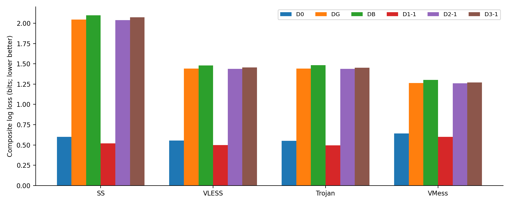
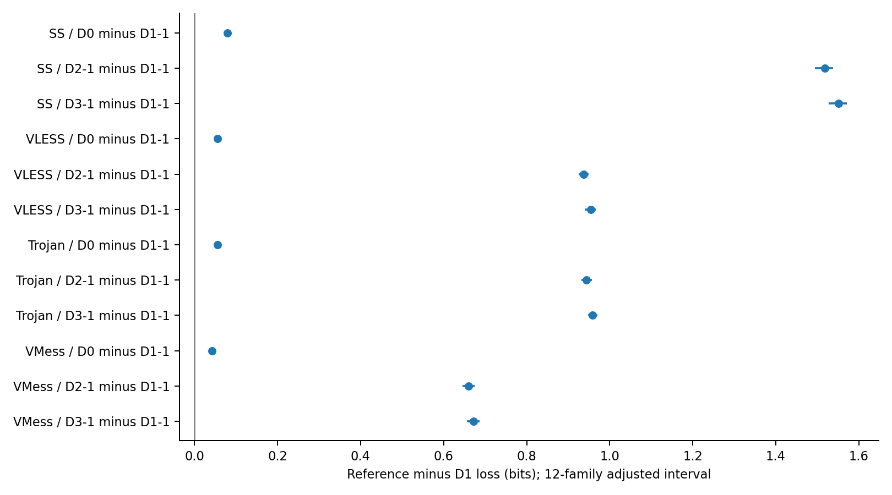
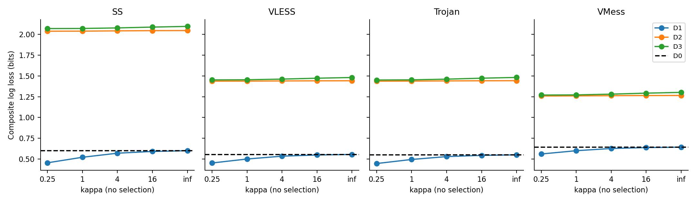
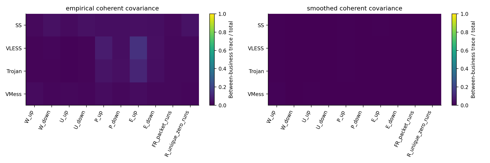
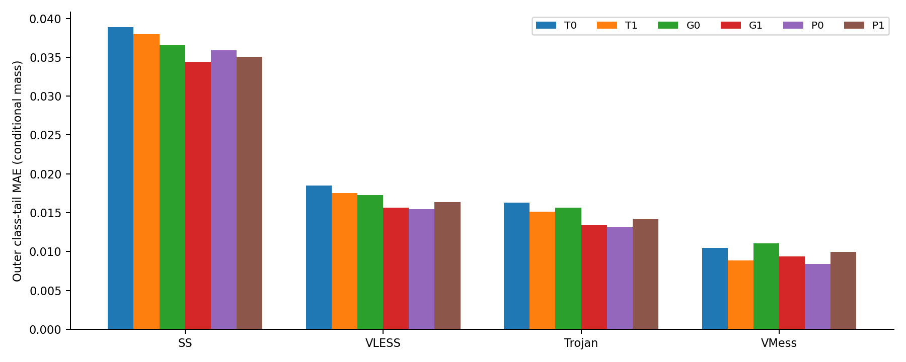
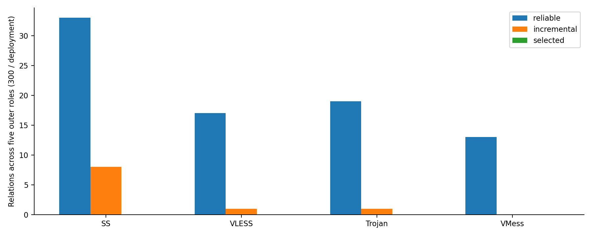
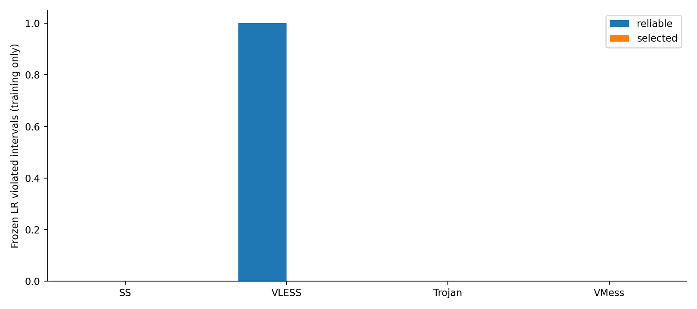

# 业务条件概率核与统计约束资格：第一阶段完整报告

日期：2026-10-05；状态：完成并停止，待用户决定下一阶段。

本轮完成Q00–Q21。保持23,566对连接、480次访问、30个内容和五折全局内容划分不变，新增1000个业务条件核bundle。十二项概率主比较中12项校正区间下界大于零；统计目标共有82/1200个角色关系通过基本可靠资格，0个进入预登记约束列表。没有新增业务分类器拟合，没有新的F1结论。

## 1 实验问题、对象与权限

检验共同核遗漏的业务条件关系，能否从连接级概率预测转化为准确、非冗余的类别总体统计先验。业务条件概率评价允许真实留出Y，是离线oracle诊断，不是攻击分类；资格目标仅使用训练pre/post/Y，校准评分只使用内层留出post/Y。外层post/Y评分在资格和区间封存之后进行。

| 部署 | 排他TCP对 | 访问 | 当前配置边界 |
| --- | ---: | ---: | --- |
| SS | 5608 | 120 | AES-256-GCM，无plugin/smux；不从包数推导chunk数 |
| VLESS | 5957 | 120 | TCP+TLS，无REALITY/Vision/smux；不沿用旧Vision解释 |
| Trojan | 5919 | 120 | TCP+TLS；不可把字节差当作精确加密内请求头开销 |
| VMess | 6082 | 120 | WS+TLS，auto；最终安全模式等历史缺口保留 |

AnyTLS/Hy2未纳入本轮同粒度核；保留共享carrier及资格边界。共同成员来自双侧离线关联，登记实体跨折检查不等于普遍完整TCP epoch证明。每类五个内容，每内容每部署四重复（1、2、4、5）；每外层训练24内容/96访问、测试6内容/24访问；内层训练18内容/72访问、验证6内容/24访问。全部部署、两侧、重复及内部连接随内容整体划分。

六业务：bing.com::search_results_view；developer.mozilla.org::document_view；github.com::repository_view；wikipedia.org::article_view；youtube.com::search_results_view；youtube.com::video_playback。

## 2 模型与评分契约

十变量：W_up, W_down, U_up, U_down, P_up, P_down, E_up, E_down, FR_packet_runs, R_unique_zero_runs。前四字节变量9箱，后六计数变量10箱；前八权重各1/12，交互两变量各1/6。连接质量为1/(内容重复数×该访问连接数)，外层质量24、每类4，内层质量18、每类3，不把加权质量当独立多项试验数。

共同核保持alpha=beta=1；条件真配/匿名核以(n_y+kappa K_common)/(n_y(A)+kappa)收缩，空入口行回退共同核。标签post参照以(n_y(B)+kappa q)/(N_y+kappa)收缩。匿名组仅按内容两侧边际乘积构造，不恢复访问或连接身份。主kappa=1；0.25、4、16、∞全部报告，不选择测试赢家。∞精确回到共同参照。

| 臂 | 预测 | 信息权限 |
| --- | --- | --- |
| D0 | 共同真配B/A | pre |
| DG | 共同匿名组B/A | pre |
| DB | 共同post边际 | 无pre/Y |
| D1 | 业务条件真配B/A,Y | pre及oracle Y |
| D2 | 业务条件匿名组B/A,Y | pre及oracle Y |
| D3 | 业务条件post边际B/Y | oracle Y，无pre |

连接负log2概率先访问内等权，再内容内四访问等权，再内容等权。复合评分不是十维联合似然；概率增益不是条件互信息估计，也不是业务F1。Brier/尾概率均为出口箱状态预测诊断。

## 3 内容外概率主结果

| 部署 | D0 | DG | DB | D1-1 | D2-1 | D3-1 |
| --- | --- | --- | --- | --- | --- | --- |
| SS | 0.599778 | 2.046395 | 2.096503 | 0.520723 | 2.039236 | 2.071504 |
| VLESS | 0.554570 | 1.441824 | 1.481072 | 0.499762 | 1.437668 | 1.453790 |
| Trojan | 0.549867 | 1.442702 | 1.481938 | 0.494277 | 1.437799 | 1.452721 |
| VMess | 0.642306 | 1.264768 | 1.301900 | 0.599720 | 1.259952 | 1.271520 |

下表正数表示D1改善；10000次六业务分层内容bootstrap，跨部署共享抽样。同内容重复和连接一起抽样。95%及12项Bonferroni对应99.583333%边际区间条件于已拟合核，不重拟合，不是外部验证。

| protocol | contrast | gain_bits | lower_95 | upper_95 | lower_adjusted | upper_adjusted | positive_adjusted |
| --- | --- | --- | --- | --- | --- | --- | --- |
| shadowsocks | D0 minus D1-1 | 0.079055 | 0.076107 | 0.081557 | 0.074944 | 0.082389 | 是 |
| shadowsocks | D2-1 minus D1-1 | 1.518513 | 1.502550 | 1.532790 | 1.494773 | 1.538557 | 是 |
| shadowsocks | D3-1 minus D1-1 | 1.550781 | 1.534978 | 1.564816 | 1.527643 | 1.571096 | 是 |
| vless | D0 minus D1-1 | 0.054808 | 0.052525 | 0.056705 | 0.051416 | 0.057275 | 是 |
| vless | D2-1 minus D1-1 | 0.937907 | 0.928803 | 0.946778 | 0.924701 | 0.949846 | 是 |
| vless | D3-1 minus D1-1 | 0.954029 | 0.944801 | 0.963176 | 0.940366 | 0.966688 | 是 |
| trojan | D0 minus D1-1 | 0.055591 | 0.053282 | 0.057650 | 0.052220 | 0.058496 | 是 |
| trojan | D2-1 minus D1-1 | 0.943523 | 0.934933 | 0.952380 | 0.931331 | 0.956773 | 是 |
| trojan | D3-1 minus D1-1 | 0.958445 | 0.950564 | 0.966693 | 0.947308 | 0.970674 | 是 |
| vmess | D0 minus D1-1 | 0.042586 | 0.041087 | 0.043952 | 0.040406 | 0.044470 | 是 |
| vmess | D2-1 minus D1-1 | 0.660232 | 0.650293 | 0.670080 | 0.645973 | 0.674235 | 是 |
| vmess | D3-1 minus D1-1 | 0.671800 | 0.661071 | 0.682370 | 0.656224 | 0.686632 | 是 |

## 4 固定收缩敏感性、业务和变量分项

以下设置均未参与选参，也不升级为新的主检验家族。逐业务、逐变量、尾部校准与Brier完整保存在content-feature-probabilities.parquet；支持情况保存于inner/outer-support.parquet。

| arm | shadowsocks | vless | trojan | vmess |
| --- | --- | --- | --- | --- |
| D1-0.25 | 0.454153 | 0.451842 | 0.445317 | 0.560121 |
| D1-1 | 0.520723 | 0.499762 | 0.494277 | 0.599720 |
| D1-16 | 0.590884 | 0.548461 | 0.543674 | 0.637559 |
| D1-4 | 0.569679 | 0.533864 | 0.528900 | 0.626333 |
| D1-inf | 0.599778 | 0.554570 | 0.549867 | 0.642306 |
| D2-0.25 | 2.038436 | 1.436878 | 1.436889 | 1.258414 |
| D2-1 | 2.039236 | 1.437668 | 1.437799 | 1.259952 |
| D2-16 | 2.045095 | 1.441084 | 1.441784 | 1.263954 |
| D2-4 | 2.042620 | 1.439688 | 1.440102 | 1.262402 |
| D2-inf | 2.046395 | 1.441824 | 1.442702 | 1.264768 |
| D3-0.25 | 2.070177 | 1.451906 | 1.450943 | 1.269621 |
| D3-1 | 2.071504 | 1.453790 | 1.452721 | 1.271520 |
| D3-16 | 2.088004 | 1.472614 | 1.472805 | 1.292645 |
| D3-4 | 2.077964 | 1.461802 | 1.461195 | 1.280642 |
| D3-inf | 2.096503 | 1.481072 | 1.481938 | 1.301900 |

### 4.1 全六业务主kappa分项

| protocol | label_id | D0 | DG | DB | D1-1 | D2-1 | D3-1 |
| --- | --- | --- | --- | --- | --- | --- | --- |
| shadowsocks | bing.com::search_results_view | 0.659877 | 2.137360 | 2.186692 | 0.581248 | 2.143935 | 2.168087 |
| shadowsocks | developer.mozilla.org::document_view | 0.597414 | 2.076610 | 2.125599 | 0.514858 | 2.083337 | 2.108079 |
| shadowsocks | github.com::repository_view | 0.699878 | 2.118525 | 2.167286 | 0.621444 | 2.115776 | 2.143836 |
| shadowsocks | wikipedia.org::article_view | 0.573743 | 2.013494 | 2.063774 | 0.498076 | 2.001992 | 2.040275 |
| shadowsocks | youtube.com::search_results_view | 0.535822 | 1.966964 | 2.018497 | 0.458850 | 1.946692 | 1.981719 |
| shadowsocks | youtube.com::video_playback | 0.531933 | 1.965415 | 2.017171 | 0.449863 | 1.943684 | 1.987028 |
| trojan | bing.com::search_results_view | 0.584256 | 1.500873 | 1.539183 | 0.532939 | 1.505536 | 1.519045 |
| trojan | developer.mozilla.org::document_view | 0.531759 | 1.462392 | 1.502726 | 0.474756 | 1.467246 | 1.477371 |
| trojan | github.com::repository_view | 0.556639 | 1.456233 | 1.496971 | 0.494056 | 1.449612 | 1.460823 |
| trojan | wikipedia.org::article_view | 0.487602 | 1.396620 | 1.436934 | 0.430227 | 1.387335 | 1.407596 |
| trojan | youtube.com::search_results_view | 0.571938 | 1.426841 | 1.464053 | 0.519767 | 1.416692 | 1.431505 |
| trojan | youtube.com::video_playback | 0.567009 | 1.413254 | 1.451760 | 0.513915 | 1.400373 | 1.419988 |
| vless | bing.com::search_results_view | 0.570101 | 1.476776 | 1.518218 | 0.514900 | 1.478283 | 1.491140 |
| vless | developer.mozilla.org::document_view | 0.508477 | 1.454443 | 1.496272 | 0.447685 | 1.457969 | 1.467904 |
| vless | github.com::repository_view | 0.608620 | 1.501836 | 1.536554 | 0.548889 | 1.503561 | 1.513656 |
| vless | wikipedia.org::article_view | 0.508621 | 1.394251 | 1.435626 | 0.456802 | 1.387741 | 1.407621 |
| vless | youtube.com::search_results_view | 0.582011 | 1.421634 | 1.458936 | 0.533875 | 1.412839 | 1.433474 |
| vless | youtube.com::video_playback | 0.549588 | 1.402003 | 1.440825 | 0.496417 | 1.385616 | 1.408946 |
| vmess | bing.com::search_results_view | 0.693808 | 1.334396 | 1.372925 | 0.652485 | 1.337006 | 1.350653 |
| vmess | developer.mozilla.org::document_view | 0.670761 | 1.294894 | 1.327900 | 0.635178 | 1.296274 | 1.308397 |
| vmess | github.com::repository_view | 0.658979 | 1.310412 | 1.349164 | 0.600613 | 1.307351 | 1.311504 |
| vmess | wikipedia.org::article_view | 0.606985 | 1.223136 | 1.261207 | 0.565057 | 1.214738 | 1.231956 |
| vmess | youtube.com::search_results_view | 0.590577 | 1.189647 | 1.227132 | 0.551123 | 1.178433 | 1.190748 |
| vmess | youtube.com::video_playback | 0.632729 | 1.236124 | 1.273070 | 0.593866 | 1.225910 | 1.235861 |

### 4.2 全十变量主kappa分项

| protocol | feature | D0 | DG | DB | D1-1 | D2-1 | D3-1 |
| --- | --- | --- | --- | --- | --- | --- | --- |
| shadowsocks | E_down | 1.182493 | 2.912211 | 2.947537 | 1.068239 | 2.902011 | 2.930684 |
| shadowsocks | E_up | 0.925737 | 2.009162 | 2.047495 | 0.846177 | 2.000474 | 2.014925 |
| shadowsocks | FR_packet_runs | 0.335752 | 2.174051 | 2.238707 | 0.249499 | 2.167909 | 2.214563 |
| shadowsocks | P_down | 1.187657 | 2.911739 | 2.946741 | 1.074022 | 2.901987 | 2.930842 |
| shadowsocks | P_up | 1.153009 | 2.051873 | 2.084557 | 1.096295 | 2.042810 | 2.052195 |
| shadowsocks | R_unique_zero_runs | 0.280501 | 2.160207 | 2.225432 | 0.190235 | 2.154042 | 2.200510 |
| shadowsocks | U_down | 0.407208 | 1.992381 | 2.045488 | 0.327140 | 1.984848 | 2.023745 |
| shadowsocks | U_up | 0.265936 | 0.962055 | 1.010501 | 0.224204 | 0.957248 | 0.979187 |
| shadowsocks | W_down | 0.412283 | 1.993025 | 2.045761 | 0.332810 | 1.985582 | 2.024786 |
| shadowsocks | W_up | 0.430500 | 1.055773 | 1.101683 | 0.400320 | 1.051970 | 1.071542 |
| trojan | E_down | 1.017382 | 2.418980 | 2.445751 | 0.924606 | 2.413175 | 2.427034 |
| trojan | E_up | 0.408515 | 1.395944 | 1.434553 | 0.341884 | 1.391630 | 1.399506 |
| trojan | FR_packet_runs | 0.422915 | 1.342052 | 1.383449 | 0.372195 | 1.338787 | 1.355757 |
| trojan | P_down | 1.020726 | 2.399188 | 2.424938 | 0.927513 | 2.391855 | 2.402375 |
| trojan | P_up | 0.677469 | 1.463738 | 1.502446 | 0.631558 | 1.458298 | 1.467973 |
| trojan | R_unique_zero_runs | 0.389948 | 1.349512 | 1.390581 | 0.333098 | 1.346655 | 1.365356 |
| trojan | U_down | 0.370939 | 1.165802 | 1.209835 | 0.318922 | 1.159466 | 1.175671 |
| trojan | U_up | 0.483062 | 0.912276 | 0.957367 | 0.458078 | 0.907073 | 0.924070 |
| trojan | W_down | 0.376431 | 1.169622 | 1.213576 | 0.324833 | 1.163220 | 1.179412 |
| trojan | W_up | 0.618158 | 1.003749 | 1.046728 | 0.593339 | 0.997989 | 1.014391 |
| vless | E_down | 1.023088 | 2.432131 | 2.460577 | 0.928829 | 2.424985 | 2.441219 |
| vless | E_up | 0.433687 | 1.356896 | 1.394089 | 0.370250 | 1.352764 | 1.360921 |
| vless | FR_packet_runs | 0.426753 | 1.347403 | 1.387989 | 0.376282 | 1.344888 | 1.363474 |
| vless | P_down | 1.034442 | 2.423437 | 2.450550 | 0.942809 | 2.417043 | 2.431475 |
| vless | P_up | 0.664367 | 1.421200 | 1.457785 | 0.621296 | 1.419189 | 1.429737 |
| vless | R_unique_zero_runs | 0.393719 | 1.346641 | 1.388081 | 0.337279 | 1.343777 | 1.363908 |
| vless | U_down | 0.374685 | 1.167545 | 1.212577 | 0.322386 | 1.161170 | 1.177331 |
| vless | U_up | 0.458495 | 0.909804 | 0.955585 | 0.431046 | 0.904228 | 0.922567 |
| vless | W_down | 0.382101 | 1.173052 | 1.218120 | 0.329817 | 1.166651 | 1.182736 |
| vless | W_up | 0.643028 | 1.029735 | 1.071439 | 0.623584 | 1.028661 | 1.044731 |
| vmess | E_down | 0.870338 | 1.993619 | 2.024945 | 0.793879 | 1.988154 | 2.001243 |
| vmess | E_up | 0.610945 | 0.971285 | 1.002824 | 0.579737 | 0.967413 | 0.969621 |
| vmess | FR_packet_runs | 0.676181 | 1.300666 | 1.337504 | 0.642195 | 1.297830 | 1.310848 |
| vmess | P_down | 0.866592 | 1.981344 | 2.014090 | 0.789850 | 1.975512 | 1.988875 |
| vmess | P_up | 0.715251 | 1.010202 | 1.041155 | 0.684501 | 1.005543 | 1.008825 |
| vmess | R_unique_zero_runs | 0.615785 | 1.286359 | 1.323636 | 0.577945 | 1.283719 | 1.297638 |
| vmess | U_down | 0.393170 | 1.166252 | 1.208560 | 0.341474 | 1.160474 | 1.174406 |
| vmess | U_up | 0.600837 | 0.832390 | 0.875363 | 0.576204 | 0.825594 | 0.838247 |
| vmess | W_down | 0.396315 | 1.168515 | 1.210735 | 0.344670 | 1.162682 | 1.176597 |
| vmess | W_up | 0.670299 | 0.879561 | 0.922845 | 0.646047 | 0.870951 | 0.883452 |

### 4.3 稀疏支持

| protocol | empty_class_A_rows | class_A_rows |
| --- | --- | --- |
| shadowsocks | 598 | 2880 |
| trojan | 524 | 2880 |
| vless | 542 | 2880 |
| vmess | 522 | 2880 |

空行仍保留并回退，不按稀疏程度删除连接。空行数是在五外层×十变量×六类范围累计，不能当作独立连接发生率。

## 5 条件协方差分解

经验联合分布中，以同一p(Y/A)、nu(A)计算业务内项与业务均值项，两项PSD且相加重放总条件协方差。业务内项仍含内容、连接角色、访问和网络效应，不是纯协议噪声。

平滑版本仅分解一致混合Kbar=sum_y p(y/A)K_y；它一般不等于原共同核。表中gap显式报告这一差异，不把不同平滑边际拼成错误的恒等式。使用同范围训练post尺度D和族权重变换，两项不分别trace归一；冻结零LR中心化权重只做训练能量解释。

| protocol | distribution | within_trace | between_trace | within_score_energy | between_score_energy | max_mixture_common_gap | max_covariance_common_gap | between_trace_fraction |
| --- | --- | --- | --- | --- | --- | --- | --- | --- |
| shadowsocks | empirical | 8.125764 | 0.321660 | 72.569588 | 5.438169 | 0.000000 | 0.000000 | 0.038078 |
| shadowsocks | smoothed | 14.638140 | 0.047720 | 147.976091 | 0.344539 | 0.079591 | 0.027613 | 0.003249 |
| trojan | empirical | 7.546320 | 0.264179 | 109.592845 | 5.298464 | 0.000000 | 0.000000 | 0.033824 |
| trojan | smoothed | 12.595058 | 0.036167 | 216.189250 | 0.400736 | 0.079837 | 0.027790 | 0.002863 |
| vless | empirical | 7.720068 | 0.324796 | 128.367313 | 10.081956 | 0.000000 | 0.000000 | 0.040373 |
| vless | smoothed | 12.648616 | 0.039502 | 225.800168 | 0.468880 | 0.079445 | 0.027589 | 0.003113 |
| vmess | empirical | 10.047807 | 0.254409 | 221.823237 | 13.238427 | 0.000000 | 0.000000 | 0.024695 |
| vmess | smoothed | 14.172865 | 0.041759 | 320.295077 | 0.809032 | 0.076354 | 0.017593 | 0.002938 |

此处跨变量trace汇总只作描述；能量使用登记族权重及实际训练尺度，逐变量和逐折完整数据另存。不能由训练业务均值项推断未见内容分类增益。

## 6 总体统计目标能否迁移到新内容

每类每变量仅固定一个上尾b>=4（字节>=4096，计数>=4），共60关系。目标为pi×类条件尾质量，pi=1/6。S只来自允许训练pre；不借用验证pre。T0/T1为共同/条件真配，G0/G1为共同/条件匿名组，P0为经验post，P1为收缩post。

### 训练区四折OOF误差

误差转换回类内质量单位，下表0.10表示10个百分点；这些不是独立显著性检验。

| 部署 | 目标 | bias | MAE | max_abs |
| --- | --- | --- | --- | --- |
| SS | T0 | 0.013989 | 0.040428 | 0.202408 |
| SS | T1 | 0.014143 | 0.040103 | 0.205286 |
| SS | G0 | -0.000044 | 0.036655 | 0.128696 |
| SS | G1 | 0.000116 | 0.034695 | 0.138605 |
| SS | P0 | 0.000000 | 0.037304 | 0.175684 |
| SS | P1 | -0.000802 | 0.035757 | 0.157978 |
| VLESS | T0 | 0.012535 | 0.019741 | 0.212017 |
| VLESS | T1 | 0.011175 | 0.018808 | 0.218090 |
| VLESS | G0 | 0.003259 | 0.018127 | 0.181772 |
| VLESS | G1 | 0.002333 | 0.016324 | 0.194133 |
| VLESS | P0 | -0.000000 | 0.015870 | 0.205816 |
| VLESS | P1 | 0.002820 | 0.017556 | 0.193599 |
| Trojan | T0 | 0.011848 | 0.017711 | 0.117686 |
| Trojan | T1 | 0.010576 | 0.016475 | 0.128955 |
| Trojan | G0 | 0.003323 | 0.016527 | 0.108045 |
| Trojan | G1 | 0.002393 | 0.014128 | 0.103530 |
| Trojan | P0 | 0.000000 | 0.013377 | 0.117463 |
| Trojan | P1 | 0.002834 | 0.015324 | 0.109134 |
| VMess | T0 | 0.007902 | 0.011939 | 0.206820 |
| VMess | T1 | 0.006461 | 0.010020 | 0.195241 |
| VMess | G0 | 0.003902 | 0.012415 | 0.203461 |
| VMess | G1 | 0.002800 | 0.010389 | 0.181696 |
| VMess | P0 | -0.000000 | 0.008591 | 0.169515 |
| VMess | P1 | 0.003378 | 0.011582 | 0.173886 |

### 外层新内容误差

误差转换回类内质量单位，下表0.10表示10个百分点；这些不是独立显著性检验。

| 部署 | 目标 | bias | MAE | max_abs |
| --- | --- | --- | --- | --- |
| SS | T0 | 0.013040 | 0.038856 | 0.190551 |
| SS | T1 | 0.012658 | 0.038001 | 0.197886 |
| SS | G0 | 0.000023 | 0.036548 | 0.125662 |
| SS | G1 | 0.000122 | 0.034432 | 0.139153 |
| SS | P0 | -0.000000 | 0.035872 | 0.171418 |
| SS | P1 | -0.000487 | 0.035055 | 0.158255 |
| VLESS | T0 | 0.010308 | 0.018513 | 0.208201 |
| VLESS | T1 | 0.008883 | 0.017537 | 0.190120 |
| VLESS | G0 | 0.002060 | 0.017250 | 0.178058 |
| VLESS | G1 | 0.001380 | 0.015620 | 0.173109 |
| VLESS | P0 | 0.000000 | 0.015477 | 0.171996 |
| VLESS | P1 | 0.001715 | 0.016331 | 0.170476 |
| Trojan | T0 | 0.009716 | 0.016314 | 0.112192 |
| Trojan | T1 | 0.008405 | 0.015140 | 0.124265 |
| Trojan | G0 | 0.002104 | 0.015628 | 0.105226 |
| Trojan | G1 | 0.001418 | 0.013399 | 0.096035 |
| Trojan | P0 | -0.000000 | 0.013100 | 0.105499 |
| Trojan | P1 | 0.001723 | 0.014153 | 0.097250 |
| VMess | T0 | 0.005986 | 0.010496 | 0.196128 |
| VMess | T1 | 0.004721 | 0.008850 | 0.168033 |
| VMess | G0 | 0.002462 | 0.011042 | 0.200422 |
| VMess | G1 | 0.001653 | 0.009354 | 0.160604 |
| VMess | P0 | -0.000000 | 0.008403 | 0.147390 |
| VMess | P1 | 0.002054 | 0.009950 | 0.149576 |

## 7 资格、容差和停止条件

主资格仅T1；每关系四个训练外拟合残差，经验区间为全训练目标+[min e,max e]，与[0,pi]求交。空交集拒绝，不把两端独立截断成假点区间。它不是95%预测区间或严格conformal保证。

基本可靠：四残差完整有限、max|e|<=0.10pi、非空且宽<=0.50pi、OOF该类与其余五类尾质量平均差绝对值>=0.05。真配增量另要求相对G1、经验P0及收缩P1各改善MAE>=0.01pi，且各至少3/4内容严格改善。最多六关系，族/业务各至多2、特征至多1，按最弱参照改善排序，不按外层结果或冻结LR违反量挑关系。

| protocol | reliable | incremental | selected |
| --- | --- | --- | --- |
| SS | 33 | 8 | 0 |
| VLESS | 17 | 1 | 0 |
| Trojan | 19 | 1 | 0 |
| VMess | 13 | 0 | 0 |

### 7.1 失败原因（可重叠）

| 部署 | 失败原因 | 关系数 |
| --- | --- | --- |
| SS | support | 0 |
| SS | max_error | 82 |
| SS | empty_interval | 0 |
| SS | width | 0 |
| SS | task_relevance | 256 |
| SS | no_increment_vs_all_three_controls | 292 |
| VLESS | support | 0 |
| VLESS | max_error | 18 |
| VLESS | empty_interval | 74 |
| VLESS | width | 0 |
| VLESS | task_relevance | 280 |
| VLESS | no_increment_vs_all_three_controls | 299 |
| Trojan | support | 0 |
| Trojan | max_error | 10 |
| Trojan | empty_interval | 70 |
| Trojan | width | 0 |
| Trojan | task_relevance | 281 |
| Trojan | no_increment_vs_all_three_controls | 299 |
| VMess | support | 0 |
| VMess | max_error | 9 |
| VMess | empty_interval | 90 |
| VMess | width | 0 |
| VMess | task_relevance | 282 |
| VMess | no_increment_vs_all_three_controls | 300 |

### 7.2 外层区间覆盖（描述，不用于修改资格）

| 部署 | 集合 | 总数 | 非空区间 | 覆盖数 | 覆盖比例 |
| --- | --- | --- | --- | --- | --- |
| SS | 全部60关系 | 300 | 300 | 199 | 0.663333 |
| SS | 基本可靠 | 33 | 33 | 17 | 0.515152 |
| SS | 最终登记 | 0 | 0 | 0 | NA |
| VLESS | 全部60关系 | 300 | 226 | 174 | 0.769912 |
| VLESS | 基本可靠 | 17 | 17 | 10 | 0.588235 |
| VLESS | 最终登记 | 0 | 0 | 0 | NA |
| Trojan | 全部60关系 | 300 | 230 | 179 | 0.778261 |
| Trojan | 基本可靠 | 19 | 19 | 12 | 0.631579 |
| Trojan | 最终登记 | 0 | 0 | 0 | NA |
| VMess | 全部60关系 | 300 | 210 | 162 | 0.771429 |
| VMess | 基本可靠 | 13 | 13 | 10 | 0.769231 |
| VMess | 最终登记 | 0 | 0 | 0 | NA |

## 8 冻结零LR上的训练约束作用

使用同范围冻结模型与训练post计算mean p_theta(Y=y)×tail；不优化、不读取测试pre，不因原模型满足区间而缩窄容差。表中梯度是登记集合pi缩放平方hinge的参数梯度；空集合正则与梯度定义为零。

| outer | protocol | relations | regularizer | gradient_norm | no_optimization |
| --- | --- | --- | --- | --- | --- |
| 0 | shadowsocks | 0 | -0.000000 | 0.000000 | 是 |
| 0 | vless | 0 | 0.000000 | 0.000000 | 是 |
| 0 | trojan | 0 | 0.000000 | 0.000000 | 是 |
| 0 | vmess | 0 | -0.000000 | 0.000000 | 是 |
| 1 | shadowsocks | 0 | 0.000000 | 0.000000 | 是 |
| 1 | vless | 0 | -0.000000 | 0.000000 | 是 |
| 1 | trojan | 0 | -0.000000 | 0.000000 | 是 |
| 1 | vmess | 0 | 0.000000 | 0.000000 | 是 |
| 2 | shadowsocks | 0 | -0.000000 | 0.000000 | 是 |
| 2 | vless | 0 | -0.000000 | 0.000000 | 是 |
| 2 | trojan | 0 | -0.000000 | 0.000000 | 是 |
| 2 | vmess | 0 | 0.000000 | 0.000000 | 是 |
| 3 | shadowsocks | 0 | -0.000000 | 0.000000 | 是 |
| 3 | vless | 0 | -0.000000 | 0.000000 | 是 |
| 3 | trojan | 0 | -0.000000 | 0.000000 | 是 |
| 3 | vmess | 0 | 0.000000 | 0.000000 | 是 |
| 4 | shadowsocks | 0 | -0.000000 | 0.000000 | 是 |
| 4 | vless | 0 | 0.000000 | 0.000000 | 是 |
| 4 | trojan | 0 | 0.000000 | 0.000000 | 是 |
| 4 | vmess | 0 | -0.000000 | 0.000000 | 是 |

| 部署 | 集合 | 非空数 | 违反数 | 平均违反/pi |
| --- | --- | --- | --- | --- |
| SS | reliable | 33 | 0 | 0.000000 |
| SS | selected | 0 | 0 | 0.000000 |
| VLESS | reliable | 17 | 1 | 0.000066 |
| VLESS | selected | 0 | 0 | 0.000000 |
| Trojan | reliable | 19 | 0 | 0.000000 |
| Trojan | selected | 0 | 0 | 0.000000 |
| VMess | reliable | 13 | 0 | 0.000000 |
| VMess | selected | 0 | 0 | 0.000000 |

## 9 结论与下一阶段决策

概率预测的12/12项校正阳性，应与统计目标的0个登记关系分开解释。加入oracle业务条件可能有可利用关系，但不能据此宣称新增约束会改善post-only业务分类。

本轮没有关系同时通过预登记的可靠性、三参照增量和容量规则，因而没有可放行的真配新增约束。建议在此结项，保留业务条件概率核的测量结果；不启动GE分类、不降低门限、不从固定敏感性挑赢家。若继续，需要另立问题，而不是把概率预测阳性当作分类约束的通过证。

本实验是已见部署、回顾性固定队列、固定分箱和有限估计器的诊断。未验证条件独立、完整信道信息量、可逆变换、业务语义解耦、跨部署/日期泛化或在线无索引攻击。父访问标签不意味着每条CDN连接具有唯一业务语义。

## 10 工程、复现与交付

| 检查 | 结果 |
| --- | --- |
| all_probability_arrays_exact_replay | 是 |
| bundles | 1000 |
| covariance_add_max | 0.000000 |
| cuda_float64 | 是 |
| new_business_classifier_fits | 0 |
| old_sources_artifacts_unchanged | 是 |
| pass | 是 |
| permission_checks | 是 |
| qualification_before_outer_scores | 是 |
| read_whitelist_not_OS_sandbox | 是 |
| registered_entity_crossfold_overlap | 0 |
| roles | 100 |
| true_counts_replay_max | 0.000000 |
| universal_TCP_epoch_proof | 否 |

Pytorch312，CUDA float64，严格确定性，关闭TF32；Arrow先于torch；加权频数用one-hot CUDA GEMV。源与包拟合前封存，旧源、核、分类器均未改写。角色白名单和实际读取台账不是OS安全沙箱。没有新采集、PCAP扫描、CPU拟合回退或业务分类训练。

- 实现与复现命令：`eval/business_conditioned_kernel/README.md`。
- 契约/来源/环境/角色/测试：输出目录`manifests/`。
- 1000个含全部收缩设置的核：`kernels/inner`和`kernels/outer`。
- 全部60关系×20角色台账：`qualification/all-relations.parquet`及本目录`qualification-ledger.md`。
- 矩量目标、四内容OOF、外层误差：`moments/`和`scores/outer-moments.parquet`。
- 内容级概率/Brier/尾校准、协方差、作用及bootstrap：`scores/`。
- 概率查询产物仅oracle诊断，不得复用于post-only攻击接口。

文档按write-page技能的证据组织原则生成，区分测量结果、解释假设和候选后续方法；未写入云端Pages。
