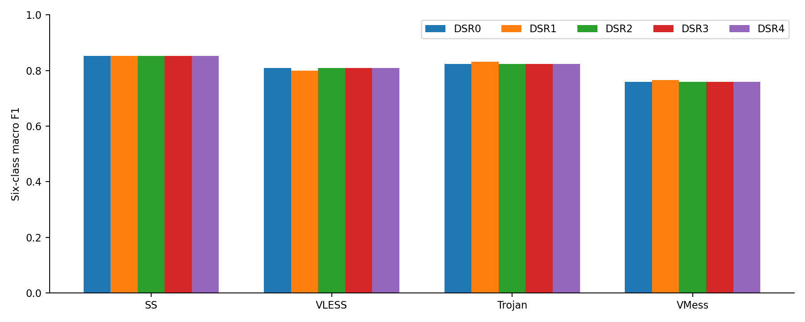
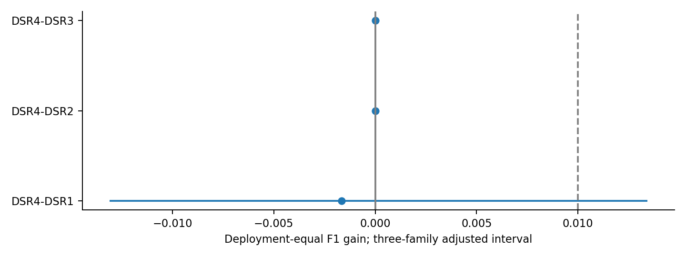
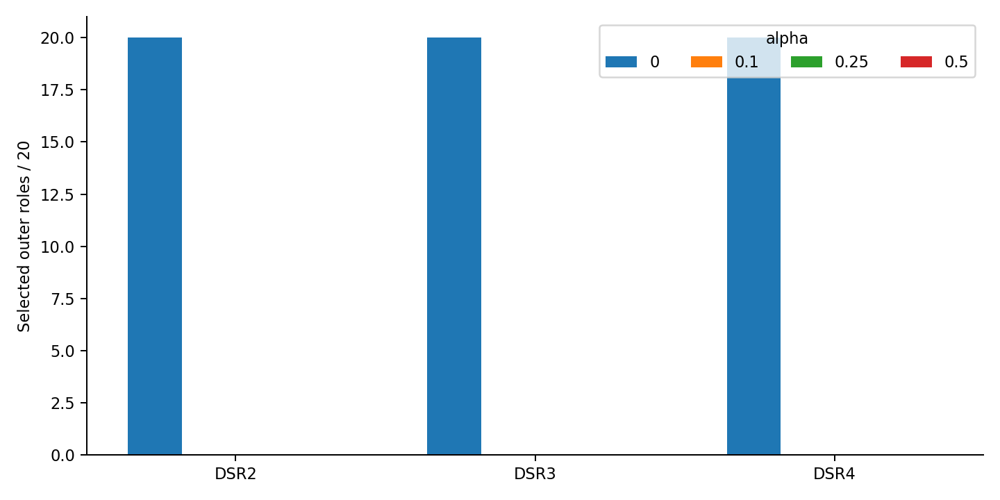
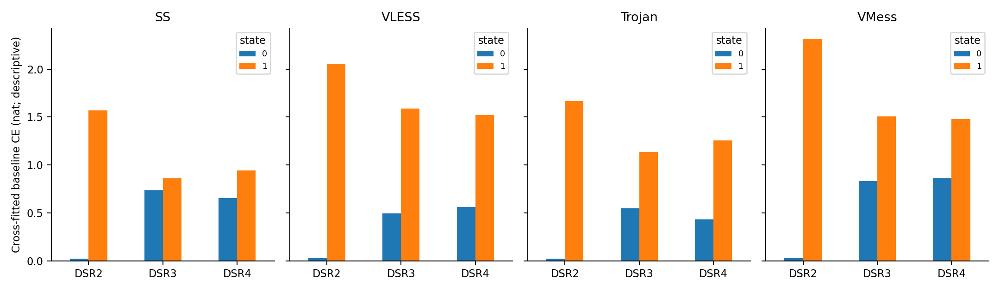
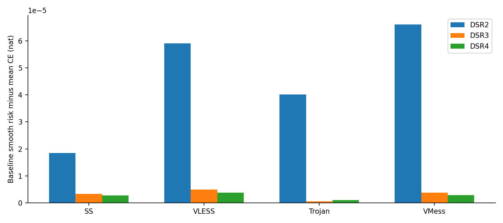
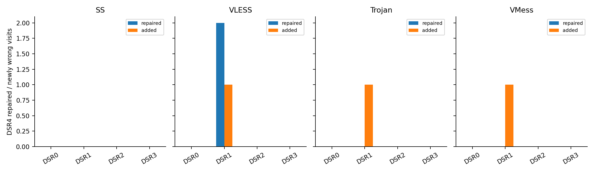
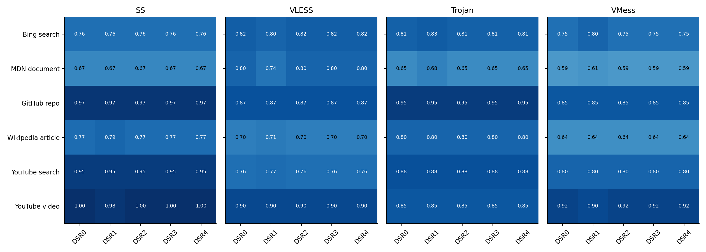

# DSR 漂移状态组风险分类完整实验报告 2026 10 06

## 1 结论

未达到完整预登记成功条件。本轮在此收束，不增加温度、保护系数、分组数、特征或模型搜索。 这是固定四个已见TCP部署、未见内容任务的结果，不是未见协议或外部数据验证。

三种状态方法在20个外层角色各自都选择alpha=0，共60次零选择；最终模型与DSR0逐概率一致。720个正alpha内层候选均已完成，这不是跳过训练或工程失败。内层选择未支持启用状态约束，因此没有新的外层正alpha优化，空优化表记为0次拟合、0秒、梯度NA，不补造模型或改平局规则。报告使用单独封存的 `report_zero.py` 空表呈现入口；封存训练源码和统计定义不变。

180个正alpha内层候选汇总与零候选的macro-F1全部持平，而不是全都降低；按预登记最小alpha平局规则选择零。17280条正alpha内层验证预测的类别改变数为0，概率最大绝对改变为0.000494678。这说明本轮约束确实产生了概率微调，但未改变验证分类决策。对DSR2/3的零宽区间来自最终模型相同，不是独立的统计等效证据。

从同轮目标压力诊断看，真实状态的外层基座平均平滑风险增量约为3×10⁻⁶ nat，未乘alpha的增量梯度范数约3.6×10⁻⁵，而CE梯度范数约7.2×10⁻³。结合内层概率变化很小，这支持“本轮风险约束在当前固定尺度下作用较弱”的描述；不证明调整温度必然有效，也不证明漂移与业务无关。DSR1还获得更低的平均CE与Brier。本轮不据此重新调参，分类用途和漂移测量价值分别保留。

| arm | equal_protocol_F1 | worst_protocol_F1 | mean_CE | mean_Brier | pooled_F1 | pooled_accuracy | pooled_CE | pooled_Brier |
| --- | --- | --- | --- | --- | --- | --- | --- | --- |
| DSR0 | 0.810782 | 0.759006 | 0.871935 | 0.311930 | 0.810949 | 0.810417 | 0.871935 | 0.311930 |
| DSR1 | 0.812449 | 0.766246 | 0.761202 | 0.299842 | 0.812284 | 0.812500 | 0.761202 | 0.299842 |
| DSR2 | 0.810782 | 0.759006 | 0.871935 | 0.311930 | 0.810949 | 0.810417 | 0.871935 | 0.311930 |
| DSR3 | 0.810782 | 0.759006 | 0.871935 | 0.311930 | 0.810949 | 0.810417 | 0.871935 | 0.311930 |
| DSR4 | 0.810782 | 0.759006 | 0.871935 | 0.311930 | 0.810949 | 0.810417 | 0.871935 | 0.311930 |


| comparison | point | lo95 | hi95 | family_lower | family_upper | family_positive | family | fixed_selected_models | practical_vs_DSR1 |
| --- | --- | --- | --- | --- | --- | --- | --- | --- | --- |
| DSR4-DSR1 | -0.001667 | -0.011529 | 0.010195 | -0.013111 | 0.013435 | False | 3 | True | False |
| DSR4-DSR2 | 0.000000 | 0.000000 | 0.000000 | 0.000000 | 0.000000 | False | 3 | True | False |
| DSR4-DSR3 | 0.000000 | 0.000000 | 0.000000 | 0.000000 | 0.000000 | False | 3 | True | False |


主终点先在每部署120访问上计算完整六类macro-F1，再对四部署等权；pooled F1仅作附录。区间来自10000次六业务分层内容bootstrap，跨部署/方法共享内容索引，重复随内容移动。普通95%及三个主比较Bonferroni对应98.333333%区间均条件于固定、已选模型，不重训。

## 2 数据与隔离

固定23566对排他TCP连接、480访问、30内容、六业务、每内容四次重复（1、2、4、5）。四部署为SS、VLESS、Trojan、VMess。AnyTLS与Hy2未加入本轮。原W/U/P/E、FR_packet_runs及R_unique_zero_runs组成10项连接观测，按既有箱形成96维post访问直方图。没有新增包扫描、地址、端口、SNI、载荷内容或协议身份数值输入。原FR未替换成记录排序特征。

全局五折按内容划分，所有部署、重复、两侧、连接整体随内容。外层训练/测试24/6内容；内层分类训练/验证18/6内容；内层训练状态的源范围12内容，外层训练状态源范围18内容。登记pair、visit、logical、carrier、epoch代理均不跨全局折；这不等于对所有未知TCP生命周期的普遍证明。

SS为已登记AES-256-GCM无plugin/smux；VLESS为TCP+TLS，非旧REALITY/Vision部署；Trojan为TCP+TLS；VMess为WS+TLS，历史security细节缺口保留。协议机制限定观测解释，不能从核统计反推精确封装开销。

## 3 五臂设计

| arm | 训练信息 | 用途 |
| --- | --- | --- |
| DSR0 | 原零LR，rho=.001 | 固定post监督基座 |
| DSR1 | 原KSR1四L2候选，内层选择 | 公平调参强post参照 |
| DSR2 | CF post CE类内低/高状态 | 不用pre的难度控制 |
| DSR3 | 匿名核+内容pre箱边际期望负log概率 | 拟合与查询都删除精确身份 |
| DSR4 | 共同真配核+同次pre/post负log概率 | 主候选 |


共同核不按业务条件化：每连接拟合质量1/(4×该访问连接数)，每内容总质量1，原平滑alpha=beta=1。状态分数先逐连接、十变量权重平均，再按访问等权。字节/包/事件变量权重各1/12，两个方向段变量各1/6。真配分数为bit；DSR2交叉拟合CE为nat，仅各方法内部排序，不跨单位比较绝对强弱。

匿名拟合是同内容两侧加权箱边际的乘积；匿名查询是对内容pre边际取−log2 KG(B|A)的期望，而非−log混合概率。接口不接收pre访问、pair或carrier身份。受信任离线包构建器拥有关联权限；角色白名单与SHA不等于OS安全沙箱。

## 4 模型与目标

六类线性softmax，96维输入，W为6×96、b为6，共582参数。各部署独立模型，使用各角色训练post的mu/scale，常数维度scale=1。Delta从零初始化，最终合并回同容量LR。alpha=0直接返回原基座，逐参数和逐概率精确复现。

每业务按自身状态分数划低/高两组等质量；边界并列使用分数质量拆分，整类同分每访问两组各0.5，不用访问ID破平局。外层每类每状态质量8，内层6。gamma冻结后，R_g为六类等权组CE，(R0+R1)/2=全训练CE。

固定目标 L=(1−alpha)CE+alpha×[logsumexp(R0,R1)−log2]+0.0005||W||²+0.1Rstay；Rstay=mean||P6(logits−base_logits)||²/5。温度1 nat；仅alpha∈{0,.1,.25,.5}按四内层合并96访问六类macro-F1选择，1e−12内平局选最小alpha。DSR1的L2选择完整复现旧规则。凸目标不等于泛化保证；组风险差单独不被声称凸。

CUDA float64全批LBFGS，strong Wolfe，max_iter500，tolerance_grad1e−9、tolerance_change1e−12；工程门为有限、目标不上升、max gradient≤1e−5、未触顶。关闭TF32并严格确定性；无随机训练seed或checkpoint搜索，无CPU拟合/推理回退。

## 5 全部结果

| protocol | arm | F1 | accuracy | CE | Brier |
| --- | --- | --- | --- | --- | --- |
| shadowsocks | DSR0 | 0.852836 | 0.850000 | 0.651379 | 0.237950 |
| shadowsocks | DSR1 | 0.852144 | 0.850000 | 0.583730 | 0.226160 |
| shadowsocks | DSR2 | 0.852836 | 0.850000 | 0.651379 | 0.237950 |
| shadowsocks | DSR3 | 0.852836 | 0.850000 | 0.651379 | 0.237950 |
| shadowsocks | DSR4 | 0.852836 | 0.850000 | 0.651379 | 0.237950 |
| trojan | DSR0 | 0.822704 | 0.825000 | 0.732356 | 0.273935 |
| trojan | DSR1 | 0.831921 | 0.833333 | 0.663361 | 0.262865 |
| trojan | DSR2 | 0.822704 | 0.825000 | 0.732356 | 0.273935 |
| trojan | DSR3 | 0.822704 | 0.825000 | 0.732356 | 0.273935 |
| trojan | DSR4 | 0.822704 | 0.825000 | 0.732356 | 0.273935 |
| vless | DSR0 | 0.808583 | 0.808333 | 0.900850 | 0.322152 |
| vless | DSR1 | 0.799486 | 0.800000 | 0.750140 | 0.315853 |
| vless | DSR2 | 0.808583 | 0.808333 | 0.900850 | 0.322152 |
| vless | DSR3 | 0.808583 | 0.808333 | 0.900850 | 0.322152 |
| vless | DSR4 | 0.808583 | 0.808333 | 0.900850 | 0.322152 |
| vmess | DSR0 | 0.759006 | 0.758333 | 1.203157 | 0.413686 |
| vmess | DSR1 | 0.766246 | 0.766667 | 1.047577 | 0.394490 |
| vmess | DSR2 | 0.759006 | 0.758333 | 1.203157 | 0.413686 |
| vmess | DSR3 | 0.759006 | 0.758333 | 1.203157 | 0.413686 |
| vmess | DSR4 | 0.759006 | 0.758333 | 1.203157 | 0.413686 |


### 5.1 逐业务结果

每类每部署支持20次访问，保留全部类别。

| protocol | arm | business | support | F1 | recall | precision |
| --- | --- | --- | --- | --- | --- | --- |
| shadowsocks | DSR0 | bing.com::search_results_view | 20 | 0.756757 | 0.700000 | 0.823529 |
| shadowsocks | DSR0 | developer.mozilla.org::document_view | 20 | 0.666667 | 0.750000 | 0.600000 |
| shadowsocks | DSR0 | github.com::repository_view | 20 | 0.974359 | 0.950000 | 1.000000 |
| shadowsocks | DSR0 | wikipedia.org::article_view | 20 | 0.769231 | 0.750000 | 0.789474 |
| shadowsocks | DSR0 | youtube.com::search_results_view | 20 | 0.950000 | 0.950000 | 0.950000 |
| shadowsocks | DSR0 | youtube.com::video_playback | 20 | 1.000000 | 1.000000 | 1.000000 |
| shadowsocks | DSR1 | bing.com::search_results_view | 20 | 0.756757 | 0.700000 | 0.823529 |
| shadowsocks | DSR1 | developer.mozilla.org::document_view | 20 | 0.666667 | 0.750000 | 0.600000 |
| shadowsocks | DSR1 | github.com::repository_view | 20 | 0.974359 | 0.950000 | 1.000000 |
| shadowsocks | DSR1 | wikipedia.org::article_view | 20 | 0.789474 | 0.750000 | 0.833333 |
| shadowsocks | DSR1 | youtube.com::search_results_view | 20 | 0.950000 | 0.950000 | 0.950000 |
| shadowsocks | DSR1 | youtube.com::video_playback | 20 | 0.975610 | 1.000000 | 0.952381 |
| shadowsocks | DSR2 | bing.com::search_results_view | 20 | 0.756757 | 0.700000 | 0.823529 |
| shadowsocks | DSR2 | developer.mozilla.org::document_view | 20 | 0.666667 | 0.750000 | 0.600000 |
| shadowsocks | DSR2 | github.com::repository_view | 20 | 0.974359 | 0.950000 | 1.000000 |
| shadowsocks | DSR2 | wikipedia.org::article_view | 20 | 0.769231 | 0.750000 | 0.789474 |
| shadowsocks | DSR2 | youtube.com::search_results_view | 20 | 0.950000 | 0.950000 | 0.950000 |
| shadowsocks | DSR2 | youtube.com::video_playback | 20 | 1.000000 | 1.000000 | 1.000000 |
| shadowsocks | DSR3 | bing.com::search_results_view | 20 | 0.756757 | 0.700000 | 0.823529 |
| shadowsocks | DSR3 | developer.mozilla.org::document_view | 20 | 0.666667 | 0.750000 | 0.600000 |
| shadowsocks | DSR3 | github.com::repository_view | 20 | 0.974359 | 0.950000 | 1.000000 |
| shadowsocks | DSR3 | wikipedia.org::article_view | 20 | 0.769231 | 0.750000 | 0.789474 |
| shadowsocks | DSR3 | youtube.com::search_results_view | 20 | 0.950000 | 0.950000 | 0.950000 |
| shadowsocks | DSR3 | youtube.com::video_playback | 20 | 1.000000 | 1.000000 | 1.000000 |
| shadowsocks | DSR4 | bing.com::search_results_view | 20 | 0.756757 | 0.700000 | 0.823529 |
| shadowsocks | DSR4 | developer.mozilla.org::document_view | 20 | 0.666667 | 0.750000 | 0.600000 |
| shadowsocks | DSR4 | github.com::repository_view | 20 | 0.974359 | 0.950000 | 1.000000 |
| shadowsocks | DSR4 | wikipedia.org::article_view | 20 | 0.769231 | 0.750000 | 0.789474 |
| shadowsocks | DSR4 | youtube.com::search_results_view | 20 | 0.950000 | 0.950000 | 0.950000 |
| shadowsocks | DSR4 | youtube.com::video_playback | 20 | 1.000000 | 1.000000 | 1.000000 |
| trojan | DSR0 | bing.com::search_results_view | 20 | 0.809524 | 0.850000 | 0.772727 |
| trojan | DSR0 | developer.mozilla.org::document_view | 20 | 0.648649 | 0.600000 | 0.705882 |
| trojan | DSR0 | github.com::repository_view | 20 | 0.950000 | 0.950000 | 0.950000 |
| trojan | DSR0 | wikipedia.org::article_view | 20 | 0.800000 | 0.800000 | 0.800000 |
| trojan | DSR0 | youtube.com::search_results_view | 20 | 0.878049 | 0.900000 | 0.857143 |
| trojan | DSR0 | youtube.com::video_playback | 20 | 0.850000 | 0.850000 | 0.850000 |
| trojan | DSR1 | bing.com::search_results_view | 20 | 0.829268 | 0.850000 | 0.809524 |
| trojan | DSR1 | developer.mozilla.org::document_view | 20 | 0.684211 | 0.650000 | 0.722222 |
| trojan | DSR1 | github.com::repository_view | 20 | 0.950000 | 0.950000 | 0.950000 |
| trojan | DSR1 | wikipedia.org::article_view | 20 | 0.800000 | 0.800000 | 0.800000 |
| trojan | DSR1 | youtube.com::search_results_view | 20 | 0.878049 | 0.900000 | 0.857143 |
| trojan | DSR1 | youtube.com::video_playback | 20 | 0.850000 | 0.850000 | 0.850000 |
| trojan | DSR2 | bing.com::search_results_view | 20 | 0.809524 | 0.850000 | 0.772727 |
| trojan | DSR2 | developer.mozilla.org::document_view | 20 | 0.648649 | 0.600000 | 0.705882 |
| trojan | DSR2 | github.com::repository_view | 20 | 0.950000 | 0.950000 | 0.950000 |
| trojan | DSR2 | wikipedia.org::article_view | 20 | 0.800000 | 0.800000 | 0.800000 |
| trojan | DSR2 | youtube.com::search_results_view | 20 | 0.878049 | 0.900000 | 0.857143 |
| trojan | DSR2 | youtube.com::video_playback | 20 | 0.850000 | 0.850000 | 0.850000 |
| trojan | DSR3 | bing.com::search_results_view | 20 | 0.809524 | 0.850000 | 0.772727 |
| trojan | DSR3 | developer.mozilla.org::document_view | 20 | 0.648649 | 0.600000 | 0.705882 |
| trojan | DSR3 | github.com::repository_view | 20 | 0.950000 | 0.950000 | 0.950000 |
| trojan | DSR3 | wikipedia.org::article_view | 20 | 0.800000 | 0.800000 | 0.800000 |
| trojan | DSR3 | youtube.com::search_results_view | 20 | 0.878049 | 0.900000 | 0.857143 |
| trojan | DSR3 | youtube.com::video_playback | 20 | 0.850000 | 0.850000 | 0.850000 |
| trojan | DSR4 | bing.com::search_results_view | 20 | 0.809524 | 0.850000 | 0.772727 |
| trojan | DSR4 | developer.mozilla.org::document_view | 20 | 0.648649 | 0.600000 | 0.705882 |
| trojan | DSR4 | github.com::repository_view | 20 | 0.950000 | 0.950000 | 0.950000 |
| trojan | DSR4 | wikipedia.org::article_view | 20 | 0.800000 | 0.800000 | 0.800000 |
| trojan | DSR4 | youtube.com::search_results_view | 20 | 0.878049 | 0.900000 | 0.857143 |
| trojan | DSR4 | youtube.com::video_playback | 20 | 0.850000 | 0.850000 | 0.850000 |
| vless | DSR0 | bing.com::search_results_view | 20 | 0.820513 | 0.800000 | 0.842105 |
| vless | DSR0 | developer.mozilla.org::document_view | 20 | 0.800000 | 0.800000 | 0.800000 |
| vless | DSR0 | github.com::repository_view | 20 | 0.871795 | 0.850000 | 0.894737 |
| vless | DSR0 | wikipedia.org::article_view | 20 | 0.697674 | 0.750000 | 0.652174 |
| vless | DSR0 | youtube.com::search_results_view | 20 | 0.756757 | 0.700000 | 0.823529 |
| vless | DSR0 | youtube.com::video_playback | 20 | 0.904762 | 0.950000 | 0.863636 |
| vless | DSR1 | bing.com::search_results_view | 20 | 0.800000 | 0.800000 | 0.800000 |
| vless | DSR1 | developer.mozilla.org::document_view | 20 | 0.736842 | 0.700000 | 0.777778 |
| vless | DSR1 | github.com::repository_view | 20 | 0.871795 | 0.850000 | 0.894737 |
| vless | DSR1 | wikipedia.org::article_view | 20 | 0.714286 | 0.750000 | 0.681818 |
| vless | DSR1 | youtube.com::search_results_view | 20 | 0.769231 | 0.750000 | 0.789474 |
| vless | DSR1 | youtube.com::video_playback | 20 | 0.904762 | 0.950000 | 0.863636 |
| vless | DSR2 | bing.com::search_results_view | 20 | 0.820513 | 0.800000 | 0.842105 |
| vless | DSR2 | developer.mozilla.org::document_view | 20 | 0.800000 | 0.800000 | 0.800000 |
| vless | DSR2 | github.com::repository_view | 20 | 0.871795 | 0.850000 | 0.894737 |
| vless | DSR2 | wikipedia.org::article_view | 20 | 0.697674 | 0.750000 | 0.652174 |
| vless | DSR2 | youtube.com::search_results_view | 20 | 0.756757 | 0.700000 | 0.823529 |
| vless | DSR2 | youtube.com::video_playback | 20 | 0.904762 | 0.950000 | 0.863636 |
| vless | DSR3 | bing.com::search_results_view | 20 | 0.820513 | 0.800000 | 0.842105 |
| vless | DSR3 | developer.mozilla.org::document_view | 20 | 0.800000 | 0.800000 | 0.800000 |
| vless | DSR3 | github.com::repository_view | 20 | 0.871795 | 0.850000 | 0.894737 |
| vless | DSR3 | wikipedia.org::article_view | 20 | 0.697674 | 0.750000 | 0.652174 |
| vless | DSR3 | youtube.com::search_results_view | 20 | 0.756757 | 0.700000 | 0.823529 |
| vless | DSR3 | youtube.com::video_playback | 20 | 0.904762 | 0.950000 | 0.863636 |
| vless | DSR4 | bing.com::search_results_view | 20 | 0.820513 | 0.800000 | 0.842105 |
| vless | DSR4 | developer.mozilla.org::document_view | 20 | 0.800000 | 0.800000 | 0.800000 |
| vless | DSR4 | github.com::repository_view | 20 | 0.871795 | 0.850000 | 0.894737 |
| vless | DSR4 | wikipedia.org::article_view | 20 | 0.697674 | 0.750000 | 0.652174 |
| vless | DSR4 | youtube.com::search_results_view | 20 | 0.756757 | 0.700000 | 0.823529 |
| vless | DSR4 | youtube.com::video_playback | 20 | 0.904762 | 0.950000 | 0.863636 |
| vmess | DSR0 | bing.com::search_results_view | 20 | 0.750000 | 0.750000 | 0.750000 |
| vmess | DSR0 | developer.mozilla.org::document_view | 20 | 0.594595 | 0.550000 | 0.647059 |
| vmess | DSR0 | github.com::repository_view | 20 | 0.850000 | 0.850000 | 0.850000 |
| vmess | DSR0 | wikipedia.org::article_view | 20 | 0.636364 | 0.700000 | 0.583333 |
| vmess | DSR0 | youtube.com::search_results_view | 20 | 0.800000 | 0.800000 | 0.800000 |
| vmess | DSR0 | youtube.com::video_playback | 20 | 0.923077 | 0.900000 | 0.947368 |
| vmess | DSR1 | bing.com::search_results_view | 20 | 0.800000 | 0.800000 | 0.800000 |
| vmess | DSR1 | developer.mozilla.org::document_view | 20 | 0.611111 | 0.550000 | 0.687500 |
| vmess | DSR1 | github.com::repository_view | 20 | 0.850000 | 0.850000 | 0.850000 |
| vmess | DSR1 | wikipedia.org::article_view | 20 | 0.636364 | 0.700000 | 0.583333 |
| vmess | DSR1 | youtube.com::search_results_view | 20 | 0.800000 | 0.800000 | 0.800000 |
| vmess | DSR1 | youtube.com::video_playback | 20 | 0.900000 | 0.900000 | 0.900000 |
| vmess | DSR2 | bing.com::search_results_view | 20 | 0.750000 | 0.750000 | 0.750000 |
| vmess | DSR2 | developer.mozilla.org::document_view | 20 | 0.594595 | 0.550000 | 0.647059 |
| vmess | DSR2 | github.com::repository_view | 20 | 0.850000 | 0.850000 | 0.850000 |
| vmess | DSR2 | wikipedia.org::article_view | 20 | 0.636364 | 0.700000 | 0.583333 |
| vmess | DSR2 | youtube.com::search_results_view | 20 | 0.800000 | 0.800000 | 0.800000 |
| vmess | DSR2 | youtube.com::video_playback | 20 | 0.923077 | 0.900000 | 0.947368 |
| vmess | DSR3 | bing.com::search_results_view | 20 | 0.750000 | 0.750000 | 0.750000 |
| vmess | DSR3 | developer.mozilla.org::document_view | 20 | 0.594595 | 0.550000 | 0.647059 |
| vmess | DSR3 | github.com::repository_view | 20 | 0.850000 | 0.850000 | 0.850000 |
| vmess | DSR3 | wikipedia.org::article_view | 20 | 0.636364 | 0.700000 | 0.583333 |
| vmess | DSR3 | youtube.com::search_results_view | 20 | 0.800000 | 0.800000 | 0.800000 |
| vmess | DSR3 | youtube.com::video_playback | 20 | 0.923077 | 0.900000 | 0.947368 |
| vmess | DSR4 | bing.com::search_results_view | 20 | 0.750000 | 0.750000 | 0.750000 |
| vmess | DSR4 | developer.mozilla.org::document_view | 20 | 0.594595 | 0.550000 | 0.647059 |
| vmess | DSR4 | github.com::repository_view | 20 | 0.850000 | 0.850000 | 0.850000 |
| vmess | DSR4 | wikipedia.org::article_view | 20 | 0.636364 | 0.700000 | 0.583333 |
| vmess | DSR4 | youtube.com::search_results_view | 20 | 0.800000 | 0.800000 | 0.800000 |
| vmess | DSR4 | youtube.com::video_playback | 20 | 0.923077 | 0.900000 | 0.947368 |


### 5.2 预登记主比较

| comparison | point | lo95 | hi95 | family_lower | family_upper | family_positive | family | fixed_selected_models | practical_vs_DSR1 |
| --- | --- | --- | --- | --- | --- | --- | --- | --- | --- |
| DSR4-DSR1 | -0.001667 | -0.011529 | 0.010195 | -0.013111 | 0.013435 | False | 3 | True | False |
| DSR4-DSR2 | 0.000000 | 0.000000 | 0.000000 | 0.000000 | 0.000000 | False | 3 | True | False |
| DSR4-DSR3 | 0.000000 | 0.000000 | 0.000000 | 0.000000 | 0.000000 | False | 3 | True | False |


### 5.3 逐部署探索性比较

下列95%区间不属于主检验家族，不据此替代主终点。

| protocol | reference | point | lo95 | hi95 | descriptive_not_main_family |
| --- | --- | --- | --- | --- | --- |
| shadowsocks | DSR1 | 0.000691 | 0.000000 | 0.002393 | True |
| shadowsocks | DSR2 | 0.000000 | 0.000000 | 0.000000 | True |
| shadowsocks | DSR3 | 0.000000 | 0.000000 | 0.000000 | True |
| vless | DSR1 | 0.009098 | -0.017179 | 0.051277 | True |
| vless | DSR2 | 0.000000 | 0.000000 | 0.000000 | True |
| vless | DSR3 | 0.000000 | 0.000000 | 0.000000 | True |
| trojan | DSR1 | -0.009218 | -0.027383 | 0.000000 | True |
| trojan | DSR2 | 0.000000 | 0.000000 | 0.000000 | True |
| trojan | DSR3 | 0.000000 | 0.000000 | 0.000000 | True |
| vmess | DSR1 | -0.007240 | -0.022677 | 0.001847 | True |
| vmess | DSR2 | 0.000000 | 0.000000 | 0.000000 | True |
| vmess | DSR3 | 0.000000 | 0.000000 | 0.000000 | True |


### 5.4 选择及新增计算

| arm | alpha | outer_roles |
| --- | --- | --- |
| DSR2 | 0.000000 | 20 |
| DSR3 | 0.000000 | 20 |
| DSR4 | 0.000000 | 20 |


| alpha | arm | inner_F1 | outer | protocol |
| --- | --- | --- | --- | --- |
| 4.000000 | DSR1 | 0.790557 | 0 | shadowsocks |
| 0.000000 | DSR2 | 0.760430 | 0 | shadowsocks |
| 0.000000 | DSR3 | 0.760430 | 0 | shadowsocks |
| 0.000000 | DSR4 | 0.760430 | 0 | shadowsocks |
| 0.000000 | DSR1 | 0.747688 | 0 | trojan |
| 0.000000 | DSR2 | 0.747688 | 0 | trojan |
| 0.000000 | DSR3 | 0.747688 | 0 | trojan |
| 0.000000 | DSR4 | 0.747688 | 0 | trojan |
| 4.000000 | DSR1 | 0.781036 | 0 | vless |
| 0.000000 | DSR2 | 0.778321 | 0 | vless |
| 0.000000 | DSR3 | 0.778321 | 0 | vless |
| 0.000000 | DSR4 | 0.778321 | 0 | vless |
| 0.000000 | DSR1 | 0.751856 | 0 | vmess |
| 0.000000 | DSR2 | 0.751856 | 0 | vmess |
| 0.000000 | DSR3 | 0.751856 | 0 | vmess |
| 0.000000 | DSR4 | 0.751856 | 0 | vmess |
| 4.000000 | DSR1 | 0.823699 | 1 | shadowsocks |
| 0.000000 | DSR2 | 0.804761 | 1 | shadowsocks |
| 0.000000 | DSR3 | 0.804761 | 1 | shadowsocks |
| 0.000000 | DSR4 | 0.804761 | 1 | shadowsocks |
| 1.000000 | DSR1 | 0.809021 | 1 | trojan |
| 0.000000 | DSR2 | 0.798003 | 1 | trojan |
| 0.000000 | DSR3 | 0.798003 | 1 | trojan |
| 0.000000 | DSR4 | 0.798003 | 1 | trojan |
| 1.000000 | DSR1 | 0.753524 | 1 | vless |
| 0.000000 | DSR2 | 0.734748 | 1 | vless |
| 0.000000 | DSR3 | 0.734748 | 1 | vless |
| 0.000000 | DSR4 | 0.734748 | 1 | vless |
| 0.000000 | DSR1 | 0.730287 | 1 | vmess |
| 0.000000 | DSR2 | 0.730287 | 1 | vmess |
| 0.000000 | DSR3 | 0.730287 | 1 | vmess |
| 0.000000 | DSR4 | 0.730287 | 1 | vmess |
| 0.000000 | DSR1 | 0.865103 | 2 | shadowsocks |
| 0.000000 | DSR2 | 0.865103 | 2 | shadowsocks |
| 0.000000 | DSR3 | 0.865103 | 2 | shadowsocks |
| 0.000000 | DSR4 | 0.865103 | 2 | shadowsocks |
| 4.000000 | DSR1 | 0.760104 | 2 | trojan |
| 0.000000 | DSR2 | 0.731291 | 2 | trojan |
| 0.000000 | DSR3 | 0.731291 | 2 | trojan |
| 0.000000 | DSR4 | 0.731291 | 2 | trojan |
| 0.000000 | DSR1 | 0.716451 | 2 | vless |
| 0.000000 | DSR2 | 0.716451 | 2 | vless |
| 0.000000 | DSR3 | 0.716451 | 2 | vless |
| 0.000000 | DSR4 | 0.716451 | 2 | vless |
| 1.000000 | DSR1 | 0.761935 | 2 | vmess |
| 0.000000 | DSR2 | 0.752574 | 2 | vmess |
| 0.000000 | DSR3 | 0.752574 | 2 | vmess |
| 0.000000 | DSR4 | 0.752574 | 2 | vmess |
| 4.000000 | DSR1 | 0.788938 | 3 | shadowsocks |
| 0.000000 | DSR2 | 0.788131 | 3 | shadowsocks |
| 0.000000 | DSR3 | 0.788131 | 3 | shadowsocks |
| 0.000000 | DSR4 | 0.788131 | 3 | shadowsocks |
| 4.000000 | DSR1 | 0.811805 | 3 | trojan |
| 0.000000 | DSR2 | 0.801440 | 3 | trojan |
| 0.000000 | DSR3 | 0.801440 | 3 | trojan |
| 0.000000 | DSR4 | 0.801440 | 3 | trojan |
| 4.000000 | DSR1 | 0.763446 | 3 | vless |
| 0.000000 | DSR2 | 0.752105 | 3 | vless |
| 0.000000 | DSR3 | 0.752105 | 3 | vless |
| 0.000000 | DSR4 | 0.752105 | 3 | vless |
| 4.000000 | DSR1 | 0.728803 | 3 | vmess |
| 0.000000 | DSR2 | 0.707888 | 3 | vmess |
| 0.000000 | DSR3 | 0.707888 | 3 | vmess |
| 0.000000 | DSR4 | 0.707888 | 3 | vmess |
| 0.000000 | DSR1 | 0.792939 | 4 | shadowsocks |
| 0.000000 | DSR2 | 0.792939 | 4 | shadowsocks |
| 0.000000 | DSR3 | 0.792939 | 4 | shadowsocks |
| 0.000000 | DSR4 | 0.792939 | 4 | shadowsocks |
| 1.000000 | DSR1 | 0.820586 | 4 | trojan |
| 0.000000 | DSR2 | 0.799195 | 4 | trojan |
| 0.000000 | DSR3 | 0.799195 | 4 | trojan |
| 0.000000 | DSR4 | 0.799195 | 4 | trojan |
| 4.000000 | DSR1 | 0.735548 | 4 | vless |
| 0.000000 | DSR2 | 0.723437 | 4 | vless |
| 0.000000 | DSR3 | 0.723437 | 4 | vless |
| 0.000000 | DSR4 | 0.723437 | 4 | vless |
| 4.000000 | DSR1 | 0.770695 | 4 | vmess |
| 0.000000 | DSR2 | 0.760397 | 4 | vmess |
| 0.000000 | DSR3 | 0.760397 | 4 | vmess |
| 0.000000 | DSR4 | 0.760397 | 4 | vmess |


| stage | fits | seconds | max_gradient | max_iterations |
| --- | --- | --- | --- | --- |
| CF12 | 40 | 27.556799 | 0.000000 | 82 |
| inner_positive | 720 | 327.414296 | 0.000001 | 112 |
| outer_selected_positive | 0 | 0.000000 | NA | 0 |


240个内层CF逻辑查询对应40个独立12内容训练集合，按成员和源码封存复用拟合，共400个新核bundle、40个难度LR；另80个18内容源角色复用并重放旧核/模型。逻辑查询仍逐一排除来源内容并审计。候选数匹配不等于总计算匹配：状态学习额外使用两侧和辅助CF拟合。

## 6 状态与目标作用

下表对五个外层训练角色、六业务等权汇总，不是留出分类终点。DSR2与OOF CE的关系由构造决定。DSR3/4的关系仅为描述，不能解读为因果或互信息。

| protocol | arm | state | OOF_CE | OOF_accuracy | mean_true_score | zero_support | low_support | effective_contents | max_content_fraction |
| --- | --- | --- | --- | --- | --- | --- | --- | --- | --- |
| shadowsocks | DSR2 | 0 | 0.024494 | 0.991667 | 0.654247 | 0.000146 | 0.066770 | 3.179290 | 0.500000 |
| shadowsocks | DSR2 | 1 | 1.571029 | 0.616667 | 0.657264 | 0.000000 | 0.060202 | 3.179290 | 0.500000 |
| shadowsocks | DSR3 | 0 | 0.734436 | 0.812500 | 0.607167 | 0.000012 | 0.055133 | 3.302626 | 0.500000 |
| shadowsocks | DSR3 | 1 | 0.861086 | 0.795833 | 0.704344 | 0.000134 | 0.071840 | 3.302626 | 0.500000 |
| shadowsocks | DSR4 | 0 | 0.653022 | 0.808333 | 0.596164 | 0.000000 | 0.055851 | 3.289697 | 0.500000 |
| shadowsocks | DSR4 | 1 | 0.942501 | 0.800000 | 0.715346 | 0.000146 | 0.071122 | 3.289697 | 0.500000 |
| trojan | DSR2 | 0 | 0.022403 | 1.000000 | 0.571034 | 0.000020 | 0.068081 | 3.485791 | 0.500000 |
| trojan | DSR2 | 1 | 1.663931 | 0.554167 | 0.611908 | 0.000061 | 0.070183 | 3.485791 | 0.500000 |
| trojan | DSR3 | 0 | 0.548128 | 0.812500 | 0.518038 | 0.000033 | 0.064717 | 3.368847 | 0.500000 |
| trojan | DSR3 | 1 | 1.138206 | 0.741667 | 0.664904 | 0.000048 | 0.073547 | 3.368847 | 0.500000 |
| trojan | DSR4 | 0 | 0.432134 | 0.850000 | 0.509207 | 0.000033 | 0.063714 | 3.402828 | 0.500000 |
| trojan | DSR4 | 1 | 1.254199 | 0.704167 | 0.673735 | 0.000048 | 0.074551 | 3.402828 | 0.500000 |
| vless | DSR2 | 0 | 0.027485 | 1.000000 | 0.573216 | 0.000102 | 0.068696 | 3.336566 | 0.500000 |
| vless | DSR2 | 1 | 2.056109 | 0.479167 | 0.617795 | 0.000111 | 0.069824 | 3.336566 | 0.500000 |
| vless | DSR3 | 0 | 0.493697 | 0.829167 | 0.518331 | 0.000034 | 0.062544 | 3.397441 | 0.500000 |
| vless | DSR3 | 1 | 1.589897 | 0.650000 | 0.672680 | 0.000179 | 0.075977 | 3.397441 | 0.500000 |
| vless | DSR4 | 0 | 0.563881 | 0.820833 | 0.510915 | 0.000019 | 0.063917 | 3.470603 | 0.500000 |
| vless | DSR4 | 1 | 1.519713 | 0.658333 | 0.680096 | 0.000194 | 0.074603 | 3.470603 | 0.500000 |
| vmess | DSR2 | 0 | 0.027574 | 0.995833 | 0.660520 | 0.000184 | 0.071988 | 3.241678 | 0.500000 |
| vmess | DSR2 | 1 | 2.312294 | 0.483333 | 0.689243 | 0.000226 | 0.077078 | 3.241678 | 0.500000 |
| vmess | DSR3 | 0 | 0.833667 | 0.791667 | 0.616369 | 0.000060 | 0.070754 | 3.199814 | 0.500000 |
| vmess | DSR3 | 1 | 1.506201 | 0.687500 | 0.733395 | 0.000349 | 0.078312 | 3.199814 | 0.500000 |
| vmess | DSR4 | 0 | 0.860984 | 0.783333 | 0.612261 | 0.000060 | 0.070836 | 3.103797 | 0.500000 |
| vmess | DSR4 | 1 | 1.478884 | 0.695833 | 0.737503 | 0.000349 | 0.078230 | 3.103797 | 0.500000 |


### 6.1 基座目标压力

| protocol | arm | mean_gap | max_gap | CE_grad | L2_grad | state_grad |
| --- | --- | --- | --- | --- | --- | --- |
| shadowsocks | DSR2 | 0.000018 | 0.000028 | 0.006315 | 0.006315 | 0.000049 |
| shadowsocks | DSR3 | 0.000003 | 0.000006 | 0.006315 | 0.006315 | 0.000037 |
| shadowsocks | DSR4 | 0.000003 | 0.000004 | 0.006315 | 0.006315 | 0.000033 |
| trojan | DSR2 | 0.000040 | 0.000053 | 0.007126 | 0.007126 | 0.000087 |
| trojan | DSR3 | 0.000001 | 0.000001 | 0.007126 | 0.007126 | 0.000015 |
| trojan | DSR4 | 0.000001 | 0.000002 | 0.007126 | 0.007126 | 0.000021 |
| vless | DSR2 | 0.000059 | 0.000082 | 0.007711 | 0.007711 | 0.000121 |
| vless | DSR3 | 0.000005 | 0.000010 | 0.007711 | 0.007711 | 0.000058 |
| vless | DSR4 | 0.000004 | 0.000010 | 0.007711 | 0.007711 | 0.000053 |
| vmess | DSR2 | 0.000066 | 0.000096 | 0.007641 | 0.007641 | 0.000130 |
| vmess | DSR3 | 0.000004 | 0.000013 | 0.007641 | 0.007641 | 0.000047 |
| vmess | DSR4 | 0.000003 | 0.000006 | 0.007641 | 0.007641 | 0.000036 |


gap=tau log cosh((R1−R0)/(2tau))，风险接近时为二阶小量。表中state_grad为未乘alpha的gap梯度；protection梯度记录已乘eta。状态非零不等于优化压力强。不能看到压力弱后重新调整温度或CE单位。

### 6.2 选定正alpha模型的变化

零alpha角色不计入此均值，完整日志另存。

| protocol | arm |
| --- | --- |


### 6.3 同状态质量重合

| protocol | outer | reference | same_state_mass | shared_low_mass | low_mass |
| --- | --- | --- | --- | --- | --- |
| shadowsocks | 0 | DSR2 | 0.458333 | 22.000000 | 48.000000 |
| shadowsocks | 0 | DSR3 | 0.833333 | 40.000000 | 48.000000 |
| shadowsocks | 1 | DSR2 | 0.458333 | 22.000000 | 48.000000 |
| shadowsocks | 1 | DSR3 | 0.791667 | 38.000000 | 48.000000 |
| shadowsocks | 2 | DSR2 | 0.437500 | 21.000000 | 48.000000 |
| shadowsocks | 2 | DSR3 | 0.812500 | 39.000000 | 48.000000 |
| shadowsocks | 3 | DSR2 | 0.541667 | 26.000000 | 48.000000 |
| shadowsocks | 3 | DSR3 | 0.750000 | 36.000000 | 48.000000 |
| shadowsocks | 4 | DSR2 | 0.437500 | 21.000000 | 48.000000 |
| shadowsocks | 4 | DSR3 | 0.791667 | 38.000000 | 48.000000 |
| trojan | 0 | DSR2 | 0.583333 | 28.000000 | 48.000000 |
| trojan | 0 | DSR3 | 0.791667 | 38.000000 | 48.000000 |
| trojan | 1 | DSR2 | 0.500000 | 24.000000 | 48.000000 |
| trojan | 1 | DSR3 | 0.770833 | 37.000000 | 48.000000 |
| trojan | 2 | DSR2 | 0.541667 | 26.000000 | 48.000000 |
| trojan | 2 | DSR3 | 0.770833 | 37.000000 | 48.000000 |
| trojan | 3 | DSR2 | 0.500000 | 24.000000 | 48.000000 |
| trojan | 3 | DSR3 | 0.791667 | 38.000000 | 48.000000 |
| trojan | 4 | DSR2 | 0.520833 | 25.000000 | 48.000000 |
| trojan | 4 | DSR3 | 0.791667 | 38.000000 | 48.000000 |
| vless | 0 | DSR2 | 0.541667 | 26.000000 | 48.000000 |
| vless | 0 | DSR3 | 0.770833 | 37.000000 | 48.000000 |
| vless | 1 | DSR2 | 0.520833 | 25.000000 | 48.000000 |
| vless | 1 | DSR3 | 0.770833 | 37.000000 | 48.000000 |
| vless | 2 | DSR2 | 0.541667 | 26.000000 | 48.000000 |
| vless | 2 | DSR3 | 0.750000 | 36.000000 | 48.000000 |
| vless | 3 | DSR2 | 0.541667 | 26.000000 | 48.000000 |
| vless | 3 | DSR3 | 0.791667 | 38.000000 | 48.000000 |
| vless | 4 | DSR2 | 0.500000 | 24.000000 | 48.000000 |
| vless | 4 | DSR3 | 0.812500 | 39.000000 | 48.000000 |
| vmess | 0 | DSR2 | 0.479167 | 23.000000 | 48.000000 |
| vmess | 0 | DSR3 | 0.895833 | 43.000000 | 48.000000 |
| vmess | 1 | DSR2 | 0.562500 | 27.000000 | 48.000000 |
| vmess | 1 | DSR3 | 0.854167 | 41.000000 | 48.000000 |
| vmess | 2 | DSR2 | 0.479167 | 23.000000 | 48.000000 |
| vmess | 2 | DSR3 | 0.770833 | 37.000000 | 48.000000 |
| vmess | 3 | DSR2 | 0.500000 | 24.000000 | 48.000000 |
| vmess | 3 | DSR3 | 0.854167 | 41.000000 | 48.000000 |
| vmess | 4 | DSR2 | 0.583333 | 28.000000 | 48.000000 |
| vmess | 4 | DSR3 | 0.854167 | 41.000000 | 48.000000 |


same_state_mass=mean(1−|gamma_true,low−gamma_control,low|)，只是训练分组重合。内容贡献、按CF源的分数分布、业务内分数与连接数/零支持/低支持Spearman另存完整表，不根据这些诊断筛样本或重新定义状态。

## 7 错误翻转与离线状态

| protocol | reference | repaired | added | changed |
| --- | --- | --- | --- | --- |
| shadowsocks | DSR0 | 0 | 0 | 0 |
| shadowsocks | DSR1 | 0 | 0 | 1 |
| shadowsocks | DSR2 | 0 | 0 | 0 |
| shadowsocks | DSR3 | 0 | 0 | 0 |
| trojan | DSR0 | 0 | 0 | 0 |
| trojan | DSR1 | 0 | 1 | 1 |
| trojan | DSR2 | 0 | 0 | 0 |
| trojan | DSR3 | 0 | 0 | 0 |
| vless | DSR0 | 0 | 0 | 0 |
| vless | DSR1 | 2 | 1 | 4 |
| vless | DSR2 | 0 | 0 | 0 |
| vless | DSR3 | 0 | 0 | 0 |
| vmess | DSR0 | 0 | 0 | 0 |
| vmess | DSR1 | 0 | 1 | 3 |
| vmess | DSR2 | 0 | 0 | 0 |
| vmess | DSR3 | 0 | 0 | 0 |


修复=参照错而DSR4对；新增=参照对而DSR4错。全部逐访问正确类别概率差和逐内容计数保留，不能用净修复数掩盖新增错误。

| protocol | reference | business | content_id | repaired | added | changed |
| --- | --- | --- | --- | --- | --- | --- |
| shadowsocks | DSR0 | bing.com::search_results_view | https://www.bing.com/search?q=beginner+guitar+chords | 0 | 0 | 0 |
| shadowsocks | DSR0 | bing.com::search_results_view | https://www.bing.com/search?q=indoor+plant+care | 0 | 0 | 0 |
| shadowsocks | DSR0 | bing.com::search_results_view | https://www.bing.com/search?q=network+traffic+analysis | 0 | 0 | 0 |
| shadowsocks | DSR0 | bing.com::search_results_view | https://www.bing.com/search?q=solar+system+facts | 0 | 0 | 0 |
| shadowsocks | DSR0 | bing.com::search_results_view | https://www.bing.com/search?q=sourdough+bread+recipe | 0 | 0 | 0 |
| shadowsocks | DSR0 | developer.mozilla.org::document_view | https://developer.mozilla.org/en-US/docs/Web/API/Fetch_API | 0 | 0 | 0 |
| shadowsocks | DSR0 | developer.mozilla.org::document_view | https://developer.mozilla.org/en-US/docs/Web/HTTP | 0 | 0 | 0 |
| shadowsocks | DSR0 | developer.mozilla.org::document_view | https://developer.mozilla.org/en-US/docs/Web/HTTP/Guides/Caching | 0 | 0 | 0 |
| shadowsocks | DSR0 | developer.mozilla.org::document_view | https://developer.mozilla.org/en-US/docs/Web/HTTP/Guides/Cookies | 0 | 0 | 0 |
| shadowsocks | DSR0 | developer.mozilla.org::document_view | https://developer.mozilla.org/en-US/docs/Web/HTTP/Guides/Overview | 0 | 0 | 0 |
| shadowsocks | DSR0 | github.com::repository_view | https://github.com/RakuLomis/TrafficTracer | 0 | 0 | 0 |
| shadowsocks | DSR0 | github.com::repository_view | https://github.com/numpy/numpy | 0 | 0 | 0 |
| shadowsocks | DSR0 | github.com::repository_view | https://github.com/pallets/flask | 0 | 0 | 0 |
| shadowsocks | DSR0 | github.com::repository_view | https://github.com/python/cpython | 0 | 0 | 0 |
| shadowsocks | DSR0 | github.com::repository_view | https://github.com/scikit-learn/scikit-learn | 0 | 0 | 0 |
| shadowsocks | DSR0 | wikipedia.org::article_view | https://en.wikipedia.org/wiki/Computer_network | 0 | 0 | 0 |
| shadowsocks | DSR0 | wikipedia.org::article_view | https://en.wikipedia.org/wiki/Domain_Name_System | 0 | 0 | 0 |
| shadowsocks | DSR0 | wikipedia.org::article_view | https://en.wikipedia.org/wiki/Hypertext_Transfer_Protocol | 0 | 0 | 0 |
| shadowsocks | DSR0 | wikipedia.org::article_view | https://en.wikipedia.org/wiki/Transmission_Control_Protocol | 0 | 0 | 0 |
| shadowsocks | DSR0 | wikipedia.org::article_view | https://en.wikipedia.org/wiki/Transport_Layer_Security | 0 | 0 | 0 |
| shadowsocks | DSR0 | youtube.com::search_results_view | https://www.youtube.com/results?search_query=astronomy+documentary | 0 | 0 | 0 |
| shadowsocks | DSR0 | youtube.com::search_results_view | https://www.youtube.com/results?search_query=bicycle+maintenance | 0 | 0 | 0 |
| shadowsocks | DSR0 | youtube.com::search_results_view | https://www.youtube.com/results?search_query=bread+baking | 0 | 0 | 0 |
| shadowsocks | DSR0 | youtube.com::search_results_view | https://www.youtube.com/results?search_query=piano+practice | 0 | 0 | 0 |
| shadowsocks | DSR0 | youtube.com::search_results_view | https://www.youtube.com/results?search_query=watercolor+tutorial | 0 | 0 | 0 |
| shadowsocks | DSR0 | youtube.com::video_playback | youtube_video:R6MlUcmOul8 | 0 | 0 | 0 |
| shadowsocks | DSR0 | youtube.com::video_playback | youtube_video:aircAruvnKk | 0 | 0 | 0 |
| shadowsocks | DSR0 | youtube.com::video_playback | youtube_video:aqz-KE-bpKQ | 0 | 0 | 0 |
| shadowsocks | DSR0 | youtube.com::video_playback | youtube_video:eRsGyueVLvQ | 0 | 0 | 0 |
| shadowsocks | DSR0 | youtube.com::video_playback | youtube_video:sAWK0mgrMp4 | 0 | 0 | 0 |
| shadowsocks | DSR1 | bing.com::search_results_view | https://www.bing.com/search?q=beginner+guitar+chords | 0 | 0 | 1 |
| shadowsocks | DSR1 | bing.com::search_results_view | https://www.bing.com/search?q=indoor+plant+care | 0 | 0 | 0 |
| shadowsocks | DSR1 | bing.com::search_results_view | https://www.bing.com/search?q=network+traffic+analysis | 0 | 0 | 0 |
| shadowsocks | DSR1 | bing.com::search_results_view | https://www.bing.com/search?q=solar+system+facts | 0 | 0 | 0 |
| shadowsocks | DSR1 | bing.com::search_results_view | https://www.bing.com/search?q=sourdough+bread+recipe | 0 | 0 | 0 |
| shadowsocks | DSR1 | developer.mozilla.org::document_view | https://developer.mozilla.org/en-US/docs/Web/API/Fetch_API | 0 | 0 | 0 |
| shadowsocks | DSR1 | developer.mozilla.org::document_view | https://developer.mozilla.org/en-US/docs/Web/HTTP | 0 | 0 | 0 |
| shadowsocks | DSR1 | developer.mozilla.org::document_view | https://developer.mozilla.org/en-US/docs/Web/HTTP/Guides/Caching | 0 | 0 | 0 |
| shadowsocks | DSR1 | developer.mozilla.org::document_view | https://developer.mozilla.org/en-US/docs/Web/HTTP/Guides/Cookies | 0 | 0 | 0 |
| shadowsocks | DSR1 | developer.mozilla.org::document_view | https://developer.mozilla.org/en-US/docs/Web/HTTP/Guides/Overview | 0 | 0 | 0 |
| shadowsocks | DSR1 | github.com::repository_view | https://github.com/RakuLomis/TrafficTracer | 0 | 0 | 0 |
| shadowsocks | DSR1 | github.com::repository_view | https://github.com/numpy/numpy | 0 | 0 | 0 |
| shadowsocks | DSR1 | github.com::repository_view | https://github.com/pallets/flask | 0 | 0 | 0 |
| shadowsocks | DSR1 | github.com::repository_view | https://github.com/python/cpython | 0 | 0 | 0 |
| shadowsocks | DSR1 | github.com::repository_view | https://github.com/scikit-learn/scikit-learn | 0 | 0 | 0 |
| shadowsocks | DSR1 | wikipedia.org::article_view | https://en.wikipedia.org/wiki/Computer_network | 0 | 0 | 0 |
| shadowsocks | DSR1 | wikipedia.org::article_view | https://en.wikipedia.org/wiki/Domain_Name_System | 0 | 0 | 0 |
| shadowsocks | DSR1 | wikipedia.org::article_view | https://en.wikipedia.org/wiki/Hypertext_Transfer_Protocol | 0 | 0 | 0 |
| shadowsocks | DSR1 | wikipedia.org::article_view | https://en.wikipedia.org/wiki/Transmission_Control_Protocol | 0 | 0 | 0 |
| shadowsocks | DSR1 | wikipedia.org::article_view | https://en.wikipedia.org/wiki/Transport_Layer_Security | 0 | 0 | 0 |
| shadowsocks | DSR1 | youtube.com::search_results_view | https://www.youtube.com/results?search_query=astronomy+documentary | 0 | 0 | 0 |
| shadowsocks | DSR1 | youtube.com::search_results_view | https://www.youtube.com/results?search_query=bicycle+maintenance | 0 | 0 | 0 |
| shadowsocks | DSR1 | youtube.com::search_results_view | https://www.youtube.com/results?search_query=bread+baking | 0 | 0 | 0 |
| shadowsocks | DSR1 | youtube.com::search_results_view | https://www.youtube.com/results?search_query=piano+practice | 0 | 0 | 0 |
| shadowsocks | DSR1 | youtube.com::search_results_view | https://www.youtube.com/results?search_query=watercolor+tutorial | 0 | 0 | 0 |
| shadowsocks | DSR1 | youtube.com::video_playback | youtube_video:R6MlUcmOul8 | 0 | 0 | 0 |
| shadowsocks | DSR1 | youtube.com::video_playback | youtube_video:aircAruvnKk | 0 | 0 | 0 |
| shadowsocks | DSR1 | youtube.com::video_playback | youtube_video:aqz-KE-bpKQ | 0 | 0 | 0 |
| shadowsocks | DSR1 | youtube.com::video_playback | youtube_video:eRsGyueVLvQ | 0 | 0 | 0 |
| shadowsocks | DSR1 | youtube.com::video_playback | youtube_video:sAWK0mgrMp4 | 0 | 0 | 0 |
| shadowsocks | DSR2 | bing.com::search_results_view | https://www.bing.com/search?q=beginner+guitar+chords | 0 | 0 | 0 |
| shadowsocks | DSR2 | bing.com::search_results_view | https://www.bing.com/search?q=indoor+plant+care | 0 | 0 | 0 |
| shadowsocks | DSR2 | bing.com::search_results_view | https://www.bing.com/search?q=network+traffic+analysis | 0 | 0 | 0 |
| shadowsocks | DSR2 | bing.com::search_results_view | https://www.bing.com/search?q=solar+system+facts | 0 | 0 | 0 |
| shadowsocks | DSR2 | bing.com::search_results_view | https://www.bing.com/search?q=sourdough+bread+recipe | 0 | 0 | 0 |
| shadowsocks | DSR2 | developer.mozilla.org::document_view | https://developer.mozilla.org/en-US/docs/Web/API/Fetch_API | 0 | 0 | 0 |
| shadowsocks | DSR2 | developer.mozilla.org::document_view | https://developer.mozilla.org/en-US/docs/Web/HTTP | 0 | 0 | 0 |
| shadowsocks | DSR2 | developer.mozilla.org::document_view | https://developer.mozilla.org/en-US/docs/Web/HTTP/Guides/Caching | 0 | 0 | 0 |
| shadowsocks | DSR2 | developer.mozilla.org::document_view | https://developer.mozilla.org/en-US/docs/Web/HTTP/Guides/Cookies | 0 | 0 | 0 |
| shadowsocks | DSR2 | developer.mozilla.org::document_view | https://developer.mozilla.org/en-US/docs/Web/HTTP/Guides/Overview | 0 | 0 | 0 |
| shadowsocks | DSR2 | github.com::repository_view | https://github.com/RakuLomis/TrafficTracer | 0 | 0 | 0 |
| shadowsocks | DSR2 | github.com::repository_view | https://github.com/numpy/numpy | 0 | 0 | 0 |
| shadowsocks | DSR2 | github.com::repository_view | https://github.com/pallets/flask | 0 | 0 | 0 |
| shadowsocks | DSR2 | github.com::repository_view | https://github.com/python/cpython | 0 | 0 | 0 |
| shadowsocks | DSR2 | github.com::repository_view | https://github.com/scikit-learn/scikit-learn | 0 | 0 | 0 |
| shadowsocks | DSR2 | wikipedia.org::article_view | https://en.wikipedia.org/wiki/Computer_network | 0 | 0 | 0 |
| shadowsocks | DSR2 | wikipedia.org::article_view | https://en.wikipedia.org/wiki/Domain_Name_System | 0 | 0 | 0 |
| shadowsocks | DSR2 | wikipedia.org::article_view | https://en.wikipedia.org/wiki/Hypertext_Transfer_Protocol | 0 | 0 | 0 |
| shadowsocks | DSR2 | wikipedia.org::article_view | https://en.wikipedia.org/wiki/Transmission_Control_Protocol | 0 | 0 | 0 |
| shadowsocks | DSR2 | wikipedia.org::article_view | https://en.wikipedia.org/wiki/Transport_Layer_Security | 0 | 0 | 0 |
| shadowsocks | DSR2 | youtube.com::search_results_view | https://www.youtube.com/results?search_query=astronomy+documentary | 0 | 0 | 0 |
| shadowsocks | DSR2 | youtube.com::search_results_view | https://www.youtube.com/results?search_query=bicycle+maintenance | 0 | 0 | 0 |
| shadowsocks | DSR2 | youtube.com::search_results_view | https://www.youtube.com/results?search_query=bread+baking | 0 | 0 | 0 |
| shadowsocks | DSR2 | youtube.com::search_results_view | https://www.youtube.com/results?search_query=piano+practice | 0 | 0 | 0 |
| shadowsocks | DSR2 | youtube.com::search_results_view | https://www.youtube.com/results?search_query=watercolor+tutorial | 0 | 0 | 0 |
| shadowsocks | DSR2 | youtube.com::video_playback | youtube_video:R6MlUcmOul8 | 0 | 0 | 0 |
| shadowsocks | DSR2 | youtube.com::video_playback | youtube_video:aircAruvnKk | 0 | 0 | 0 |
| shadowsocks | DSR2 | youtube.com::video_playback | youtube_video:aqz-KE-bpKQ | 0 | 0 | 0 |
| shadowsocks | DSR2 | youtube.com::video_playback | youtube_video:eRsGyueVLvQ | 0 | 0 | 0 |
| shadowsocks | DSR2 | youtube.com::video_playback | youtube_video:sAWK0mgrMp4 | 0 | 0 | 0 |
| shadowsocks | DSR3 | bing.com::search_results_view | https://www.bing.com/search?q=beginner+guitar+chords | 0 | 0 | 0 |
| shadowsocks | DSR3 | bing.com::search_results_view | https://www.bing.com/search?q=indoor+plant+care | 0 | 0 | 0 |
| shadowsocks | DSR3 | bing.com::search_results_view | https://www.bing.com/search?q=network+traffic+analysis | 0 | 0 | 0 |
| shadowsocks | DSR3 | bing.com::search_results_view | https://www.bing.com/search?q=solar+system+facts | 0 | 0 | 0 |
| shadowsocks | DSR3 | bing.com::search_results_view | https://www.bing.com/search?q=sourdough+bread+recipe | 0 | 0 | 0 |
| shadowsocks | DSR3 | developer.mozilla.org::document_view | https://developer.mozilla.org/en-US/docs/Web/API/Fetch_API | 0 | 0 | 0 |
| shadowsocks | DSR3 | developer.mozilla.org::document_view | https://developer.mozilla.org/en-US/docs/Web/HTTP | 0 | 0 | 0 |
| shadowsocks | DSR3 | developer.mozilla.org::document_view | https://developer.mozilla.org/en-US/docs/Web/HTTP/Guides/Caching | 0 | 0 | 0 |
| shadowsocks | DSR3 | developer.mozilla.org::document_view | https://developer.mozilla.org/en-US/docs/Web/HTTP/Guides/Cookies | 0 | 0 | 0 |
| shadowsocks | DSR3 | developer.mozilla.org::document_view | https://developer.mozilla.org/en-US/docs/Web/HTTP/Guides/Overview | 0 | 0 | 0 |
| shadowsocks | DSR3 | github.com::repository_view | https://github.com/RakuLomis/TrafficTracer | 0 | 0 | 0 |
| shadowsocks | DSR3 | github.com::repository_view | https://github.com/numpy/numpy | 0 | 0 | 0 |
| shadowsocks | DSR3 | github.com::repository_view | https://github.com/pallets/flask | 0 | 0 | 0 |
| shadowsocks | DSR3 | github.com::repository_view | https://github.com/python/cpython | 0 | 0 | 0 |
| shadowsocks | DSR3 | github.com::repository_view | https://github.com/scikit-learn/scikit-learn | 0 | 0 | 0 |
| shadowsocks | DSR3 | wikipedia.org::article_view | https://en.wikipedia.org/wiki/Computer_network | 0 | 0 | 0 |
| shadowsocks | DSR3 | wikipedia.org::article_view | https://en.wikipedia.org/wiki/Domain_Name_System | 0 | 0 | 0 |
| shadowsocks | DSR3 | wikipedia.org::article_view | https://en.wikipedia.org/wiki/Hypertext_Transfer_Protocol | 0 | 0 | 0 |
| shadowsocks | DSR3 | wikipedia.org::article_view | https://en.wikipedia.org/wiki/Transmission_Control_Protocol | 0 | 0 | 0 |
| shadowsocks | DSR3 | wikipedia.org::article_view | https://en.wikipedia.org/wiki/Transport_Layer_Security | 0 | 0 | 0 |
| shadowsocks | DSR3 | youtube.com::search_results_view | https://www.youtube.com/results?search_query=astronomy+documentary | 0 | 0 | 0 |
| shadowsocks | DSR3 | youtube.com::search_results_view | https://www.youtube.com/results?search_query=bicycle+maintenance | 0 | 0 | 0 |
| shadowsocks | DSR3 | youtube.com::search_results_view | https://www.youtube.com/results?search_query=bread+baking | 0 | 0 | 0 |
| shadowsocks | DSR3 | youtube.com::search_results_view | https://www.youtube.com/results?search_query=piano+practice | 0 | 0 | 0 |
| shadowsocks | DSR3 | youtube.com::search_results_view | https://www.youtube.com/results?search_query=watercolor+tutorial | 0 | 0 | 0 |
| shadowsocks | DSR3 | youtube.com::video_playback | youtube_video:R6MlUcmOul8 | 0 | 0 | 0 |
| shadowsocks | DSR3 | youtube.com::video_playback | youtube_video:aircAruvnKk | 0 | 0 | 0 |
| shadowsocks | DSR3 | youtube.com::video_playback | youtube_video:aqz-KE-bpKQ | 0 | 0 | 0 |
| shadowsocks | DSR3 | youtube.com::video_playback | youtube_video:eRsGyueVLvQ | 0 | 0 | 0 |
| shadowsocks | DSR3 | youtube.com::video_playback | youtube_video:sAWK0mgrMp4 | 0 | 0 | 0 |
| trojan | DSR0 | bing.com::search_results_view | https://www.bing.com/search?q=beginner+guitar+chords | 0 | 0 | 0 |
| trojan | DSR0 | bing.com::search_results_view | https://www.bing.com/search?q=indoor+plant+care | 0 | 0 | 0 |
| trojan | DSR0 | bing.com::search_results_view | https://www.bing.com/search?q=network+traffic+analysis | 0 | 0 | 0 |
| trojan | DSR0 | bing.com::search_results_view | https://www.bing.com/search?q=solar+system+facts | 0 | 0 | 0 |
| trojan | DSR0 | bing.com::search_results_view | https://www.bing.com/search?q=sourdough+bread+recipe | 0 | 0 | 0 |
| trojan | DSR0 | developer.mozilla.org::document_view | https://developer.mozilla.org/en-US/docs/Web/API/Fetch_API | 0 | 0 | 0 |
| trojan | DSR0 | developer.mozilla.org::document_view | https://developer.mozilla.org/en-US/docs/Web/HTTP | 0 | 0 | 0 |
| trojan | DSR0 | developer.mozilla.org::document_view | https://developer.mozilla.org/en-US/docs/Web/HTTP/Guides/Caching | 0 | 0 | 0 |
| trojan | DSR0 | developer.mozilla.org::document_view | https://developer.mozilla.org/en-US/docs/Web/HTTP/Guides/Cookies | 0 | 0 | 0 |
| trojan | DSR0 | developer.mozilla.org::document_view | https://developer.mozilla.org/en-US/docs/Web/HTTP/Guides/Overview | 0 | 0 | 0 |
| trojan | DSR0 | github.com::repository_view | https://github.com/RakuLomis/TrafficTracer | 0 | 0 | 0 |
| trojan | DSR0 | github.com::repository_view | https://github.com/numpy/numpy | 0 | 0 | 0 |
| trojan | DSR0 | github.com::repository_view | https://github.com/pallets/flask | 0 | 0 | 0 |
| trojan | DSR0 | github.com::repository_view | https://github.com/python/cpython | 0 | 0 | 0 |
| trojan | DSR0 | github.com::repository_view | https://github.com/scikit-learn/scikit-learn | 0 | 0 | 0 |
| trojan | DSR0 | wikipedia.org::article_view | https://en.wikipedia.org/wiki/Computer_network | 0 | 0 | 0 |
| trojan | DSR0 | wikipedia.org::article_view | https://en.wikipedia.org/wiki/Domain_Name_System | 0 | 0 | 0 |
| trojan | DSR0 | wikipedia.org::article_view | https://en.wikipedia.org/wiki/Hypertext_Transfer_Protocol | 0 | 0 | 0 |
| trojan | DSR0 | wikipedia.org::article_view | https://en.wikipedia.org/wiki/Transmission_Control_Protocol | 0 | 0 | 0 |
| trojan | DSR0 | wikipedia.org::article_view | https://en.wikipedia.org/wiki/Transport_Layer_Security | 0 | 0 | 0 |
| trojan | DSR0 | youtube.com::search_results_view | https://www.youtube.com/results?search_query=astronomy+documentary | 0 | 0 | 0 |
| trojan | DSR0 | youtube.com::search_results_view | https://www.youtube.com/results?search_query=bicycle+maintenance | 0 | 0 | 0 |
| trojan | DSR0 | youtube.com::search_results_view | https://www.youtube.com/results?search_query=bread+baking | 0 | 0 | 0 |
| trojan | DSR0 | youtube.com::search_results_view | https://www.youtube.com/results?search_query=piano+practice | 0 | 0 | 0 |
| trojan | DSR0 | youtube.com::search_results_view | https://www.youtube.com/results?search_query=watercolor+tutorial | 0 | 0 | 0 |
| trojan | DSR0 | youtube.com::video_playback | youtube_video:R6MlUcmOul8 | 0 | 0 | 0 |
| trojan | DSR0 | youtube.com::video_playback | youtube_video:aircAruvnKk | 0 | 0 | 0 |
| trojan | DSR0 | youtube.com::video_playback | youtube_video:aqz-KE-bpKQ | 0 | 0 | 0 |
| trojan | DSR0 | youtube.com::video_playback | youtube_video:eRsGyueVLvQ | 0 | 0 | 0 |
| trojan | DSR0 | youtube.com::video_playback | youtube_video:sAWK0mgrMp4 | 0 | 0 | 0 |
| trojan | DSR1 | bing.com::search_results_view | https://www.bing.com/search?q=beginner+guitar+chords | 0 | 0 | 0 |
| trojan | DSR1 | bing.com::search_results_view | https://www.bing.com/search?q=indoor+plant+care | 0 | 0 | 0 |
| trojan | DSR1 | bing.com::search_results_view | https://www.bing.com/search?q=network+traffic+analysis | 0 | 0 | 0 |
| trojan | DSR1 | bing.com::search_results_view | https://www.bing.com/search?q=solar+system+facts | 0 | 0 | 0 |
| trojan | DSR1 | bing.com::search_results_view | https://www.bing.com/search?q=sourdough+bread+recipe | 0 | 0 | 0 |
| trojan | DSR1 | developer.mozilla.org::document_view | https://developer.mozilla.org/en-US/docs/Web/API/Fetch_API | 0 | 0 | 0 |
| trojan | DSR1 | developer.mozilla.org::document_view | https://developer.mozilla.org/en-US/docs/Web/HTTP | 0 | 1 | 1 |
| trojan | DSR1 | developer.mozilla.org::document_view | https://developer.mozilla.org/en-US/docs/Web/HTTP/Guides/Caching | 0 | 0 | 0 |
| trojan | DSR1 | developer.mozilla.org::document_view | https://developer.mozilla.org/en-US/docs/Web/HTTP/Guides/Cookies | 0 | 0 | 0 |
| trojan | DSR1 | developer.mozilla.org::document_view | https://developer.mozilla.org/en-US/docs/Web/HTTP/Guides/Overview | 0 | 0 | 0 |
| trojan | DSR1 | github.com::repository_view | https://github.com/RakuLomis/TrafficTracer | 0 | 0 | 0 |
| trojan | DSR1 | github.com::repository_view | https://github.com/numpy/numpy | 0 | 0 | 0 |
| trojan | DSR1 | github.com::repository_view | https://github.com/pallets/flask | 0 | 0 | 0 |
| trojan | DSR1 | github.com::repository_view | https://github.com/python/cpython | 0 | 0 | 0 |
| trojan | DSR1 | github.com::repository_view | https://github.com/scikit-learn/scikit-learn | 0 | 0 | 0 |
| trojan | DSR1 | wikipedia.org::article_view | https://en.wikipedia.org/wiki/Computer_network | 0 | 0 | 0 |
| trojan | DSR1 | wikipedia.org::article_view | https://en.wikipedia.org/wiki/Domain_Name_System | 0 | 0 | 0 |
| trojan | DSR1 | wikipedia.org::article_view | https://en.wikipedia.org/wiki/Hypertext_Transfer_Protocol | 0 | 0 | 0 |
| trojan | DSR1 | wikipedia.org::article_view | https://en.wikipedia.org/wiki/Transmission_Control_Protocol | 0 | 0 | 0 |
| trojan | DSR1 | wikipedia.org::article_view | https://en.wikipedia.org/wiki/Transport_Layer_Security | 0 | 0 | 0 |
| trojan | DSR1 | youtube.com::search_results_view | https://www.youtube.com/results?search_query=astronomy+documentary | 0 | 0 | 0 |
| trojan | DSR1 | youtube.com::search_results_view | https://www.youtube.com/results?search_query=bicycle+maintenance | 0 | 0 | 0 |
| trojan | DSR1 | youtube.com::search_results_view | https://www.youtube.com/results?search_query=bread+baking | 0 | 0 | 0 |
| trojan | DSR1 | youtube.com::search_results_view | https://www.youtube.com/results?search_query=piano+practice | 0 | 0 | 0 |
| trojan | DSR1 | youtube.com::search_results_view | https://www.youtube.com/results?search_query=watercolor+tutorial | 0 | 0 | 0 |
| trojan | DSR1 | youtube.com::video_playback | youtube_video:R6MlUcmOul8 | 0 | 0 | 0 |
| trojan | DSR1 | youtube.com::video_playback | youtube_video:aircAruvnKk | 0 | 0 | 0 |
| trojan | DSR1 | youtube.com::video_playback | youtube_video:aqz-KE-bpKQ | 0 | 0 | 0 |
| trojan | DSR1 | youtube.com::video_playback | youtube_video:eRsGyueVLvQ | 0 | 0 | 0 |
| trojan | DSR1 | youtube.com::video_playback | youtube_video:sAWK0mgrMp4 | 0 | 0 | 0 |
| trojan | DSR2 | bing.com::search_results_view | https://www.bing.com/search?q=beginner+guitar+chords | 0 | 0 | 0 |
| trojan | DSR2 | bing.com::search_results_view | https://www.bing.com/search?q=indoor+plant+care | 0 | 0 | 0 |
| trojan | DSR2 | bing.com::search_results_view | https://www.bing.com/search?q=network+traffic+analysis | 0 | 0 | 0 |
| trojan | DSR2 | bing.com::search_results_view | https://www.bing.com/search?q=solar+system+facts | 0 | 0 | 0 |
| trojan | DSR2 | bing.com::search_results_view | https://www.bing.com/search?q=sourdough+bread+recipe | 0 | 0 | 0 |
| trojan | DSR2 | developer.mozilla.org::document_view | https://developer.mozilla.org/en-US/docs/Web/API/Fetch_API | 0 | 0 | 0 |
| trojan | DSR2 | developer.mozilla.org::document_view | https://developer.mozilla.org/en-US/docs/Web/HTTP | 0 | 0 | 0 |
| trojan | DSR2 | developer.mozilla.org::document_view | https://developer.mozilla.org/en-US/docs/Web/HTTP/Guides/Caching | 0 | 0 | 0 |
| trojan | DSR2 | developer.mozilla.org::document_view | https://developer.mozilla.org/en-US/docs/Web/HTTP/Guides/Cookies | 0 | 0 | 0 |
| trojan | DSR2 | developer.mozilla.org::document_view | https://developer.mozilla.org/en-US/docs/Web/HTTP/Guides/Overview | 0 | 0 | 0 |
| trojan | DSR2 | github.com::repository_view | https://github.com/RakuLomis/TrafficTracer | 0 | 0 | 0 |
| trojan | DSR2 | github.com::repository_view | https://github.com/numpy/numpy | 0 | 0 | 0 |
| trojan | DSR2 | github.com::repository_view | https://github.com/pallets/flask | 0 | 0 | 0 |
| trojan | DSR2 | github.com::repository_view | https://github.com/python/cpython | 0 | 0 | 0 |
| trojan | DSR2 | github.com::repository_view | https://github.com/scikit-learn/scikit-learn | 0 | 0 | 0 |
| trojan | DSR2 | wikipedia.org::article_view | https://en.wikipedia.org/wiki/Computer_network | 0 | 0 | 0 |
| trojan | DSR2 | wikipedia.org::article_view | https://en.wikipedia.org/wiki/Domain_Name_System | 0 | 0 | 0 |
| trojan | DSR2 | wikipedia.org::article_view | https://en.wikipedia.org/wiki/Hypertext_Transfer_Protocol | 0 | 0 | 0 |
| trojan | DSR2 | wikipedia.org::article_view | https://en.wikipedia.org/wiki/Transmission_Control_Protocol | 0 | 0 | 0 |
| trojan | DSR2 | wikipedia.org::article_view | https://en.wikipedia.org/wiki/Transport_Layer_Security | 0 | 0 | 0 |
| trojan | DSR2 | youtube.com::search_results_view | https://www.youtube.com/results?search_query=astronomy+documentary | 0 | 0 | 0 |
| trojan | DSR2 | youtube.com::search_results_view | https://www.youtube.com/results?search_query=bicycle+maintenance | 0 | 0 | 0 |
| trojan | DSR2 | youtube.com::search_results_view | https://www.youtube.com/results?search_query=bread+baking | 0 | 0 | 0 |
| trojan | DSR2 | youtube.com::search_results_view | https://www.youtube.com/results?search_query=piano+practice | 0 | 0 | 0 |
| trojan | DSR2 | youtube.com::search_results_view | https://www.youtube.com/results?search_query=watercolor+tutorial | 0 | 0 | 0 |
| trojan | DSR2 | youtube.com::video_playback | youtube_video:R6MlUcmOul8 | 0 | 0 | 0 |
| trojan | DSR2 | youtube.com::video_playback | youtube_video:aircAruvnKk | 0 | 0 | 0 |
| trojan | DSR2 | youtube.com::video_playback | youtube_video:aqz-KE-bpKQ | 0 | 0 | 0 |
| trojan | DSR2 | youtube.com::video_playback | youtube_video:eRsGyueVLvQ | 0 | 0 | 0 |
| trojan | DSR2 | youtube.com::video_playback | youtube_video:sAWK0mgrMp4 | 0 | 0 | 0 |
| trojan | DSR3 | bing.com::search_results_view | https://www.bing.com/search?q=beginner+guitar+chords | 0 | 0 | 0 |
| trojan | DSR3 | bing.com::search_results_view | https://www.bing.com/search?q=indoor+plant+care | 0 | 0 | 0 |
| trojan | DSR3 | bing.com::search_results_view | https://www.bing.com/search?q=network+traffic+analysis | 0 | 0 | 0 |
| trojan | DSR3 | bing.com::search_results_view | https://www.bing.com/search?q=solar+system+facts | 0 | 0 | 0 |
| trojan | DSR3 | bing.com::search_results_view | https://www.bing.com/search?q=sourdough+bread+recipe | 0 | 0 | 0 |
| trojan | DSR3 | developer.mozilla.org::document_view | https://developer.mozilla.org/en-US/docs/Web/API/Fetch_API | 0 | 0 | 0 |
| trojan | DSR3 | developer.mozilla.org::document_view | https://developer.mozilla.org/en-US/docs/Web/HTTP | 0 | 0 | 0 |
| trojan | DSR3 | developer.mozilla.org::document_view | https://developer.mozilla.org/en-US/docs/Web/HTTP/Guides/Caching | 0 | 0 | 0 |
| trojan | DSR3 | developer.mozilla.org::document_view | https://developer.mozilla.org/en-US/docs/Web/HTTP/Guides/Cookies | 0 | 0 | 0 |
| trojan | DSR3 | developer.mozilla.org::document_view | https://developer.mozilla.org/en-US/docs/Web/HTTP/Guides/Overview | 0 | 0 | 0 |
| trojan | DSR3 | github.com::repository_view | https://github.com/RakuLomis/TrafficTracer | 0 | 0 | 0 |
| trojan | DSR3 | github.com::repository_view | https://github.com/numpy/numpy | 0 | 0 | 0 |
| trojan | DSR3 | github.com::repository_view | https://github.com/pallets/flask | 0 | 0 | 0 |
| trojan | DSR3 | github.com::repository_view | https://github.com/python/cpython | 0 | 0 | 0 |
| trojan | DSR3 | github.com::repository_view | https://github.com/scikit-learn/scikit-learn | 0 | 0 | 0 |
| trojan | DSR3 | wikipedia.org::article_view | https://en.wikipedia.org/wiki/Computer_network | 0 | 0 | 0 |
| trojan | DSR3 | wikipedia.org::article_view | https://en.wikipedia.org/wiki/Domain_Name_System | 0 | 0 | 0 |
| trojan | DSR3 | wikipedia.org::article_view | https://en.wikipedia.org/wiki/Hypertext_Transfer_Protocol | 0 | 0 | 0 |
| trojan | DSR3 | wikipedia.org::article_view | https://en.wikipedia.org/wiki/Transmission_Control_Protocol | 0 | 0 | 0 |
| trojan | DSR3 | wikipedia.org::article_view | https://en.wikipedia.org/wiki/Transport_Layer_Security | 0 | 0 | 0 |
| trojan | DSR3 | youtube.com::search_results_view | https://www.youtube.com/results?search_query=astronomy+documentary | 0 | 0 | 0 |
| trojan | DSR3 | youtube.com::search_results_view | https://www.youtube.com/results?search_query=bicycle+maintenance | 0 | 0 | 0 |
| trojan | DSR3 | youtube.com::search_results_view | https://www.youtube.com/results?search_query=bread+baking | 0 | 0 | 0 |
| trojan | DSR3 | youtube.com::search_results_view | https://www.youtube.com/results?search_query=piano+practice | 0 | 0 | 0 |
| trojan | DSR3 | youtube.com::search_results_view | https://www.youtube.com/results?search_query=watercolor+tutorial | 0 | 0 | 0 |
| trojan | DSR3 | youtube.com::video_playback | youtube_video:R6MlUcmOul8 | 0 | 0 | 0 |
| trojan | DSR3 | youtube.com::video_playback | youtube_video:aircAruvnKk | 0 | 0 | 0 |
| trojan | DSR3 | youtube.com::video_playback | youtube_video:aqz-KE-bpKQ | 0 | 0 | 0 |
| trojan | DSR3 | youtube.com::video_playback | youtube_video:eRsGyueVLvQ | 0 | 0 | 0 |
| trojan | DSR3 | youtube.com::video_playback | youtube_video:sAWK0mgrMp4 | 0 | 0 | 0 |
| vless | DSR0 | bing.com::search_results_view | https://www.bing.com/search?q=beginner+guitar+chords | 0 | 0 | 0 |
| vless | DSR0 | bing.com::search_results_view | https://www.bing.com/search?q=indoor+plant+care | 0 | 0 | 0 |
| vless | DSR0 | bing.com::search_results_view | https://www.bing.com/search?q=network+traffic+analysis | 0 | 0 | 0 |
| vless | DSR0 | bing.com::search_results_view | https://www.bing.com/search?q=solar+system+facts | 0 | 0 | 0 |
| vless | DSR0 | bing.com::search_results_view | https://www.bing.com/search?q=sourdough+bread+recipe | 0 | 0 | 0 |
| vless | DSR0 | developer.mozilla.org::document_view | https://developer.mozilla.org/en-US/docs/Web/API/Fetch_API | 0 | 0 | 0 |
| vless | DSR0 | developer.mozilla.org::document_view | https://developer.mozilla.org/en-US/docs/Web/HTTP | 0 | 0 | 0 |
| vless | DSR0 | developer.mozilla.org::document_view | https://developer.mozilla.org/en-US/docs/Web/HTTP/Guides/Caching | 0 | 0 | 0 |
| vless | DSR0 | developer.mozilla.org::document_view | https://developer.mozilla.org/en-US/docs/Web/HTTP/Guides/Cookies | 0 | 0 | 0 |
| vless | DSR0 | developer.mozilla.org::document_view | https://developer.mozilla.org/en-US/docs/Web/HTTP/Guides/Overview | 0 | 0 | 0 |
| vless | DSR0 | github.com::repository_view | https://github.com/RakuLomis/TrafficTracer | 0 | 0 | 0 |
| vless | DSR0 | github.com::repository_view | https://github.com/numpy/numpy | 0 | 0 | 0 |
| vless | DSR0 | github.com::repository_view | https://github.com/pallets/flask | 0 | 0 | 0 |
| vless | DSR0 | github.com::repository_view | https://github.com/python/cpython | 0 | 0 | 0 |
| vless | DSR0 | github.com::repository_view | https://github.com/scikit-learn/scikit-learn | 0 | 0 | 0 |
| vless | DSR0 | wikipedia.org::article_view | https://en.wikipedia.org/wiki/Computer_network | 0 | 0 | 0 |
| vless | DSR0 | wikipedia.org::article_view | https://en.wikipedia.org/wiki/Domain_Name_System | 0 | 0 | 0 |
| vless | DSR0 | wikipedia.org::article_view | https://en.wikipedia.org/wiki/Hypertext_Transfer_Protocol | 0 | 0 | 0 |
| vless | DSR0 | wikipedia.org::article_view | https://en.wikipedia.org/wiki/Transmission_Control_Protocol | 0 | 0 | 0 |
| vless | DSR0 | wikipedia.org::article_view | https://en.wikipedia.org/wiki/Transport_Layer_Security | 0 | 0 | 0 |
| vless | DSR0 | youtube.com::search_results_view | https://www.youtube.com/results?search_query=astronomy+documentary | 0 | 0 | 0 |
| vless | DSR0 | youtube.com::search_results_view | https://www.youtube.com/results?search_query=bicycle+maintenance | 0 | 0 | 0 |
| vless | DSR0 | youtube.com::search_results_view | https://www.youtube.com/results?search_query=bread+baking | 0 | 0 | 0 |
| vless | DSR0 | youtube.com::search_results_view | https://www.youtube.com/results?search_query=piano+practice | 0 | 0 | 0 |
| vless | DSR0 | youtube.com::search_results_view | https://www.youtube.com/results?search_query=watercolor+tutorial | 0 | 0 | 0 |
| vless | DSR0 | youtube.com::video_playback | youtube_video:R6MlUcmOul8 | 0 | 0 | 0 |
| vless | DSR0 | youtube.com::video_playback | youtube_video:aircAruvnKk | 0 | 0 | 0 |
| vless | DSR0 | youtube.com::video_playback | youtube_video:aqz-KE-bpKQ | 0 | 0 | 0 |
| vless | DSR0 | youtube.com::video_playback | youtube_video:eRsGyueVLvQ | 0 | 0 | 0 |
| vless | DSR0 | youtube.com::video_playback | youtube_video:sAWK0mgrMp4 | 0 | 0 | 0 |
| vless | DSR1 | bing.com::search_results_view | https://www.bing.com/search?q=beginner+guitar+chords | 0 | 0 | 0 |
| vless | DSR1 | bing.com::search_results_view | https://www.bing.com/search?q=indoor+plant+care | 0 | 0 | 0 |
| vless | DSR1 | bing.com::search_results_view | https://www.bing.com/search?q=network+traffic+analysis | 0 | 0 | 0 |
| vless | DSR1 | bing.com::search_results_view | https://www.bing.com/search?q=solar+system+facts | 0 | 0 | 0 |
| vless | DSR1 | bing.com::search_results_view | https://www.bing.com/search?q=sourdough+bread+recipe | 0 | 0 | 0 |
| vless | DSR1 | developer.mozilla.org::document_view | https://developer.mozilla.org/en-US/docs/Web/API/Fetch_API | 0 | 0 | 0 |
| vless | DSR1 | developer.mozilla.org::document_view | https://developer.mozilla.org/en-US/docs/Web/HTTP | 0 | 0 | 0 |
| vless | DSR1 | developer.mozilla.org::document_view | https://developer.mozilla.org/en-US/docs/Web/HTTP/Guides/Caching | 0 | 0 | 0 |
| vless | DSR1 | developer.mozilla.org::document_view | https://developer.mozilla.org/en-US/docs/Web/HTTP/Guides/Cookies | 2 | 0 | 2 |
| vless | DSR1 | developer.mozilla.org::document_view | https://developer.mozilla.org/en-US/docs/Web/HTTP/Guides/Overview | 0 | 0 | 0 |
| vless | DSR1 | github.com::repository_view | https://github.com/RakuLomis/TrafficTracer | 0 | 0 | 0 |
| vless | DSR1 | github.com::repository_view | https://github.com/numpy/numpy | 0 | 0 | 0 |
| vless | DSR1 | github.com::repository_view | https://github.com/pallets/flask | 0 | 0 | 0 |
| vless | DSR1 | github.com::repository_view | https://github.com/python/cpython | 0 | 0 | 0 |
| vless | DSR1 | github.com::repository_view | https://github.com/scikit-learn/scikit-learn | 0 | 0 | 1 |
| vless | DSR1 | wikipedia.org::article_view | https://en.wikipedia.org/wiki/Computer_network | 0 | 0 | 0 |
| vless | DSR1 | wikipedia.org::article_view | https://en.wikipedia.org/wiki/Domain_Name_System | 0 | 0 | 0 |
| vless | DSR1 | wikipedia.org::article_view | https://en.wikipedia.org/wiki/Hypertext_Transfer_Protocol | 0 | 0 | 0 |
| vless | DSR1 | wikipedia.org::article_view | https://en.wikipedia.org/wiki/Transmission_Control_Protocol | 0 | 0 | 0 |
| vless | DSR1 | wikipedia.org::article_view | https://en.wikipedia.org/wiki/Transport_Layer_Security | 0 | 0 | 0 |
| vless | DSR1 | youtube.com::search_results_view | https://www.youtube.com/results?search_query=astronomy+documentary | 0 | 0 | 0 |
| vless | DSR1 | youtube.com::search_results_view | https://www.youtube.com/results?search_query=bicycle+maintenance | 0 | 0 | 0 |
| vless | DSR1 | youtube.com::search_results_view | https://www.youtube.com/results?search_query=bread+baking | 0 | 0 | 0 |
| vless | DSR1 | youtube.com::search_results_view | https://www.youtube.com/results?search_query=piano+practice | 0 | 0 | 0 |
| vless | DSR1 | youtube.com::search_results_view | https://www.youtube.com/results?search_query=watercolor+tutorial | 0 | 1 | 1 |
| vless | DSR1 | youtube.com::video_playback | youtube_video:R6MlUcmOul8 | 0 | 0 | 0 |
| vless | DSR1 | youtube.com::video_playback | youtube_video:aircAruvnKk | 0 | 0 | 0 |
| vless | DSR1 | youtube.com::video_playback | youtube_video:aqz-KE-bpKQ | 0 | 0 | 0 |
| vless | DSR1 | youtube.com::video_playback | youtube_video:eRsGyueVLvQ | 0 | 0 | 0 |
| vless | DSR1 | youtube.com::video_playback | youtube_video:sAWK0mgrMp4 | 0 | 0 | 0 |
| vless | DSR2 | bing.com::search_results_view | https://www.bing.com/search?q=beginner+guitar+chords | 0 | 0 | 0 |
| vless | DSR2 | bing.com::search_results_view | https://www.bing.com/search?q=indoor+plant+care | 0 | 0 | 0 |
| vless | DSR2 | bing.com::search_results_view | https://www.bing.com/search?q=network+traffic+analysis | 0 | 0 | 0 |
| vless | DSR2 | bing.com::search_results_view | https://www.bing.com/search?q=solar+system+facts | 0 | 0 | 0 |
| vless | DSR2 | bing.com::search_results_view | https://www.bing.com/search?q=sourdough+bread+recipe | 0 | 0 | 0 |
| vless | DSR2 | developer.mozilla.org::document_view | https://developer.mozilla.org/en-US/docs/Web/API/Fetch_API | 0 | 0 | 0 |
| vless | DSR2 | developer.mozilla.org::document_view | https://developer.mozilla.org/en-US/docs/Web/HTTP | 0 | 0 | 0 |
| vless | DSR2 | developer.mozilla.org::document_view | https://developer.mozilla.org/en-US/docs/Web/HTTP/Guides/Caching | 0 | 0 | 0 |
| vless | DSR2 | developer.mozilla.org::document_view | https://developer.mozilla.org/en-US/docs/Web/HTTP/Guides/Cookies | 0 | 0 | 0 |
| vless | DSR2 | developer.mozilla.org::document_view | https://developer.mozilla.org/en-US/docs/Web/HTTP/Guides/Overview | 0 | 0 | 0 |
| vless | DSR2 | github.com::repository_view | https://github.com/RakuLomis/TrafficTracer | 0 | 0 | 0 |
| vless | DSR2 | github.com::repository_view | https://github.com/numpy/numpy | 0 | 0 | 0 |
| vless | DSR2 | github.com::repository_view | https://github.com/pallets/flask | 0 | 0 | 0 |
| vless | DSR2 | github.com::repository_view | https://github.com/python/cpython | 0 | 0 | 0 |
| vless | DSR2 | github.com::repository_view | https://github.com/scikit-learn/scikit-learn | 0 | 0 | 0 |
| vless | DSR2 | wikipedia.org::article_view | https://en.wikipedia.org/wiki/Computer_network | 0 | 0 | 0 |
| vless | DSR2 | wikipedia.org::article_view | https://en.wikipedia.org/wiki/Domain_Name_System | 0 | 0 | 0 |
| vless | DSR2 | wikipedia.org::article_view | https://en.wikipedia.org/wiki/Hypertext_Transfer_Protocol | 0 | 0 | 0 |
| vless | DSR2 | wikipedia.org::article_view | https://en.wikipedia.org/wiki/Transmission_Control_Protocol | 0 | 0 | 0 |
| vless | DSR2 | wikipedia.org::article_view | https://en.wikipedia.org/wiki/Transport_Layer_Security | 0 | 0 | 0 |
| vless | DSR2 | youtube.com::search_results_view | https://www.youtube.com/results?search_query=astronomy+documentary | 0 | 0 | 0 |
| vless | DSR2 | youtube.com::search_results_view | https://www.youtube.com/results?search_query=bicycle+maintenance | 0 | 0 | 0 |
| vless | DSR2 | youtube.com::search_results_view | https://www.youtube.com/results?search_query=bread+baking | 0 | 0 | 0 |
| vless | DSR2 | youtube.com::search_results_view | https://www.youtube.com/results?search_query=piano+practice | 0 | 0 | 0 |
| vless | DSR2 | youtube.com::search_results_view | https://www.youtube.com/results?search_query=watercolor+tutorial | 0 | 0 | 0 |
| vless | DSR2 | youtube.com::video_playback | youtube_video:R6MlUcmOul8 | 0 | 0 | 0 |
| vless | DSR2 | youtube.com::video_playback | youtube_video:aircAruvnKk | 0 | 0 | 0 |
| vless | DSR2 | youtube.com::video_playback | youtube_video:aqz-KE-bpKQ | 0 | 0 | 0 |
| vless | DSR2 | youtube.com::video_playback | youtube_video:eRsGyueVLvQ | 0 | 0 | 0 |
| vless | DSR2 | youtube.com::video_playback | youtube_video:sAWK0mgrMp4 | 0 | 0 | 0 |
| vless | DSR3 | bing.com::search_results_view | https://www.bing.com/search?q=beginner+guitar+chords | 0 | 0 | 0 |
| vless | DSR3 | bing.com::search_results_view | https://www.bing.com/search?q=indoor+plant+care | 0 | 0 | 0 |
| vless | DSR3 | bing.com::search_results_view | https://www.bing.com/search?q=network+traffic+analysis | 0 | 0 | 0 |
| vless | DSR3 | bing.com::search_results_view | https://www.bing.com/search?q=solar+system+facts | 0 | 0 | 0 |
| vless | DSR3 | bing.com::search_results_view | https://www.bing.com/search?q=sourdough+bread+recipe | 0 | 0 | 0 |
| vless | DSR3 | developer.mozilla.org::document_view | https://developer.mozilla.org/en-US/docs/Web/API/Fetch_API | 0 | 0 | 0 |
| vless | DSR3 | developer.mozilla.org::document_view | https://developer.mozilla.org/en-US/docs/Web/HTTP | 0 | 0 | 0 |
| vless | DSR3 | developer.mozilla.org::document_view | https://developer.mozilla.org/en-US/docs/Web/HTTP/Guides/Caching | 0 | 0 | 0 |
| vless | DSR3 | developer.mozilla.org::document_view | https://developer.mozilla.org/en-US/docs/Web/HTTP/Guides/Cookies | 0 | 0 | 0 |
| vless | DSR3 | developer.mozilla.org::document_view | https://developer.mozilla.org/en-US/docs/Web/HTTP/Guides/Overview | 0 | 0 | 0 |
| vless | DSR3 | github.com::repository_view | https://github.com/RakuLomis/TrafficTracer | 0 | 0 | 0 |
| vless | DSR3 | github.com::repository_view | https://github.com/numpy/numpy | 0 | 0 | 0 |
| vless | DSR3 | github.com::repository_view | https://github.com/pallets/flask | 0 | 0 | 0 |
| vless | DSR3 | github.com::repository_view | https://github.com/python/cpython | 0 | 0 | 0 |
| vless | DSR3 | github.com::repository_view | https://github.com/scikit-learn/scikit-learn | 0 | 0 | 0 |
| vless | DSR3 | wikipedia.org::article_view | https://en.wikipedia.org/wiki/Computer_network | 0 | 0 | 0 |
| vless | DSR3 | wikipedia.org::article_view | https://en.wikipedia.org/wiki/Domain_Name_System | 0 | 0 | 0 |
| vless | DSR3 | wikipedia.org::article_view | https://en.wikipedia.org/wiki/Hypertext_Transfer_Protocol | 0 | 0 | 0 |
| vless | DSR3 | wikipedia.org::article_view | https://en.wikipedia.org/wiki/Transmission_Control_Protocol | 0 | 0 | 0 |
| vless | DSR3 | wikipedia.org::article_view | https://en.wikipedia.org/wiki/Transport_Layer_Security | 0 | 0 | 0 |
| vless | DSR3 | youtube.com::search_results_view | https://www.youtube.com/results?search_query=astronomy+documentary | 0 | 0 | 0 |
| vless | DSR3 | youtube.com::search_results_view | https://www.youtube.com/results?search_query=bicycle+maintenance | 0 | 0 | 0 |
| vless | DSR3 | youtube.com::search_results_view | https://www.youtube.com/results?search_query=bread+baking | 0 | 0 | 0 |
| vless | DSR3 | youtube.com::search_results_view | https://www.youtube.com/results?search_query=piano+practice | 0 | 0 | 0 |
| vless | DSR3 | youtube.com::search_results_view | https://www.youtube.com/results?search_query=watercolor+tutorial | 0 | 0 | 0 |
| vless | DSR3 | youtube.com::video_playback | youtube_video:R6MlUcmOul8 | 0 | 0 | 0 |
| vless | DSR3 | youtube.com::video_playback | youtube_video:aircAruvnKk | 0 | 0 | 0 |
| vless | DSR3 | youtube.com::video_playback | youtube_video:aqz-KE-bpKQ | 0 | 0 | 0 |
| vless | DSR3 | youtube.com::video_playback | youtube_video:eRsGyueVLvQ | 0 | 0 | 0 |
| vless | DSR3 | youtube.com::video_playback | youtube_video:sAWK0mgrMp4 | 0 | 0 | 0 |
| vmess | DSR0 | bing.com::search_results_view | https://www.bing.com/search?q=beginner+guitar+chords | 0 | 0 | 0 |
| vmess | DSR0 | bing.com::search_results_view | https://www.bing.com/search?q=indoor+plant+care | 0 | 0 | 0 |
| vmess | DSR0 | bing.com::search_results_view | https://www.bing.com/search?q=network+traffic+analysis | 0 | 0 | 0 |
| vmess | DSR0 | bing.com::search_results_view | https://www.bing.com/search?q=solar+system+facts | 0 | 0 | 0 |
| vmess | DSR0 | bing.com::search_results_view | https://www.bing.com/search?q=sourdough+bread+recipe | 0 | 0 | 0 |
| vmess | DSR0 | developer.mozilla.org::document_view | https://developer.mozilla.org/en-US/docs/Web/API/Fetch_API | 0 | 0 | 0 |
| vmess | DSR0 | developer.mozilla.org::document_view | https://developer.mozilla.org/en-US/docs/Web/HTTP | 0 | 0 | 0 |
| vmess | DSR0 | developer.mozilla.org::document_view | https://developer.mozilla.org/en-US/docs/Web/HTTP/Guides/Caching | 0 | 0 | 0 |
| vmess | DSR0 | developer.mozilla.org::document_view | https://developer.mozilla.org/en-US/docs/Web/HTTP/Guides/Cookies | 0 | 0 | 0 |
| vmess | DSR0 | developer.mozilla.org::document_view | https://developer.mozilla.org/en-US/docs/Web/HTTP/Guides/Overview | 0 | 0 | 0 |
| vmess | DSR0 | github.com::repository_view | https://github.com/RakuLomis/TrafficTracer | 0 | 0 | 0 |
| vmess | DSR0 | github.com::repository_view | https://github.com/numpy/numpy | 0 | 0 | 0 |
| vmess | DSR0 | github.com::repository_view | https://github.com/pallets/flask | 0 | 0 | 0 |
| vmess | DSR0 | github.com::repository_view | https://github.com/python/cpython | 0 | 0 | 0 |
| vmess | DSR0 | github.com::repository_view | https://github.com/scikit-learn/scikit-learn | 0 | 0 | 0 |
| vmess | DSR0 | wikipedia.org::article_view | https://en.wikipedia.org/wiki/Computer_network | 0 | 0 | 0 |
| vmess | DSR0 | wikipedia.org::article_view | https://en.wikipedia.org/wiki/Domain_Name_System | 0 | 0 | 0 |
| vmess | DSR0 | wikipedia.org::article_view | https://en.wikipedia.org/wiki/Hypertext_Transfer_Protocol | 0 | 0 | 0 |
| vmess | DSR0 | wikipedia.org::article_view | https://en.wikipedia.org/wiki/Transmission_Control_Protocol | 0 | 0 | 0 |
| vmess | DSR0 | wikipedia.org::article_view | https://en.wikipedia.org/wiki/Transport_Layer_Security | 0 | 0 | 0 |
| vmess | DSR0 | youtube.com::search_results_view | https://www.youtube.com/results?search_query=astronomy+documentary | 0 | 0 | 0 |
| vmess | DSR0 | youtube.com::search_results_view | https://www.youtube.com/results?search_query=bicycle+maintenance | 0 | 0 | 0 |
| vmess | DSR0 | youtube.com::search_results_view | https://www.youtube.com/results?search_query=bread+baking | 0 | 0 | 0 |
| vmess | DSR0 | youtube.com::search_results_view | https://www.youtube.com/results?search_query=piano+practice | 0 | 0 | 0 |
| vmess | DSR0 | youtube.com::search_results_view | https://www.youtube.com/results?search_query=watercolor+tutorial | 0 | 0 | 0 |
| vmess | DSR0 | youtube.com::video_playback | youtube_video:R6MlUcmOul8 | 0 | 0 | 0 |
| vmess | DSR0 | youtube.com::video_playback | youtube_video:aircAruvnKk | 0 | 0 | 0 |
| vmess | DSR0 | youtube.com::video_playback | youtube_video:aqz-KE-bpKQ | 0 | 0 | 0 |
| vmess | DSR0 | youtube.com::video_playback | youtube_video:eRsGyueVLvQ | 0 | 0 | 0 |
| vmess | DSR0 | youtube.com::video_playback | youtube_video:sAWK0mgrMp4 | 0 | 0 | 0 |
| vmess | DSR1 | bing.com::search_results_view | https://www.bing.com/search?q=beginner+guitar+chords | 0 | 0 | 0 |
| vmess | DSR1 | bing.com::search_results_view | https://www.bing.com/search?q=indoor+plant+care | 0 | 0 | 0 |
| vmess | DSR1 | bing.com::search_results_view | https://www.bing.com/search?q=network+traffic+analysis | 0 | 0 | 0 |
| vmess | DSR1 | bing.com::search_results_view | https://www.bing.com/search?q=solar+system+facts | 0 | 1 | 1 |
| vmess | DSR1 | bing.com::search_results_view | https://www.bing.com/search?q=sourdough+bread+recipe | 0 | 0 | 0 |
| vmess | DSR1 | developer.mozilla.org::document_view | https://developer.mozilla.org/en-US/docs/Web/API/Fetch_API | 0 | 0 | 0 |
| vmess | DSR1 | developer.mozilla.org::document_view | https://developer.mozilla.org/en-US/docs/Web/HTTP | 0 | 0 | 0 |
| vmess | DSR1 | developer.mozilla.org::document_view | https://developer.mozilla.org/en-US/docs/Web/HTTP/Guides/Caching | 0 | 0 | 0 |
| vmess | DSR1 | developer.mozilla.org::document_view | https://developer.mozilla.org/en-US/docs/Web/HTTP/Guides/Cookies | 0 | 0 | 0 |
| vmess | DSR1 | developer.mozilla.org::document_view | https://developer.mozilla.org/en-US/docs/Web/HTTP/Guides/Overview | 0 | 0 | 0 |
| vmess | DSR1 | github.com::repository_view | https://github.com/RakuLomis/TrafficTracer | 0 | 0 | 0 |
| vmess | DSR1 | github.com::repository_view | https://github.com/numpy/numpy | 0 | 0 | 0 |
| vmess | DSR1 | github.com::repository_view | https://github.com/pallets/flask | 0 | 0 | 0 |
| vmess | DSR1 | github.com::repository_view | https://github.com/python/cpython | 0 | 0 | 0 |
| vmess | DSR1 | github.com::repository_view | https://github.com/scikit-learn/scikit-learn | 0 | 0 | 0 |
| vmess | DSR1 | wikipedia.org::article_view | https://en.wikipedia.org/wiki/Computer_network | 0 | 0 | 0 |
| vmess | DSR1 | wikipedia.org::article_view | https://en.wikipedia.org/wiki/Domain_Name_System | 0 | 0 | 0 |
| vmess | DSR1 | wikipedia.org::article_view | https://en.wikipedia.org/wiki/Hypertext_Transfer_Protocol | 0 | 0 | 0 |
| vmess | DSR1 | wikipedia.org::article_view | https://en.wikipedia.org/wiki/Transmission_Control_Protocol | 0 | 0 | 1 |
| vmess | DSR1 | wikipedia.org::article_view | https://en.wikipedia.org/wiki/Transport_Layer_Security | 0 | 0 | 0 |
| vmess | DSR1 | youtube.com::search_results_view | https://www.youtube.com/results?search_query=astronomy+documentary | 0 | 0 | 0 |
| vmess | DSR1 | youtube.com::search_results_view | https://www.youtube.com/results?search_query=bicycle+maintenance | 0 | 0 | 0 |
| vmess | DSR1 | youtube.com::search_results_view | https://www.youtube.com/results?search_query=bread+baking | 0 | 0 | 0 |
| vmess | DSR1 | youtube.com::search_results_view | https://www.youtube.com/results?search_query=piano+practice | 0 | 0 | 0 |
| vmess | DSR1 | youtube.com::search_results_view | https://www.youtube.com/results?search_query=watercolor+tutorial | 0 | 0 | 0 |
| vmess | DSR1 | youtube.com::video_playback | youtube_video:R6MlUcmOul8 | 0 | 0 | 0 |
| vmess | DSR1 | youtube.com::video_playback | youtube_video:aircAruvnKk | 0 | 0 | 0 |
| vmess | DSR1 | youtube.com::video_playback | youtube_video:aqz-KE-bpKQ | 0 | 0 | 0 |
| vmess | DSR1 | youtube.com::video_playback | youtube_video:eRsGyueVLvQ | 0 | 0 | 0 |
| vmess | DSR1 | youtube.com::video_playback | youtube_video:sAWK0mgrMp4 | 0 | 0 | 1 |
| vmess | DSR2 | bing.com::search_results_view | https://www.bing.com/search?q=beginner+guitar+chords | 0 | 0 | 0 |
| vmess | DSR2 | bing.com::search_results_view | https://www.bing.com/search?q=indoor+plant+care | 0 | 0 | 0 |
| vmess | DSR2 | bing.com::search_results_view | https://www.bing.com/search?q=network+traffic+analysis | 0 | 0 | 0 |
| vmess | DSR2 | bing.com::search_results_view | https://www.bing.com/search?q=solar+system+facts | 0 | 0 | 0 |
| vmess | DSR2 | bing.com::search_results_view | https://www.bing.com/search?q=sourdough+bread+recipe | 0 | 0 | 0 |
| vmess | DSR2 | developer.mozilla.org::document_view | https://developer.mozilla.org/en-US/docs/Web/API/Fetch_API | 0 | 0 | 0 |
| vmess | DSR2 | developer.mozilla.org::document_view | https://developer.mozilla.org/en-US/docs/Web/HTTP | 0 | 0 | 0 |
| vmess | DSR2 | developer.mozilla.org::document_view | https://developer.mozilla.org/en-US/docs/Web/HTTP/Guides/Caching | 0 | 0 | 0 |
| vmess | DSR2 | developer.mozilla.org::document_view | https://developer.mozilla.org/en-US/docs/Web/HTTP/Guides/Cookies | 0 | 0 | 0 |
| vmess | DSR2 | developer.mozilla.org::document_view | https://developer.mozilla.org/en-US/docs/Web/HTTP/Guides/Overview | 0 | 0 | 0 |
| vmess | DSR2 | github.com::repository_view | https://github.com/RakuLomis/TrafficTracer | 0 | 0 | 0 |
| vmess | DSR2 | github.com::repository_view | https://github.com/numpy/numpy | 0 | 0 | 0 |
| vmess | DSR2 | github.com::repository_view | https://github.com/pallets/flask | 0 | 0 | 0 |
| vmess | DSR2 | github.com::repository_view | https://github.com/python/cpython | 0 | 0 | 0 |
| vmess | DSR2 | github.com::repository_view | https://github.com/scikit-learn/scikit-learn | 0 | 0 | 0 |
| vmess | DSR2 | wikipedia.org::article_view | https://en.wikipedia.org/wiki/Computer_network | 0 | 0 | 0 |
| vmess | DSR2 | wikipedia.org::article_view | https://en.wikipedia.org/wiki/Domain_Name_System | 0 | 0 | 0 |
| vmess | DSR2 | wikipedia.org::article_view | https://en.wikipedia.org/wiki/Hypertext_Transfer_Protocol | 0 | 0 | 0 |
| vmess | DSR2 | wikipedia.org::article_view | https://en.wikipedia.org/wiki/Transmission_Control_Protocol | 0 | 0 | 0 |
| vmess | DSR2 | wikipedia.org::article_view | https://en.wikipedia.org/wiki/Transport_Layer_Security | 0 | 0 | 0 |
| vmess | DSR2 | youtube.com::search_results_view | https://www.youtube.com/results?search_query=astronomy+documentary | 0 | 0 | 0 |
| vmess | DSR2 | youtube.com::search_results_view | https://www.youtube.com/results?search_query=bicycle+maintenance | 0 | 0 | 0 |
| vmess | DSR2 | youtube.com::search_results_view | https://www.youtube.com/results?search_query=bread+baking | 0 | 0 | 0 |
| vmess | DSR2 | youtube.com::search_results_view | https://www.youtube.com/results?search_query=piano+practice | 0 | 0 | 0 |
| vmess | DSR2 | youtube.com::search_results_view | https://www.youtube.com/results?search_query=watercolor+tutorial | 0 | 0 | 0 |
| vmess | DSR2 | youtube.com::video_playback | youtube_video:R6MlUcmOul8 | 0 | 0 | 0 |
| vmess | DSR2 | youtube.com::video_playback | youtube_video:aircAruvnKk | 0 | 0 | 0 |
| vmess | DSR2 | youtube.com::video_playback | youtube_video:aqz-KE-bpKQ | 0 | 0 | 0 |
| vmess | DSR2 | youtube.com::video_playback | youtube_video:eRsGyueVLvQ | 0 | 0 | 0 |
| vmess | DSR2 | youtube.com::video_playback | youtube_video:sAWK0mgrMp4 | 0 | 0 | 0 |
| vmess | DSR3 | bing.com::search_results_view | https://www.bing.com/search?q=beginner+guitar+chords | 0 | 0 | 0 |
| vmess | DSR3 | bing.com::search_results_view | https://www.bing.com/search?q=indoor+plant+care | 0 | 0 | 0 |
| vmess | DSR3 | bing.com::search_results_view | https://www.bing.com/search?q=network+traffic+analysis | 0 | 0 | 0 |
| vmess | DSR3 | bing.com::search_results_view | https://www.bing.com/search?q=solar+system+facts | 0 | 0 | 0 |
| vmess | DSR3 | bing.com::search_results_view | https://www.bing.com/search?q=sourdough+bread+recipe | 0 | 0 | 0 |
| vmess | DSR3 | developer.mozilla.org::document_view | https://developer.mozilla.org/en-US/docs/Web/API/Fetch_API | 0 | 0 | 0 |
| vmess | DSR3 | developer.mozilla.org::document_view | https://developer.mozilla.org/en-US/docs/Web/HTTP | 0 | 0 | 0 |
| vmess | DSR3 | developer.mozilla.org::document_view | https://developer.mozilla.org/en-US/docs/Web/HTTP/Guides/Caching | 0 | 0 | 0 |
| vmess | DSR3 | developer.mozilla.org::document_view | https://developer.mozilla.org/en-US/docs/Web/HTTP/Guides/Cookies | 0 | 0 | 0 |
| vmess | DSR3 | developer.mozilla.org::document_view | https://developer.mozilla.org/en-US/docs/Web/HTTP/Guides/Overview | 0 | 0 | 0 |
| vmess | DSR3 | github.com::repository_view | https://github.com/RakuLomis/TrafficTracer | 0 | 0 | 0 |
| vmess | DSR3 | github.com::repository_view | https://github.com/numpy/numpy | 0 | 0 | 0 |
| vmess | DSR3 | github.com::repository_view | https://github.com/pallets/flask | 0 | 0 | 0 |
| vmess | DSR3 | github.com::repository_view | https://github.com/python/cpython | 0 | 0 | 0 |
| vmess | DSR3 | github.com::repository_view | https://github.com/scikit-learn/scikit-learn | 0 | 0 | 0 |
| vmess | DSR3 | wikipedia.org::article_view | https://en.wikipedia.org/wiki/Computer_network | 0 | 0 | 0 |
| vmess | DSR3 | wikipedia.org::article_view | https://en.wikipedia.org/wiki/Domain_Name_System | 0 | 0 | 0 |
| vmess | DSR3 | wikipedia.org::article_view | https://en.wikipedia.org/wiki/Hypertext_Transfer_Protocol | 0 | 0 | 0 |
| vmess | DSR3 | wikipedia.org::article_view | https://en.wikipedia.org/wiki/Transmission_Control_Protocol | 0 | 0 | 0 |
| vmess | DSR3 | wikipedia.org::article_view | https://en.wikipedia.org/wiki/Transport_Layer_Security | 0 | 0 | 0 |
| vmess | DSR3 | youtube.com::search_results_view | https://www.youtube.com/results?search_query=astronomy+documentary | 0 | 0 | 0 |
| vmess | DSR3 | youtube.com::search_results_view | https://www.youtube.com/results?search_query=bicycle+maintenance | 0 | 0 | 0 |
| vmess | DSR3 | youtube.com::search_results_view | https://www.youtube.com/results?search_query=bread+baking | 0 | 0 | 0 |
| vmess | DSR3 | youtube.com::search_results_view | https://www.youtube.com/results?search_query=piano+practice | 0 | 0 | 0 |
| vmess | DSR3 | youtube.com::search_results_view | https://www.youtube.com/results?search_query=watercolor+tutorial | 0 | 0 | 0 |
| vmess | DSR3 | youtube.com::video_playback | youtube_video:R6MlUcmOul8 | 0 | 0 | 0 |
| vmess | DSR3 | youtube.com::video_playback | youtube_video:aircAruvnKk | 0 | 0 | 0 |
| vmess | DSR3 | youtube.com::video_playback | youtube_video:aqz-KE-bpKQ | 0 | 0 | 0 |
| vmess | DSR3 | youtube.com::video_playback | youtube_video:eRsGyueVLvQ | 0 | 0 | 0 |
| vmess | DSR3 | youtube.com::video_playback | youtube_video:sAWK0mgrMp4 | 0 | 0 | 0 |


### 7.1 封存后状态附录

| protocol | arm | state | mass | class_support | F1_descriptive | accuracy | CE | post_only_inference |
| --- | --- | --- | --- | --- | --- | --- | --- | --- |
| shadowsocks | DSR0 | low | 58.000000 | 6 | 0.807590 | 0.827586 | 0.582738 | False |
| shadowsocks | DSR0 | high | 62.000000 | 6 | 0.874757 | 0.870968 | 0.715591 | False |
| shadowsocks | DSR1 | low | 58.000000 | 6 | 0.807166 | 0.827586 | 0.529106 | False |
| shadowsocks | DSR1 | high | 62.000000 | 6 | 0.874757 | 0.870968 | 0.634829 | False |
| shadowsocks | DSR2 | low | 58.000000 | 6 | 0.807590 | 0.827586 | 0.582738 | False |
| shadowsocks | DSR2 | high | 62.000000 | 6 | 0.874757 | 0.870968 | 0.715591 | False |
| shadowsocks | DSR3 | low | 58.000000 | 6 | 0.807590 | 0.827586 | 0.582738 | False |
| shadowsocks | DSR3 | high | 62.000000 | 6 | 0.874757 | 0.870968 | 0.715591 | False |
| shadowsocks | DSR4 | low | 58.000000 | 6 | 0.807590 | 0.827586 | 0.582738 | False |
| shadowsocks | DSR4 | high | 62.000000 | 6 | 0.874757 | 0.870968 | 0.715591 | False |
| trojan | DSR0 | low | 55.000000 | 6 | 0.892355 | 0.890909 | 0.229376 | False |
| trojan | DSR0 | high | 65.000000 | 6 | 0.767014 | 0.769231 | 1.157955 | False |
| trojan | DSR1 | low | 55.000000 | 6 | 0.892355 | 0.890909 | 0.228013 | False |
| trojan | DSR1 | high | 65.000000 | 6 | 0.783560 | 0.784615 | 1.031732 | False |
| trojan | DSR2 | low | 55.000000 | 6 | 0.892355 | 0.890909 | 0.229376 | False |
| trojan | DSR2 | high | 65.000000 | 6 | 0.767014 | 0.769231 | 1.157955 | False |
| trojan | DSR3 | low | 55.000000 | 6 | 0.892355 | 0.890909 | 0.229376 | False |
| trojan | DSR3 | high | 65.000000 | 6 | 0.767014 | 0.769231 | 1.157955 | False |
| trojan | DSR4 | low | 55.000000 | 6 | 0.892355 | 0.890909 | 0.229376 | False |
| trojan | DSR4 | high | 65.000000 | 6 | 0.767014 | 0.769231 | 1.157955 | False |
| vless | DSR0 | low | 54.000000 | 6 | 0.853946 | 0.851852 | 0.452386 | False |
| vless | DSR0 | high | 66.000000 | 6 | 0.771692 | 0.772727 | 1.267774 | False |
| vless | DSR1 | low | 54.000000 | 6 | 0.831887 | 0.833333 | 0.403380 | False |
| vless | DSR1 | high | 66.000000 | 6 | 0.771912 | 0.772727 | 1.033852 | False |
| vless | DSR2 | low | 54.000000 | 6 | 0.853946 | 0.851852 | 0.452386 | False |
| vless | DSR2 | high | 66.000000 | 6 | 0.771692 | 0.772727 | 1.267774 | False |
| vless | DSR3 | low | 54.000000 | 6 | 0.853946 | 0.851852 | 0.452386 | False |
| vless | DSR3 | high | 66.000000 | 6 | 0.771692 | 0.772727 | 1.267774 | False |
| vless | DSR4 | low | 54.000000 | 6 | 0.853946 | 0.851852 | 0.452386 | False |
| vless | DSR4 | high | 66.000000 | 6 | 0.771692 | 0.772727 | 1.267774 | False |
| vmess | DSR0 | low | 54.000000 | 6 | 0.799639 | 0.796296 | 0.957116 | False |
| vmess | DSR0 | high | 66.000000 | 6 | 0.717697 | 0.727273 | 1.404462 | False |
| vmess | DSR1 | low | 54.000000 | 6 | 0.799639 | 0.796296 | 0.809440 | False |
| vmess | DSR1 | high | 66.000000 | 6 | 0.730509 | 0.742424 | 1.242417 | False |
| vmess | DSR2 | low | 54.000000 | 6 | 0.799639 | 0.796296 | 0.957116 | False |
| vmess | DSR2 | high | 66.000000 | 6 | 0.717697 | 0.727273 | 1.404462 | False |
| vmess | DSR3 | low | 54.000000 | 6 | 0.799639 | 0.796296 | 0.957116 | False |
| vmess | DSR3 | high | 66.000000 | 6 | 0.717697 | 0.727273 | 1.404462 | False |
| vmess | DSR4 | low | 54.000000 | 6 | 0.799639 | 0.796296 | 0.957116 | False |
| vmess | DSR4 | high | 66.000000 | 6 | 0.717697 | 0.727273 | 1.404462 | False |


此附录使用测试pre与Y，仅在分类预测封存后运行。测试分数为四个18内容共同核负log概率平均，再应用各业务冻结训练阈值，所有臂使用同一DSR4状态；不重算测试中位数。训练单核OOF与测试四核平均有观测差异；无完整六类支持的状态F1记NA。这不是攻击者可用查询，不回写模型或选择。

## 8 审计与复现

```json
{
  "CF12_unique_sources": 40,
  "final_probability_max_replay_error": 0.0,
  "gamma_max_replay_error": 0.0,
  "logical_CF_roles": 320,
  "offline_test_pre_no_model_feedback": true,
  "old_sources_artifacts_unchanged": true,
  "pass": true,
  "post_only_classification_verified": true,
  "read_whitelist_not_OS_sandbox": true,
  "registered_entity_crossfold_overlap": 0,
  "source_query_content_disjoint": true,
  "state_score_max_replay_error": 0.0,
  "universal_TCP_epoch_proof": false,
  "zero_parameter_max_replay_error": 0.0
}
```

本轮于2026-10-05登记，2026-10-06按用户确认完成工程修订：L2单项梯度日志显式记录bias零导数，其他项仍严格检查计算图；没有给bias新增正则化。原契约与源码快照保留，修订契约单独封存，原目标与训练主函数AST相同，已有CF产物SHA不变。机器修订契约见 `manifests/experiment-contract-amended-v1.json`，修复测试及快照见 `manifests/engineering-repair-v1/`。

来源契约、每阶段读取台账、选择封存时间、模型/状态/概率逐一重放均保存。分类推理只接收opaque visit_id和96维post；拟合不接收当前验证/测试内容；匿名查询不接收真实pre身份。alpha=0与原基座精确一致。老源码和旧产物SHA保持不变。

复现入口见 `eval/drift_state_group_risk/README.md`。源码/包/旧产物哈希见 `outputs/drift-state-group-risk-20261005/run-01/manifests/experiment-contract.json`；全部候选预测、OOF分数、gamma、边界、混淆矩阵、优化日志与bootstrap索引均在该run目录。

## 9 停止决策与范围

未达到完整预登记成功条件。本轮在此收束，不增加温度、保护系数、分组数、特征或模型搜索。 本轮不重写旧GE资格，不删除不利业务，不追加模型容量或新权重搜索。已测的对应概率结构与本次分类用途是两件事；若分类未改善，不能据此否定全部测量价值。即使改善，也不证明未知部署、外部DIRECT、在线无索引分段、业务解耦、协议噪声消除或真实配对普遍必要。

## 10 图














