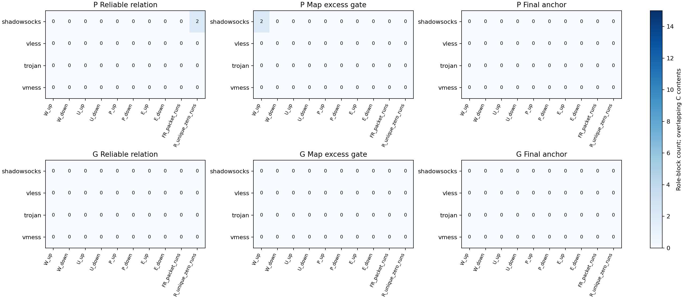
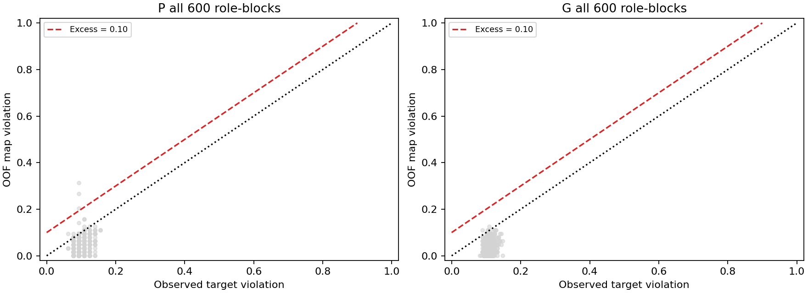
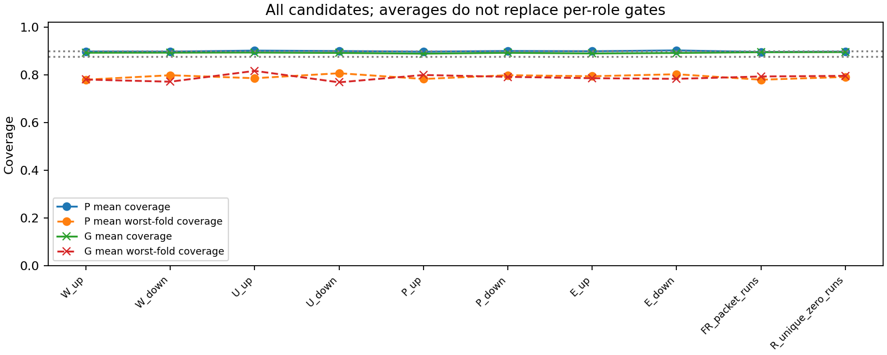
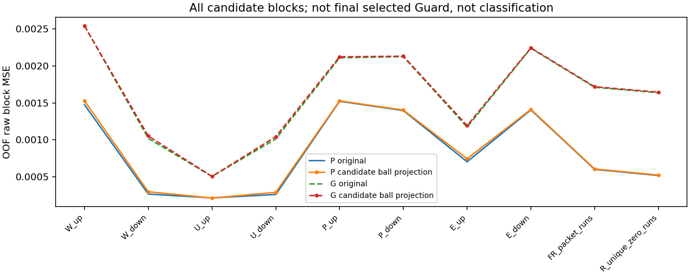

# 不变锚点与漂移越界第一阶段报告

2026年10月12日。存在通过关系资格的P角色块，但没有块最终同时通过映射越界和完整C复核。当前保护没有得到支持的作用对象，不启动分类、不放宽门限。

## 数据与执行范围

extend既有SS、VLESS、Trojan、VMess队列，480访问、30独立内容、23566排他共同有效TCP对；60个外层角色，每角色C为16内容64访问，四折各12内容48访问拟合、4内容16访问验证。O1继续暂停，AnyTLS、Hy2不进入本轮TCP诊断。

已完成480个OOF全96维仿射映射，没有新分类器拟合，没有业务F1重算。十个候选是原96维的十个完整归一化直方图块，未预先指定FR为锚点。原P-small、组控制、96维M-S及162维结果未覆盖。

## 规则与权限

距离为原始频率块L2除以sqrt(2)。训练epsilon为经验Q90，上限0.10；两侧内容中心距离Q90的最小值至少0.10，epsilon与该变化尺度之比不超过0.5。四折训练资格都通过，验证每折覆盖至少0.875、合并至少0.90。映射额外违约质量至少0.10，并且至少两折达到0.10，才进入完整C容差复核。

G独立使用内容内4乘4匿名Cartesian组合，不读取P的规则、访问身份或重复身份。这是保守集合约束，不等价于逐访问不变性；不能仅用锚点数量比较宣布身份价值。

缩放仅使用剔除验证内容后的240个源post与48个C训练post。eta沿用历史源内选出的JA2值，实际目标部署不参与原选择；但旧选择曾接触源部署上的相同内容，因此本诊断不是对全部历史研究流程完全独立的盲测。

完整C仅由可信装包器拆分，诊断工作器只能读取自己的拟合、预测或封存后评分包。全部480份C预测先封存，再解锁C验证post评分。该角色H查询、H标签、目标U数值和全量原生缓存没有进入本轮。跨角色各自训练范围不同，但规则不跨角色共享。应用级字段和API隔离不是操作系统沙箱。

## 分部署资格和停止门

| target      | arm   |   role_blocks |   relation_qualified |   map_gate |   final_anchors |
|:------------|:------|--------------:|---------------------:|-----------:|----------------:|
| shadowsocks | G     |           150 |                    0 |          0 |               0 |
| shadowsocks | P     |           150 |                    2 |          2 |               0 |
| trojan      | G     |           150 |                    0 |          0 |               0 |
| trojan      | P     |           150 |                    0 |          0 |               0 |
| vless       | G     |           150 |                    0 |          0 |               0 |
| vless       | P     |           150 |                    0 |          0 |               0 |
| vmess       | G     |           150 |                    0 |          0 |               0 |
| vmess       | P     |           150 |                    0 |          0 |               0 |

每个部署每种对应有15角色乘10块，即150个角色块。角色共享部分C内容，不是150个独立实验。

## 分块关系与变化

| arm   | feature            |   relation_qualified |   final_anchors |   mean_coverage |   mean_map_excess |
|:------|:-------------------|---------------------:|----------------:|----------------:|------------------:|
| G     | E_down             |                    0 |               0 |        0.891081 |         -0.086523 |
| G     | E_up               |                    0 |               0 |        0.888997 |         -0.045638 |
| G     | FR_packet_runs     |                    0 |               0 |        0.894271 |         -0.075260 |
| G     | P_down             |                    0 |               0 |        0.891797 |         -0.083724 |
| G     | P_up               |                    0 |               0 |        0.888281 |         -0.064323 |
| G     | R_unique_zero_runs |                    0 |               0 |        0.894661 |         -0.075130 |
| G     | U_down             |                    0 |               0 |        0.891211 |         -0.059570 |
| G     | U_up               |                    0 |               0 |        0.892839 |         -0.104557 |
| G     | W_down             |                    0 |               0 |        0.892383 |         -0.059440 |
| G     | W_up               |                    0 |               0 |        0.892057 |         -0.104557 |
| P     | E_down             |                    0 |               0 |        0.901823 |         -0.068490 |
| P     | E_up               |                    0 |               0 |        0.898438 |         -0.028646 |
| P     | FR_packet_runs     |                    0 |               0 |        0.895312 |         -0.048698 |
| P     | P_down             |                    0 |               0 |        0.899479 |         -0.071875 |
| P     | P_up               |                    0 |               0 |        0.896615 |         -0.054427 |
| P     | R_unique_zero_runs |                    2 |               0 |        0.896875 |         -0.047396 |
| P     | U_down             |                    0 |               0 |        0.899219 |         -0.048177 |
| P     | U_up               |                    0 |               0 |        0.901042 |         -0.080469 |
| P     | W_down             |                    0 |               0 |        0.896875 |         -0.049219 |
| P     | W_up               |                    0 |               0 |        0.897396 |         -0.058594 |

平均覆盖只能描述所有候选，不能替代逐角色最差折门。高相关、平均差小和归一化总和均未成为资格标准。

## 最终锚点

没有最终合格锚点。全部失败块及逐折原因见详细附录和anchor-qualification.parquet。

## 恢复与辅助视图

| arm   |   raw_MSE_before |   raw_MSE_after |   standardized_MSE_before |   standardized_MSE_after |
|:------|-----------------:|----------------:|--------------------------:|-------------------------:|
| G     |         0.001608 |        0.001620 |                  1.223761 |                 1.539063 |
| P     |         0.000836 |        0.000854 |                  0.802530 |                 1.255073 |

上表和下图是全部候选块的投影诊断；其投影在验证post解锁之前已计算，但不是最终选中集合的独立Guard风险评价。恢复误差不替代分类。筛选后数字条件于本C选择，不是新的独立验证。

| arm       |   role_views |   modified_exposures |   mean_correction |   max_correction |
|:----------|-------------:|---------------------:|------------------:|-----------------:|
| G-Guard   |           60 |                    0 |          0.000000 |         0.000000 |
| P-Guard   |           60 |                    0 |          0.000000 |         0.000000 |
| P-Uniform |           60 |                    0 |          0.000000 |         0.000000 |

源视图每角色288行，汇总的是重复训练暴露，不是新增独立访问。完整C上的冻结原映射仅作描述性核对，不参与OOF停止门。负坐标和块和偏离照实保存，未投影单纯形；输出仍是统计适配视图，不是合法协议会话。

## 数值与工程验收

GPU为NVIDIA GeForce RTX 4060 Ti，Pytorch312、torch 2.5.1、CUDA 12.4。映射、保护及推理均CUDA float64，无CPU回退。1028项合成与权限检查通过；历史频率及映射视图重放最大误差为0。

480个映射全部接受；最大原坐标梯度为3.41e-13，最大目标重放误差4.48e-13，最大梯度重放误差6.77e-13，最大线性方程归一化残差4.38e-14。接受门分别保持1e-8、1e-10、1e-10、1e-10。

## 阶段决定与结论边界

当前状态为`stop_no_supported_protection_target`。分类阶段没有授权或启动。存在通过关系资格的P角色块，但没有块最终同时通过映射越界和完整C复核。当前保护没有得到支持的作用对象，不启动分类、不放宽门限。

若有合格保护目标，后续仍需用户确认三新臂、最多180个LR拟合。若没有，则本候选按登记规则停止；不指定FR补位、不加阈值、不将候选恢复改善写成业务收益。

本结果不证明所有代理流量都缺少不变关系，也不证明漂移映射没有其他错误。四类C的关系不自动推广到两类U或跨部署源pre。完整物理post连接、独立窗口、无索引在线输入资格仍未通过；当前pre不是DIRECT反事实。小样本经验覆盖不是真实总体覆盖保证，固定既有队列不是外部验证。
