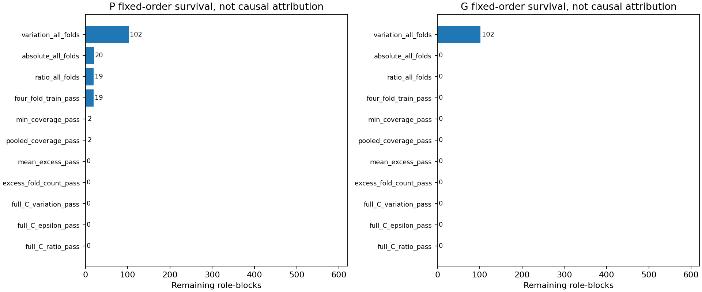
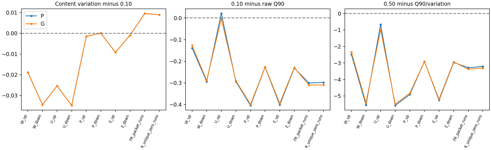
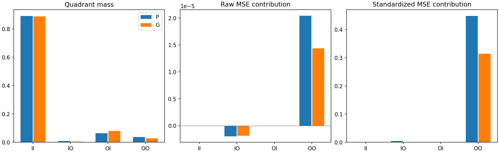
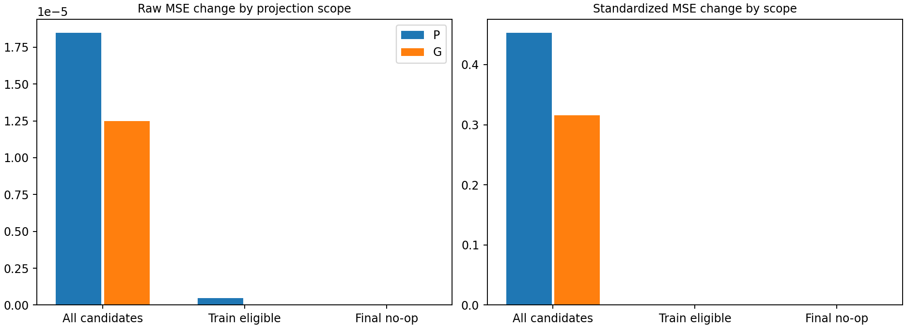

# 锚点资格失败路径与投影误差分层报告

2026年10月12日。独立算式重放通过，原资格、距离、权重、Q90和投影口径没有发现需要修订的实质不一致。保持`stop_no_supported_protection_target`，零新映射拟合、零新分类拟合，不启动180个分类器。

## 诊断范围和原结果保留

使用父运行既有480份C预测、四折评分和完整C规则；1200个角色块、4800个折块、19200行显式四格以及192000个观测块。P包含实际C配对，G包含内容内匿名Cartesian组合，不能把组合或角色重复暴露当独立新访问。没有读取H、目标U或PCAP，没有更改阈值、锚点或原验收。

## 资格失败路径

| arm   | gate           |   candidates |   passed |   failed |
|:------|:---------------|-------------:|---------:|---------:|
| G     | coverage_pass  |         2400 |     1606 |      794 |
| G     | epsilon_pass   |         2400 |      114 |     2286 |
| G     | excess_pass    |         2400 |        0 |     2400 |
| G     | ratio_pass     |         2400 |        0 |     2400 |
| G     | variation_pass |         2400 |      808 |     1592 |
| P     | coverage_pass  |         2400 |     1831 |      569 |
| P     | epsilon_pass   |         2400 |      321 |     2079 |
| P     | excess_pass    |         2400 |       14 |     2386 |
| P     | ratio_pass     |         2400 |      151 |     2249 |
| P     | variation_pass |         2400 |      808 |     1592 |

各门边际失败可以重叠。固定顺序漏斗只描述展示次序，不提供哪一个门造成方法失败的因果归因。门值余量说明离登记界限的距离，不能自行证明阈值过强或支持放宽。

逐折完整表保存Q90、两侧内容中心变化、比例、通过标志及各门余量；逐角色表展开四折覆盖、平均越界、越界折数和完整C三项资格。分位数上限没有截断：实际Q90先保存，再执行0.10资格检查。

## 四个SS候选的停止原因

| role_id                      | arm   | feature            |   epsilon |   variation |   epsilon_variation_ratio |   OOF_coverage |   OOF_excess | relation_qualified   | map_violation_gate   | full_C_replayed_train_eligible   | rejection_reasons                                                 |
|:-----------------------------|:------|:-------------------|----------:|------------:|--------------------------:|---------------:|-------------:|:---------------------|:---------------------|:---------------------------------|:------------------------------------------------------------------|
| main/f0/shadowsocks/G1/outer | P     | R_unique_zero_runs |  0.020408 |    0.120231 |                  0.169742 |       0.906250 |    -0.093750 | True                 | False                | True                             | map_excess                                                        |
| main/f1/shadowsocks/G2/outer | P     | R_unique_zero_runs |  0.016393 |    0.133382 |                  0.122906 |       0.906250 |    -0.078125 | True                 | False                | True                             | map_excess                                                        |
| main/f2/shadowsocks/G0/outer | P     | W_up               |  0.045455 |    0.092838 |                  0.489614 |       0.906250 |     0.109375 | False                | True                 | False                            | fold_training_qualification;full_C_qualification                  |
| main/f3/shadowsocks/G0/outer | P     | W_up               |  0.044444 |    0.091155 |                  0.487570 |       0.906250 |     0.218750 | False                | True                 | False                            | fold_training_qualification;heldout_coverage;full_C_qualification |

两个R_unique_zero_runs通过四折关系资格和完整C复核，但原映射额外违约分别为-0.093750与-0.078125，达到0.10的折数都是零。它们失败于map_excess，不是完整C资格，也不是原包级FR锚点。

两个W_up存在映射额外违约，却未满足完整块的非平凡关系资格；一个还未满足最差折覆盖。稳定关系与映射破坏分别出现在不同块，不能合成一项保护证据。

## 四格质量与投影风险

| arm   | quadrant   |       mass |   raw_conditional_delta |   raw_contribution |   std_conditional_delta |   std_contribution |   raw_worsened_mass |   std_worsened_mass |
|:------|:-----------|-----------:|------------------------:|-------------------:|------------------------:|-------------------:|--------------------:|--------------------:|
| G     | II         | 0.88754557 |              0.00000000 |         0.00000000 |              0.00000000 |         0.00000000 |          0.00000000 |          0.00000000 |
| G     | IO         | 0.00421224 |             -0.00044078 |        -0.00000186 |              0.32804792 |         0.00138182 |          0.00000000 |          0.00212240 |
| G     | OI         | 0.08008464 |              0.00000000 |         0.00000000 |              0.00000000 |         0.00000000 |          0.00000000 |          0.00000000 |
| G     | OO         | 0.02815755 |              0.00050954 |         0.00001435 |             11.14870567 |         0.31392026 |          0.02470703 |          0.02474609 |
| P     | II         | 0.89010417 |              0.00000000 |         0.00000000 |              0.00000000 |         0.00000000 |          0.00000000 |          0.00000000 |
| P     | IO         | 0.00820313 |             -0.00023975 |        -0.00000197 |              0.51821230 |         0.00425096 |          0.00000000 |          0.00307292 |
| P     | OI         | 0.06380208 |              0.00000000 |         0.00000000 |              0.00000000 |         0.00000000 |          0.00000000 |          0.00000000 |
| P     | OO         | 0.03789062 |              0.00053916 |         0.00002043 |             11.83120704 |         0.44829183 |          0.03296875 |          0.03197917 |

II为真实界内且映射界内；IO为真实界内且映射界外；OI为真实界外且映射界内；OO为两者都界外。条件误差是该格内部均值，贡献是按其质量乘回总体的误差变化。空格质量零而条件均值缺失，没有用零均值参与汇总。

P的IO质量为0.008203，原始误差总体贡献为-0.00000197；OO质量为0.037891，原始误差总体贡献为0.00002043。这些是候选几何诊断，不是业务结果。完整贡献见分部署、分块与资格分层表。

真实严格在原始频率欧氏球内时，投影的原始误差非增条件通过；标准化坐标可能因不同scale改变几何而出现另一种误差方向。真实界外的投影没有非增保证。epsilon加1e-12的评分边界与精确投影半径分开审计。

## 投影范围与坐标放大

| arm   | scope                      |   mean_raw_delta |   mean_std_delta |   accepted_anchor_count | classification_evaluated   |
|:------|:---------------------------|-----------------:|-----------------:|------------------------:|:---------------------------|
| G     | all_candidate_blocks       |       0.00001249 |       0.31530208 |                       0 | False                      |
| G     | training_eligible_blocks   |       0.00000000 |       0.00000000 |                       0 | False                      |
| G     | final_selected_blocks_noop |       0.00000000 |       0.00000000 |                       0 | False                      |
| P     | all_candidate_blocks       |       0.00001846 |       0.45254279 |                       0 | False                      |
| P     | training_eligible_blocks   |       0.00000049 |       0.00001980 |                       0 | False                      |
| P     | final_selected_blocks_noop |       0.00000000 |       0.00000000 |                       0 | False                      |

all_candidate_blocks是对十个候选计算的假设性投影；training_eligible_blocks仅修改训练折合格块；final_selected_blocks_noop对应实际空集合。第一类候选投影的改善或恶化不能写成最终Guard效果，更不能代替F1。

坐标贡献表将正向恶化与负向改善分别保存，包含scale、真实常数维标志、IO与OO正贡献。top5排序仅用于解释，不删除坐标、不重新赋权。原始MSE与标准化MSE的差异不是自动的尺度转换错误。

## 独立核对

145446项数值和标志核对通过。最大四格误差闭合与重放误差详见numerical-replay-audit.json。未调用父rules、project或score函数，未导入父runner，没有任何fit入口。固定源/C成员、匿名权限、常数维scale=1和源内容剔除均重放核对。

P训练Q90取48值中的第44项，完整C取64值中的第58项；G分别取192值第173项及256值第231项。两侧内容中心两两距离分别为66或120个，Q90位置为60或108。拟合折与完整C采用相同距离与质量定义，只是样本数不同。表格始终使用原冻结epsilon，没有采用重放出的新规则。

## 结项决定

计算一致，保留原停止，无需数值修复或重新拟合。当前结果只关闭完整直方图块近似恒等保护这一具体候选；不否定粗关系、其他表示或条件不变关系，也不支持它们一定有效。P-small已有正结果不撤回，O1仍暂停，独立物理post与在线窗口资格未获得新证据。

所有表格同时提供Parquet和静态CSV，CSV没有可调阈值或Excel重计算模型。来源与输出哈希见独立结项验收。表索引和两个候选的四折详细轨迹见附录。
