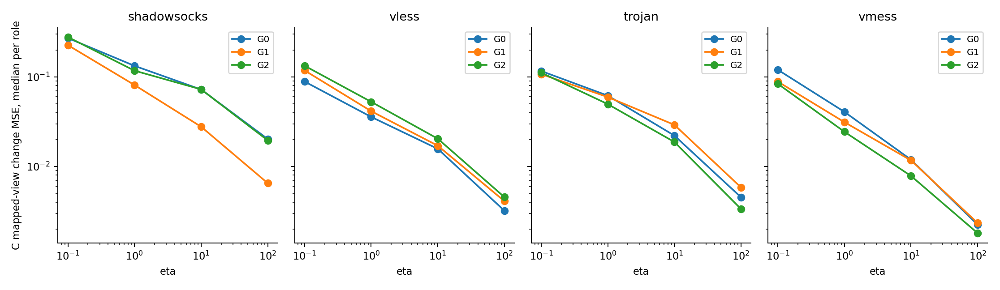
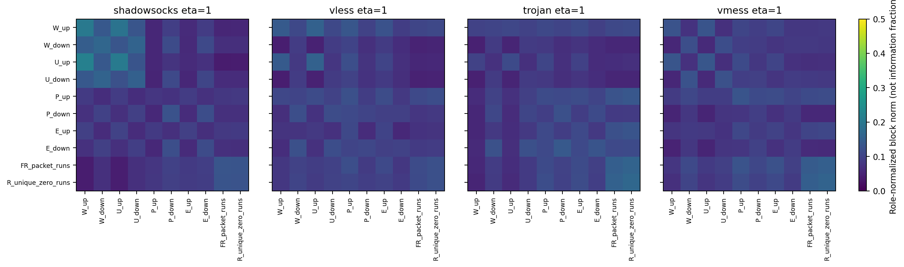
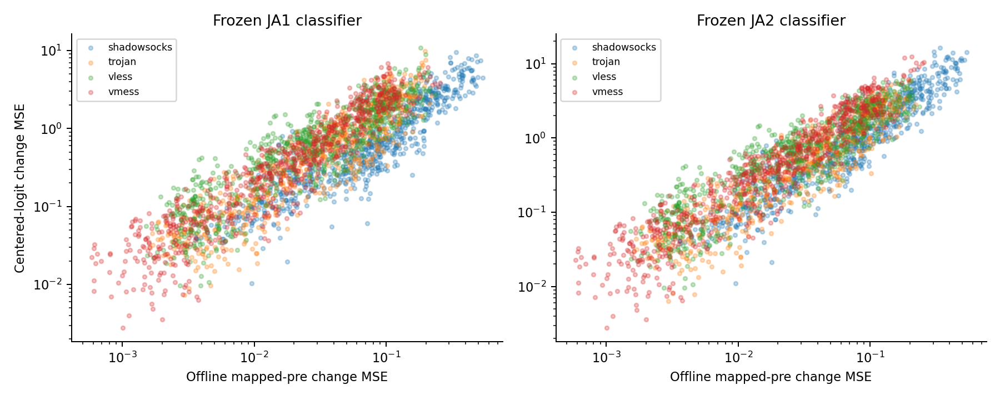
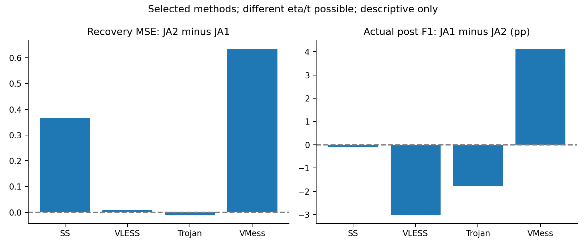

# 精确访问身份增量分解与研究结项报告

2026年10月9日。保持原JA科学设计和全部模型不变，本轮完成追加工程结项、同正则分解、冻结决策投影和跨实验证据整理。新增分类器及映射拟合均为0。

## 工程结项与数学核验

原CT5读取错误已在独立后处理入口兼容：420项历史和180项新模型CUDA float64重放误差为0，评分及10000次bootstrap与旧独立报告完全一致。原failure保留，修订completion仅存在于追加结项目录。全部模型、映射、槽位和历史工作包重新核对哈希，复用已绑定实现的全量数值验收。

2880对内层与49对外层同正则映射均通过核验；归一化最大误差4.511e-13，原门为1e-10。60个外层中另有11个选择不同eta，不能直接按访问内项归因。

$$C_{BA}=C_{\mathrm{between}}+C_{\mathrm{within}},\quad M_1-M_2=C_{\mathrm{within}}(S_{AA}+\alpha I)^{-1},\quad b_1-b_2=-(M_1-M_2)\mu_A.$$

JA2保留同内容中心之间的关系和全部入口协方差；JA1额外使用同内容内、同次访问两侧波动的交叉项。该恒等式已在当前保存模型上数值验证，不再只是代数猜测。它不证明访问残差是纯噪声，也不等于互信息估计。

## 访问内关系的幅度与正则作用

以下对每角色先计算，再按校准部署与eta报告内层角色中位数；不是2880个独立实验。尺度来自各角色post训练标准化，不能混合原坐标矩阵作物理或因果解释。

| calibration | eta | within_norm | between_norm | delta_matrix_norm | C_effect_MSE | delta_stable_rank |
| --- | --- | --- | --- | --- | --- | --- |
| shadowsocks | 0.100000 | 90.218703 | 46.867308 | 1.901271 | 0.255419 | 4.583619 |
| shadowsocks | 1.000000 | 90.218703 | 46.867308 | 0.590186 | 0.112517 | 2.631751 |
| shadowsocks | 10.000000 | 90.218703 | 46.867308 | 0.117369 | 0.051911 | 2.084842 |
| shadowsocks | 100.000000 | 90.218703 | 46.867308 | 0.031352 | 0.012562 | 1.123517 |
| trojan | 0.100000 | 47.698740 | 45.989514 | 1.523244 | 0.112353 | 3.018355 |
| trojan | 1.000000 | 47.698740 | 45.989514 | 0.434796 | 0.058598 | 1.949304 |
| trojan | 10.000000 | 47.698740 | 45.989514 | 0.082322 | 0.021990 | 1.510704 |
| trojan | 100.000000 | 47.698740 | 45.989514 | 0.019199 | 0.004539 | 1.181180 |
| vless | 0.100000 | 53.423549 | 48.735390 | 1.467467 | 0.116017 | 3.056462 |
| vless | 1.000000 | 53.423549 | 48.735390 | 0.397590 | 0.043683 | 2.255283 |
| vless | 10.000000 | 53.423549 | 48.735390 | 0.069428 | 0.017291 | 1.808975 |
| vless | 100.000000 | 53.423549 | 48.735390 | 0.017069 | 0.003948 | 1.231651 |
| vmess | 0.100000 | 36.520194 | 47.642912 | 1.510689 | 0.087830 | 3.332819 |
| vmess | 1.000000 | 36.520194 | 47.642912 | 0.384331 | 0.031094 | 2.436884 |
| vmess | 10.000000 | 36.520194 | 47.642912 | 0.066280 | 0.010798 | 2.354873 |
| vmess | 100.000000 | 36.520194 | 47.642912 | 0.013515 | 0.002111 | 1.363120 |

四eta全部保留；更大eta对同一角色的差算子施加更强收缩，但不把小eta或大within范数自动判为最佳。内容间和访问内矩阵通常非正定，范数平方含交叉项，不能用范数比例计算“对应信息占比”。

在固定eta=1面板中，SS的校准视图变化MSE中位数为0.112517，VLESS为0.043683，Trojan为0.058598，VMess为0.031094。这说明精确身份不是在映射中被完全忽略。其差矩阵稳定秩中位数约在1.12至4.58之间；稳定秩仅描述奇异值能量集中程度，不是协议状态数或信息论维度。

固定eta=1下十个最大平均块作用项如下；全100块、所有eta保留在原表，不据此挑选下一轮特征。块作用能量存在跨输入块交叉项，不能将这十项简单相加成总贡献。

| output_block | input_block | C_effect_energy |
| --- | --- | --- |
| FR_packet_runs | P_up | 0.115616 |
| R_unique_zero_runs | P_up | 0.106763 |
| W_down | P_up | 0.104859 |
| P_down | P_up | 0.096222 |
| E_down | P_up | 0.095974 |
| U_down | P_up | 0.095788 |
| FR_packet_runs | E_up | 0.088291 |
| R_unique_zero_runs | E_up | 0.084350 |
| W_down | E_up | 0.078081 |
| E_down | E_up | 0.072455 |

## 冻结决策投影

固定内层t=0，分别使用JA1与JA2已保存的分类器，各自冻结。下表是映射视图变化，不是新攻击F1；概率变化与类别翻转只说明同一冻结读出对两个映射的敏感性。外层使用49个共同eta角色的各自最终分类器，t差单独登记。

| classifier_arm | scope | eta | mapping_effect_MSE | relative_logit_effect_MSE | probability_L1_mean | mapped_view_class_change_mass |
| --- | --- | --- | --- | --- | --- | --- |
| JA1 | C | 0.100000 | 0.118791 | 2.199798 | 0.100652 | 0.041667 |
| JA1 | C | 1.000000 | 0.052364 | 0.783161 | 0.071079 | 0.020833 |
| JA1 | C | 10.000000 | 0.020896 | 0.298851 | 0.045802 | 0.020833 |
| JA1 | C | 100.000000 | 0.004230 | 0.062361 | 0.021458 | 0.000000 |
| JA1 | heldout-pre-offline | 0.100000 | 0.113487 | 2.373952 | 0.219814 | 0.125000 |
| JA1 | heldout-pre-offline | 1.000000 | 0.048939 | 0.713911 | 0.101286 | 0.041667 |
| JA1 | heldout-pre-offline | 10.000000 | 0.020958 | 0.300016 | 0.060763 | 0.041667 |
| JA1 | heldout-pre-offline | 100.000000 | 0.004097 | 0.063584 | 0.026378 | 0.000000 |
| JA1 | source-pre | 0.100000 | 0.136201 | 2.851223 | 0.181516 | 0.062500 |
| JA1 | source-pre | 1.000000 | 0.055762 | 0.770951 | 0.062736 | 0.013889 |
| JA1 | source-pre | 10.000000 | 0.024065 | 0.309608 | 0.026790 | 0.000000 |
| JA1 | source-pre | 100.000000 | 0.004715 | 0.066335 | 0.010873 | 0.000000 |
| JA2 | C | 0.100000 | 0.118791 | 2.598908 | 0.108699 | 0.041667 |
| JA2 | C | 1.000000 | 0.052364 | 0.927992 | 0.079959 | 0.041667 |
| JA2 | C | 10.000000 | 0.020896 | 0.311082 | 0.046100 | 0.020833 |
| JA2 | C | 100.000000 | 0.004230 | 0.062912 | 0.021839 | 0.000000 |
| JA2 | heldout-pre-offline | 0.100000 | 0.113487 | 2.708025 | 0.224415 | 0.125000 |
| JA2 | heldout-pre-offline | 1.000000 | 0.048939 | 0.871409 | 0.112387 | 0.041667 |
| JA2 | heldout-pre-offline | 10.000000 | 0.020958 | 0.330252 | 0.060650 | 0.041667 |
| JA2 | heldout-pre-offline | 100.000000 | 0.004097 | 0.063994 | 0.026221 | 0.000000 |
| JA2 | source-pre | 0.100000 | 0.136201 | 3.329063 | 0.163743 | 0.062500 |
| JA2 | source-pre | 1.000000 | 0.055762 | 0.933800 | 0.066223 | 0.020833 |
| JA2 | source-pre | 10.000000 | 0.024065 | 0.352950 | 0.029808 | 0.000000 |
| JA2 | source-pre | 100.000000 | 0.004715 | 0.067412 | 0.011039 | 0.000000 |

$$\Delta s(x)=P_6W(M_1-M_2)(x-\mu_A).$$

较大投影不是正确分类收益；较小投影也不是所有业务信息不存在。源库pre可用于训练视图诊断，留出pre仅用于封存后的离线诊断。源post分数方差及逐真类相对分数完整保存在表中，不把这些离线伪预测当作真实post测试。

## 与原分类证据的关系

JA1实际测试接口输入真实post，没有在测试时应用pre到post映射。两方法最终分类器由不同辅助视图训练而来；本轮未反事实重训。因此，冻结投影和实际post错误翻转的并列是机制定位线索，不能证明某个within坐标导致了F1变化。

既有CT4相对CT1及CT3的正向区间成立，低于StrongPost的负向区间同样成立。JA1优于CT1，但未建立相对JA2、JA0或StrongPost的完整优势。恢复MSE改善、映射改变和业务增益必须分开。

## 冻结读出的具体解释

弱正则eta=0.1下，JA1冻结分类器对两种映射留出pre视图的类别翻转比例中位数为12.50%，相对logit变化MSE中位数为2.373952，概率L1变化均值的角色中位数为0.219814。JA2冻结分类器的类别翻转比例中位数同为12.50%。eta=1下，JA1冻结分类器相应翻转比例为4.17%，相对logit变化MSE为0.713911。

这些角色内值说明精确身份增量不仅改变恢复坐标，也可以作用到当前冻结模型的相对决策分数。因此，不能把本轮负结果一概归为“没有使用对应”或“差全部位于分类器看不见的方向”。但翻转可以修正或引入错误，而且这里输入的是离线映射pre视图；实际攻击输入为真实post。两者不能混用。

在同eta、t=0的已有内层真实post预测中，eta=0.1时JA1减JA2的角色平均未覆盖F1差，在SS、VLESS、VMess为负，在Trojan为正；其他eta也有方向不同。这些仅是固定候选描述，不是新外层主检验，也不据此选择eta。最终JA1与JA2的原家族区间跨零，不能宣布等效或认为“只需放松正则就能赢”。

## 同候选与最终选择的区别

| partition | calibration | eta | F1_U_delta | repair | added_error | prediction_changed |
| --- | --- | --- | --- | --- | --- | --- |
| outer-common-eta-selected | shadowsocks | 0.100000 | -0.045040 | 0.750000 | 0.750000 | 2.250000 |
| outer-common-eta-selected | shadowsocks | 1.000000 | 0.099405 | 1.000000 | 0.500000 | 2.500000 |
| outer-common-eta-selected | shadowsocks | 10.000000 | -0.047619 | 0.000000 | 0.500000 | 0.500000 |
| outer-common-eta-selected | shadowsocks | 100.000000 | 0.000000 | 0.000000 | 0.000000 | 0.000000 |
| outer-common-eta-selected | trojan | 0.100000 | -0.013278 | 0.461538 | 0.538462 | 1.461538 |
| outer-common-eta-selected | vless | 0.100000 | -0.035348 | 0.692308 | 0.538462 | 1.461538 |
| outer-common-eta-selected | vmess | 0.100000 | 0.038528 | 0.454545 | 0.272727 | 0.909091 |
| outer-common-eta-selected | vmess | 10.000000 | -0.053571 | 0.000000 | 0.000000 | 1.000000 |
| source-inner-fixed-t0 | shadowsocks | 0.100000 | -0.026966 | 1.122222 | 1.066667 | 2.683333 |
| source-inner-fixed-t0 | shadowsocks | 1.000000 | 0.000759 | 0.572222 | 0.383333 | 1.383333 |
| source-inner-fixed-t0 | shadowsocks | 10.000000 | 0.005112 | 0.188889 | 0.133333 | 0.466667 |
| source-inner-fixed-t0 | shadowsocks | 100.000000 | -0.002659 | 0.005556 | 0.038889 | 0.050000 |
| source-inner-fixed-t0 | trojan | 0.100000 | 0.008464 | 0.805556 | 0.605556 | 1.872222 |
| source-inner-fixed-t0 | trojan | 1.000000 | -0.005512 | 0.233333 | 0.327778 | 0.755556 |
| source-inner-fixed-t0 | trojan | 10.000000 | -0.002253 | 0.083333 | 0.072222 | 0.211111 |
| source-inner-fixed-t0 | trojan | 100.000000 | -0.001640 | 0.027778 | 0.011111 | 0.044444 |
| source-inner-fixed-t0 | vless | 0.100000 | -0.023308 | 0.600000 | 0.705556 | 1.688889 |
| source-inner-fixed-t0 | vless | 1.000000 | -0.000744 | 0.288889 | 0.261111 | 0.777778 |
| source-inner-fixed-t0 | vless | 10.000000 | -0.000426 | 0.055556 | 0.033333 | 0.161111 |
| source-inner-fixed-t0 | vless | 100.000000 | -0.001157 | 0.000000 | 0.016667 | 0.022222 |
| source-inner-fixed-t0 | vmess | 0.100000 | -0.012224 | 0.450000 | 0.577778 | 1.405556 |
| source-inner-fixed-t0 | vmess | 1.000000 | 0.002233 | 0.233333 | 0.188889 | 0.611111 |
| source-inner-fixed-t0 | vmess | 10.000000 | 0.001184 | 0.044444 | 0.022222 | 0.094444 |
| source-inner-fixed-t0 | vmess | 100.000000 | 0.000397 | 0.005556 | 0.000000 | 0.005556 |

这些是每24访问小角色的描述性均值，不替代合并五折OOF的原主指标。F1差取未覆盖两类，错误修复、新增及翻转计数则覆盖全部24访问、六类。内层使用同eta、同t=0；外层49角色eta相同但t可能不同，内外层分区单列。不要从该表选择下一轮eta或宣称新的显著性。完整60角色覆盖见附录；11个不匹配角色没有被悄悄从原JA结论中删除。

## 当前研究判断

精确关系确实增加了访问内跨侧协方差，而组关系并非没有跨侧知识。当前仿射解能把这一差精确定位；现有分类证据却不支持将“这项统计关系存在”直接推成“当前模型超过强post参照”。这支持冻结当前利用方式，不支持宣布代理关联无信息或普遍无益。

下一步不新增损失、网络或正则搜索。是否重开方法，需要一个过去摘要未表达、真实对应可标定且post端能利用的新信息对象，并同时升级公平强post输入。

## 产物与复现

代码位于`eval/paired_identity_closeout/`；解释证据位于`outputs/paired-identity-decomposition-20261009/run-01/`；追加结项位于`outputs/joint-affine-transfer-20261007/run-01/closeout-20261009/`。报告区间全部继承原实验，没有新主检验。详见[逐项附录](detailed-appendix.md)、[跨实验主张证据边界](evidence-synthesis.md)和[重开条件](information-object-reopening-checklist.md)。
