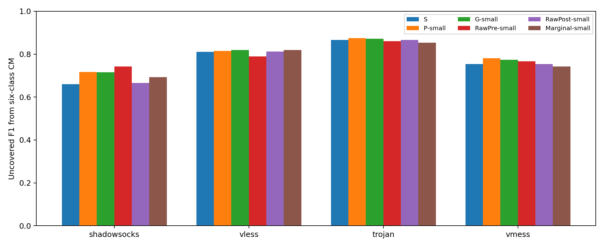
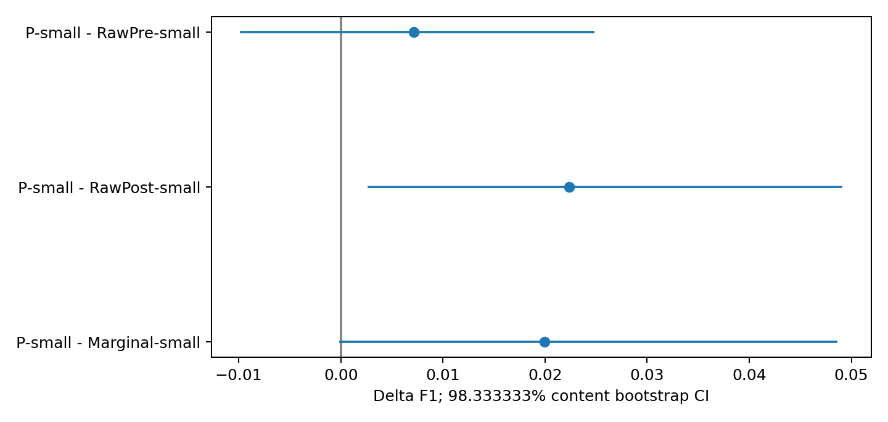
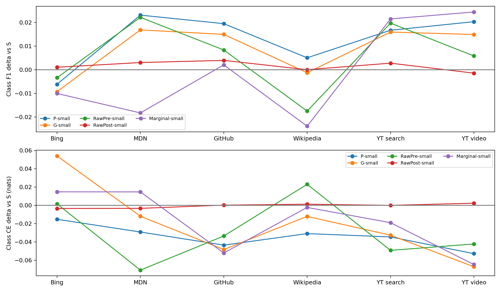
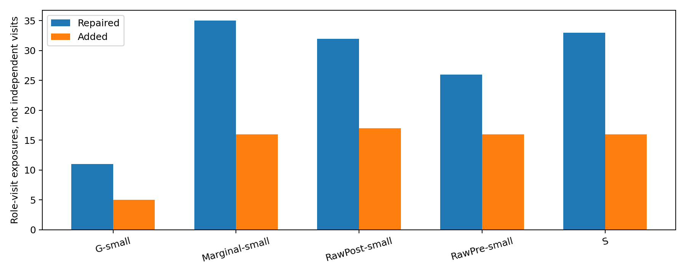
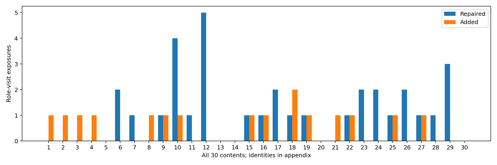

# 小比例辅助视图收益归因完整报告

2026年10月10日。冻结P-small、StrongPost和G-small，补齐RawPre-small、RawPost-small及Marginal-small三个同样小比例的对照，共完成180个新分类器和60个匿名边际矩变换。P-small相对RawPost-small建立正向未覆盖业务F1增量。

本轮解释原P-small相对StrongPost的约2.42个百分点收益，不改变P-small或重新搜索比例。新对照能排除哪些解释，应逐项依据下表；不能把某一个参照失败解释为精确访问身份必要。

## 数据和输入

extend的SS、VLESS、Trojan、VMess四部署，480访问、30内容、六业务、每内容每部署四重复，23566对排他TCP连接。五个全局内容折对全部部署、重复、两侧及flow整体划分；四目标乘五折乘三个业务遮蔽，共60外层角色。每角色使用三源288训练访问、目标四类C的64访问，目标两类U的32训练访问两侧均禁用，留出H为24访问。

六类依次为Bing搜索、MDN文档、GitHub仓库、Wikipedia文章、YouTube搜索、YouTube视频。当前VLESS是TCP+TLS，不是历史REALITY/Vision。AnyTLS、Hy2未进入本轮。

模型输入固定96维连接边际直方图，由W上下行、U上下行、P上下行、E上下行、FR_packet_runs和R_unique_zero_runs组成。分箱、连接纳入和访问汇聚沿用冻结口径。IP/端口/SNI/URL文本、协议ID、连接数、时间序列和配对索引均不进入分类器。

预处理只来自源真实post288行加目标C-post64行，常数维scale为1。pre也使用这套post坐标，不重新缩放、剪裁或投影。源pre/post独立排序，各自标签和质量随自身行移动。

## 六臂设计与训练资源

| 臂 | 原辅助槽组成 | 新拟合 |
| --- | --- | --- |
| S | 100% CORAL | 0，复用60 |
| P-small | 90% CORAL+10%真配全仿射pre | 0，复用60 |
| G-small | 90% CORAL+10%内容组全仿射pre | 0，复用60 |
| RawPre-small | 90% CORAL+10%原始源pre | 60 |
| RawPost-small | 90% CORAL+10%原始源post | 60 |
| Marginal-small | 90% CORAL+10%匿名边际矩适配pre | 60 |

所有新臂的目标为J_S+0.1(A_X-A_CORAL)。源post主槽1/3、CORAL0.3、新视图1/30、目标C-post1/3，六类各1/6。10%是辅助槽比例，只占总CE质量约3.33%，不是新增加10%独立样本，也不是把两个向量平均。

RawPost-small增加同一源post的损失暴露，源post直接暴露由1/3增至11/30。因此其用途是检查减CORAL/加原post解释，不能声称所有臂post暴露相同。small统一保存928个加权计算行，独立访问并未增加。

Marginal只使用目标C两侧各64行的匿名数值与等权质量，不读取内容token、visit、repetition、配对索引或业务标签。两侧独立置乱，在冻结坐标使用样本协方差、固定+I白化着色：T(z)=(z-m_pre)(Σ_pre+I)^(-1/2)(Σ_post+I)^(1/2)+m_post。没有跨侧交叉协方差，保留两侧各自的96维跨维协方差。正则化协方差的对齐不等于原始协方差精确对齐。它是双侧适配而非post-only；与P的估计器也不同，不能单独提供身份必要性的因果证据。

## 模型和数值配置

96→6逻辑回归，582参数；weight L2为0.0005(1+t)，bias不惩罚。t完全复用StrongPost；P/G与其原JA2 eta和视图冻结，Marginal无eta选择。零初始化、可逆Cholesky预条件化、原坐标梯度感知LBFGS，max_iter=2000、max_eval=10000，原梯度最大值≤1e-5、目标和梯度重放误差<1e-10。

训练、矩变换与模型推理在NVIDIA GeForce RTX 4060 Ti、CUDA 12.4、float64上执行，CPU仅用于文件处理、bootstrap和绘图。12固定角色的36先导拟合已计入180；先导只核验数值、未读目标标签或查询。拟合耗时中位数0.432秒，总计104.015秒，不含其他阶段。

全部360个方法角色模型先封存，之后生成并封存8640行post预测；真实独立访问仍是480。目标U训练两侧和测试pre未读取。原S/P/G概率与指标复现，旧full负结果及失败影响函数先导保持原样。

## 主要结果

每部署×遮蔽先合并五折，构造完整六类混淆矩阵，再取未覆盖两类F1，四部署与三遮蔽等权。不是在真实U行上做二分类。

| arm | F1_all | F1_uncovered | F1_aux | accuracy | CE_nats | CE_bits | Brier | worst_target_uncovered |
| --- | --- | --- | --- | --- | --- | --- | --- | --- |
| S | 0.804617 | 0.772708 | 0.820571 | 0.807639 | 0.675111 | 0.973979 | 0.299617 | 0.660738 |
| P-small | 0.817674 | 0.796931 | 0.828046 | 0.819444 | 0.640659 | 0.924276 | 0.284811 | 0.716522 |
| G-small | 0.813273 | 0.794927 | 0.822447 | 0.815278 | 0.655339 | 0.945454 | 0.285762 | 0.715677 |
| RawPre-small | 0.810455 | 0.789813 | 0.820777 | 0.812500 | 0.646482 | 0.932677 | 0.288584 | 0.741870 |
| RawPost-small | 0.806160 | 0.774597 | 0.821941 | 0.809028 | 0.674521 | 0.973128 | 0.299459 | 0.666244 |
| Marginal-small | 0.803893 | 0.777001 | 0.817338 | 0.806250 | 0.656923 | 0.947739 | 0.293263 | 0.692801 |

## 三项预定比较

30内容按六业务分层，10000次bootstrap、种子20261010；同一抽样质量共享于部署、重复、遮蔽和方法。新三项家族使用98.333333%区间，95%只辅助保存。

| candidate | reference | delta_F1_U | CI98.333333_low | CI98.333333_high | positive_increment |
| --- | --- | --- | --- | --- | --- |
| P-small | RawPre-small | 0.007119 | -0.009752 | 0.024696 | False |
| P-small | RawPost-small | 0.022334 | 0.002758 | 0.049019 | True |
| P-small | Marginal-small | 0.019931 | -0.000043 | 0.048518 | False |

旧四项家族区间不改写。本轮不重复检验旧P-small−G-small以期待转正：其原点差为0.002005，98.75%区间为[-0.009232797901167501, 0.012691711090137859]。即使新三项全通过，该旧比较仍未建立精确访问配对的额外业务用途。区间跨零不是等效。

区间条件于固定模型，不包含重训练变异，也不是跨日期、外部节点或研究者未知数据验证。此前多轮分析带来的回顾性选择边界仍存在；旧四项加新三项不能称一个统一七项家族。

## 部署与业务分项

| arm | target | F1_all | F1_uncovered | F1_aux | accuracy | CE_nats | CE_bits | Brier |
| --- | --- | --- | --- | --- | --- | --- | --- | --- |
| G-small | shadowsocks | 0.763549 | 0.715677 | 0.787485 | 0.766667 | 0.835520 | 1.205401 | 0.346013 |
| G-small | trojan | 0.866196 | 0.871745 | 0.863421 | 0.866667 | 0.396102 | 0.571454 | 0.216032 |
| G-small | vless | 0.817573 | 0.818731 | 0.816994 | 0.816667 | 0.621870 | 0.897169 | 0.287904 |
| G-small | vmess | 0.805776 | 0.773553 | 0.821887 | 0.811111 | 0.767863 | 1.107793 | 0.293098 |
| Marginal-small | shadowsocks | 0.754233 | 0.692801 | 0.784949 | 0.758333 | 0.780858 | 1.126540 | 0.351405 |
| Marginal-small | trojan | 0.857849 | 0.853201 | 0.860173 | 0.858333 | 0.418753 | 0.604132 | 0.220199 |
| Marginal-small | vless | 0.822929 | 0.819365 | 0.824711 | 0.822222 | 0.649194 | 0.936589 | 0.293479 |
| Marginal-small | vmess | 0.780559 | 0.742636 | 0.799521 | 0.786111 | 0.778887 | 1.123696 | 0.307971 |
| P-small | shadowsocks | 0.765109 | 0.716522 | 0.789403 | 0.769444 | 0.788722 | 1.137885 | 0.342862 |
| P-small | trojan | 0.877317 | 0.875343 | 0.878304 | 0.877778 | 0.394921 | 0.569750 | 0.214494 |
| P-small | vless | 0.815818 | 0.814506 | 0.816473 | 0.813889 | 0.626141 | 0.903330 | 0.286122 |
| P-small | vmess | 0.812454 | 0.781354 | 0.828004 | 0.816667 | 0.752855 | 1.086140 | 0.295766 |
| RawPost-small | shadowsocks | 0.752216 | 0.666244 | 0.795202 | 0.758333 | 0.871698 | 1.257595 | 0.380380 |
| RawPost-small | trojan | 0.868673 | 0.865599 | 0.870210 | 0.869444 | 0.396172 | 0.571556 | 0.215287 |
| RawPost-small | vless | 0.809482 | 0.812476 | 0.807986 | 0.808333 | 0.642822 | 0.927396 | 0.293261 |
| RawPost-small | vmess | 0.794269 | 0.754071 | 0.814368 | 0.800000 | 0.787392 | 1.135966 | 0.308908 |
| RawPre-small | shadowsocks | 0.787658 | 0.741870 | 0.810552 | 0.791667 | 0.765553 | 1.104460 | 0.335867 |
| RawPre-small | trojan | 0.857090 | 0.860456 | 0.855407 | 0.858333 | 0.393738 | 0.568043 | 0.217019 |
| RawPre-small | vless | 0.803236 | 0.790066 | 0.809822 | 0.802778 | 0.646168 | 0.932223 | 0.300391 |
| RawPre-small | vmess | 0.793837 | 0.766858 | 0.807326 | 0.797222 | 0.780470 | 1.125981 | 0.301060 |
| S | shadowsocks | 0.749149 | 0.660738 | 0.793354 | 0.755556 | 0.874065 | 1.261010 | 0.380930 |
| S | trojan | 0.868673 | 0.865599 | 0.870210 | 0.869444 | 0.396980 | 0.572720 | 0.215725 |
| S | vless | 0.806377 | 0.810425 | 0.804353 | 0.805556 | 0.642466 | 0.926883 | 0.293255 |
| S | vmess | 0.794269 | 0.754071 | 0.814368 | 0.800000 | 0.786933 | 1.135305 | 0.308556 |

业务CE与F1变化分开保留，不用概率改善替代主F1终点，负部署和YouTube例外不删除。

## 修复和新增错误及集中程度

| candidate | reference | exposures | unique_visits | repaired | added | changed | mean_delta_CE | mean_probability_L1 | unique_fixed_visits | unique_added_visits |
| --- | --- | --- | --- | --- | --- | --- | --- | --- | --- | --- |
| P-small | G-small | 1440 | 480 | 11 | 5 | 21 | -0.014679 | 0.028585 | 11 | 4 |
| P-small | Marginal-small | 1440 | 480 | 35 | 16 | 66 | -0.016263 | 0.089153 | 31 | 15 |
| P-small | RawPost-small | 1440 | 480 | 32 | 17 | 60 | -0.033862 | 0.084864 | 28 | 17 |
| P-small | RawPre-small | 1440 | 480 | 26 | 16 | 53 | -0.005823 | 0.067251 | 25 | 15 |
| P-small | S | 1440 | 480 | 33 | 16 | 58 | -0.034452 | 0.084566 | 29 | 16 |

| candidate | contents | contents_with_added_errors | contents_with_repairs | largest_content_added_share | largest_content_repair_share | reference |
| --- | --- | --- | --- | --- | --- | --- |
| P-small | 30 | 3 | 11 | 0.400000 | 0.090909 | G-small |
| P-small | 30 | 12 | 16 | 0.187500 | 0.142857 | Marginal-small |
| P-small | 30 | 15 | 18 | 0.117647 | 0.156250 | RawPost-small |
| P-small | 30 | 11 | 14 | 0.187500 | 0.115385 | RawPre-small |
| P-small | 30 | 15 | 19 | 0.125000 | 0.151515 | S |

每比较1440个角色—访问暴露；unique_fixed_visits和unique_added_visits去除了同访问在不同遮蔽中的重复计数，但两列可重叠，因为同一访问可能在不同模型角色中被修复或被损害。内容全表、C/U、部署、折、概率L1和CE差均在附录及机器表中。30次留一内容只对冻结预测描述性计分，不重训，不作为主区间或选择依据。

## 跨批次和物理输入资格

| batch | contents | current_96D_ready | identity_overlap_contents | labels | matching_current_labels | missing_current_labels | protocols | repetitions | status | visits |
| --- | --- | --- | --- | --- | --- | --- | --- | --- | --- | --- |
| 0914 | 14 | False | 4 | 14 | 5 | youtube.com::search_results_view | SHADOWSOCKS; VLESS | 1; 2; 3; 4; 5 | 业务覆盖不兼容且需重新构造表示 | 140 |
| 0916 | 30 | False | 30 | 6 | 6 |  | SHADOWSOCKS; VLESS | 1; 2; 4; 5 | 业务标签兼容，需重新构造并审核96维表示 | 240 |

0914/0916不是自动加入训练的新数据。历史157维业务摘要不能直接替代96维连接直方图；既有字节台账提供部分基础，但仍需独立构造、连接资格及窗口审核。跨批次相同资源必须全局排除训练/测试重叠。旧VLESS配置不同、历史SS cipher未知；不因配置差异删掉数据，也不强行重标业务。

物理输入资格仍未通过：现有600个窗口的结束规则依赖browser_quiescent，未核实攻击者独立外部窗口；完整物理连接重建也未验证。现有W/T缓存不能自动证明能从物理post恢复全部96维输入。没有读取PCAP或执行重建，本轮仍是离线关联整理后的post-only模型推理。

详见[历史批次兼容性](historical-batch-compatibility-20261010.md)和[物理post资格](physical-post-qualification-20261010.md)。需新提取、跨批次训练或有限PCAP时另行确认，不阻断本轮已完成的分类归因。

## 结论与停止

P-small相对RawPost-small建立正向未覆盖业务F1增量。 未超过RawPre时，原样额外pre仍可能足够；未超过RawPost时，减CORAL/重复post仍可能解释收益；超过这两项但未超过Marginal时，简单双侧矩适配尚未被排除。超过三个也不能越过旧G-small证据边界。

这轮不选择新的最强臂，不改beta/eta/t，不削弱G，不增seed或重跑full。物理输入与跨批次资格保持单独状态；不会因主分类完成写成全部验证通过。

## 复核产物

运行根`outputs/small-view-attribution-20261010/run-02/`包含合同、来源SHA、匿名工作包、60矩变换、180新模型和日志、8640预测、六类CM、抽样质量、三项区间及独立验收。首次run-01仅完成登记，外部库路径核验错误导致在测试/拟合前停止；记录保留，run-02只修复路径处理，科学设置与数值政策不变。代码在`eval/small_view_attribution/`。详见[详细附录](detailed-appendix-20261010.md)。
