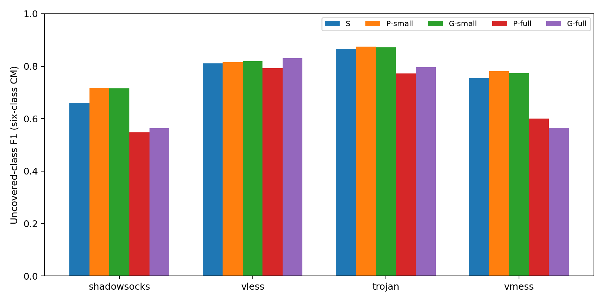
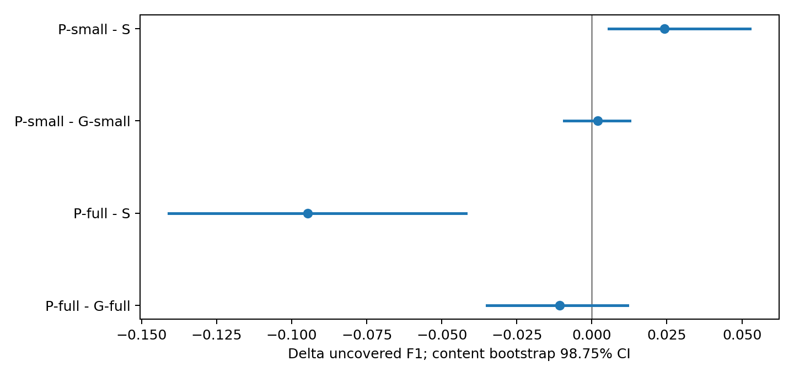
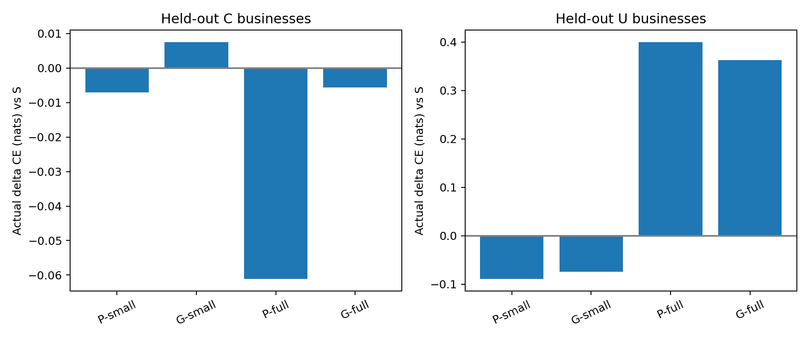
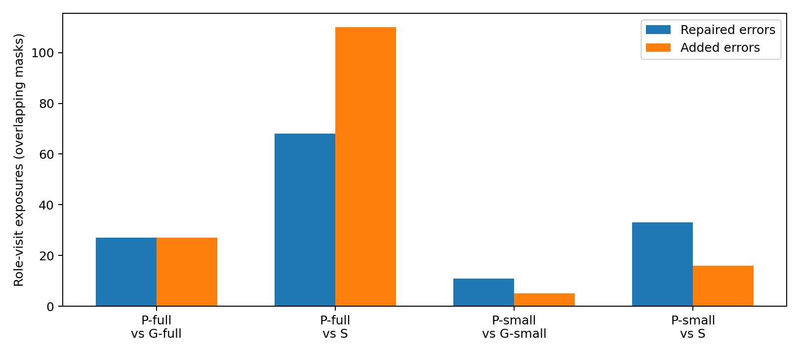
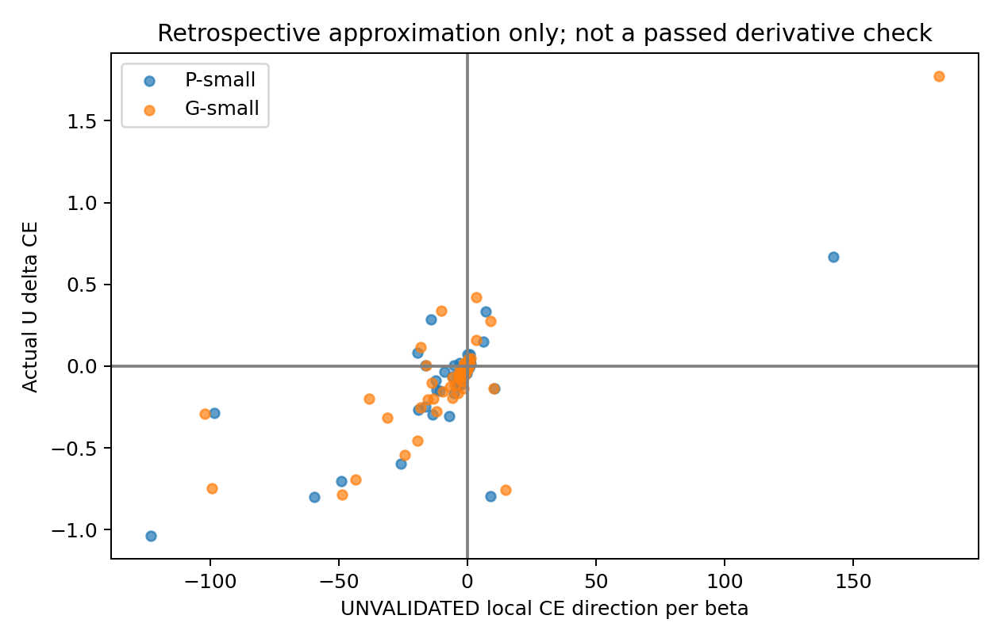
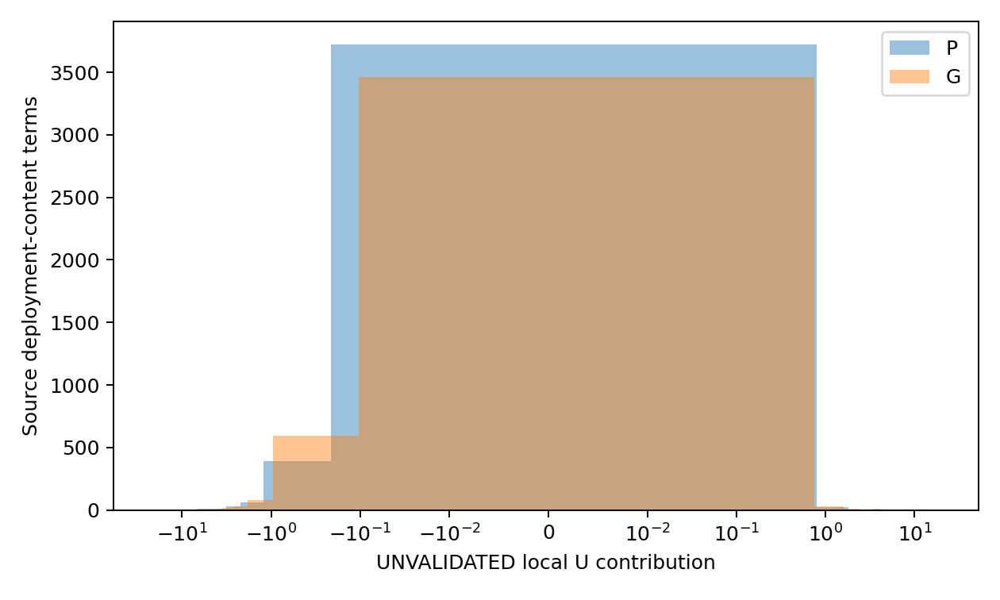

# StrongPost辅助视图有限训练干预完整报告

2026年10月9日。保持原五臂、映射及分类正则、CUDA float64求解政策和四项比较不变，本轮完成全部60外层角色的有限干预。P-small相对S的未覆盖F1增量通过本轮家族校正区间。

这是固定训练材料替换的分类证据，不是对整个配对方法族的最终裁决。影响函数先导未通过近似精度门，原失败完整保留；用户确认后继续的是有限重训，而不是宣布先导通过。报告将实际业务结果与未验收局部影响明确分开。

## 数据与任务

沿用extend合格TCP队列：Shadowsocks、VLESS、Trojan、VMess；480个访问、30个内容、六业务，每部署每内容四次重复，共23566对排他TCP连接。AnyTLS和Hy2不进入本轮，不将结果推广到这两种载体。

业务为Bing搜索结果、MDN文档、GitHub仓库、Wikipedia文章、YouTube搜索结果、YouTube视频播放。当前extend VLESS是TCP加TLS，不能套用旧队列的REALITY与Vision机制。

五个全局内容折对全部部署、重复、两侧和内部连接整体划分。每个目标部署的三种业务遮蔽分别为G0的GitHub与YouTube搜索、G1的Bing与Wikipedia、G2的MDN与YouTube视频。四部署乘五折乘三个遮蔽，共60角色。

每角色有三源部署的288训练访问，目标四类C的64访问，目标两类U的32训练访问禁止使用任何一侧；六类留出H为24访问。H中校准业务16访问，未覆盖业务8访问。本轮没有同内容跨折随机拆重复。

## 表示与输入权限

固定96维访问级连接边际直方图，由W上下行、U上下行、P上下行、E上下行、正payload方向段和唯一新字节方向段共十项构成。字节四项各9箱、计数六项各10箱。W包含重复观测的正payload字节，U是唯一TCP字节；FR_packet_runs与R_unique_zero_runs各自保持原定义。

没有新增地址、端口、SNI、域名文本、协议ID、访问索引、连接数、IAT或TLS记录序列输入。部署和内容元数据只用于可信分组、划分及权限检查。共同标准化只来自源真实post加目标C-post的352行，常数维scale为1；测试post不重新缩放。

P/G映射在目标C中拟合；它们共同采用原JA2在源内选出的eta。分类正则统一为该角色冻结StrongPost的t，不重新调参。源pre和源post独立排序，分别沿用自己的标签和质量，不按行号恢复同次访问。

## 干预设计

源真实post、源辅助槽、目标C-post损失质量各为1/3，六类总质量各1/6。原核心CE与weight L2不变；bias不惩罚。每个角色保持同一个源库与C资源，只替换辅助槽的质量。

| 臂 | 辅助槽 | beta | 含义 |
| --- | --- | --- | --- |
| S | 原CORAL | 0 | 冻结StrongPost |
| P-small | 90% CORAL加10%真配全仿射视图 | 0.1 | 真配小比例干预 |
| G-small | 90% CORAL加10%匿名内容组全仿射视图 | 0.1 | 同容量身份控制 |
| P-full | 全部真配视图 | 1 | 完整替换 |
| G-full | 全部匿名内容组视图 | 1 | 完整替换控制 |

beta作用于原辅助槽质量，0.1只替换全CE质量约3.33%；它不是平均特征向量。small有928个加权计算行，full与S有640行，不是新增这些数量的独立访问。P与S包含输入侧及变换方式变化；P与G的同设置比较才直接隔离精确身份增量。

分类器为96到6逻辑回归，576个weight加6个bias。L2为0.0005乘1加t乘weight平方和。新拟合统一零初始化、可逆预条件化、CUDA float64、max_iter为2000、max_eval为10000；原坐标梯度不超过1e-5、目标及梯度重放误差小于1e-10。没有warm start、标签调整、新网络或权重搜索。

## 主结果

每部署每遮蔽先合并五折预测，计算完整六类混淆矩阵，再取未覆盖两类F1均值；四部署与三遮蔽组等权汇总。不是仅在真实U样本上建立简化二分类。

| arm | F1_uncovered | F1_aux | F1_all | accuracy | CE_nats | Brier | worst_target_uncovered |
| --- | --- | --- | --- | --- | --- | --- | --- |
| S | 0.772708 | 0.820571 | 0.804617 | 0.807639 | 0.675111 | 0.299617 | 0.660738 |
| P-small | 0.796931 | 0.828046 | 0.817674 | 0.819444 | 0.640659 | 0.284811 | 0.716522 |
| G-small | 0.794927 | 0.822447 | 0.813273 | 0.815278 | 0.655339 | 0.285762 | 0.715677 |
| P-full | 0.677992 | 0.807828 | 0.764549 | 0.778472 | 0.767764 | 0.330611 | 0.547538 |
| G-full | 0.688711 | 0.803284 | 0.765093 | 0.778472 | 0.792256 | 0.329720 | 0.563893 |

## 四项固定比较

以下全部保留，不从small和full中挑选“最终方法”。对30个全局内容按六业务分层，10000次有放回抽样，同一抽样质量共享于部署、遮蔽、重复和方法；随机种子20261009。四项家族采用98.75%区间，95%区间仅在机器表中辅助保存。

| candidate | reference | delta_F1_U | CI98.75_low | CI98.75_high | positive_increment |
| --- | --- | --- | --- | --- | --- |
| P-small | S | 0.024223 | 0.005681 | 0.052705 | True |
| P-small | G-small | 0.002005 | -0.009233 | 0.012692 | False |
| P-full | S | -0.094716 | -0.140880 | -0.042032 | False |
| P-full | G-full | -0.010719 | -0.034941 | 0.011860 | False |

区间条件于已经拟合的模型，不包含重训练变异，也不是外部验证。数据此前经过多轮分析，本轮内部封存不能使其变为从未接触的盲测。区间跨零不证明等效；部分正向比较不等于完整配对增益主张成立。

## 部署差异

| target | arm | F1_uncovered | F1_aux | F1_all | CE_nats | Brier |
| --- | --- | --- | --- | --- | --- | --- |
| shadowsocks | G-full | 0.563893 | 0.773539 | 0.703657 | 1.065066 | 0.408678 |
| trojan | G-full | 0.795917 | 0.826580 | 0.816359 | 0.487628 | 0.256316 |
| vless | G-full | 0.830215 | 0.827854 | 0.828641 | 0.666913 | 0.278173 |
| vmess | G-full | 0.564818 | 0.785164 | 0.711715 | 0.949418 | 0.375714 |
| shadowsocks | G-small | 0.715677 | 0.787485 | 0.763549 | 0.835520 | 0.346013 |
| trojan | G-small | 0.871745 | 0.863421 | 0.866196 | 0.396102 | 0.216032 |
| vless | G-small | 0.818731 | 0.816994 | 0.817573 | 0.621870 | 0.287904 |
| vmess | G-small | 0.773553 | 0.821887 | 0.805776 | 0.767863 | 0.293098 |
| shadowsocks | P-full | 0.547538 | 0.775887 | 0.699770 | 1.010966 | 0.408786 |
| trojan | P-full | 0.771821 | 0.828555 | 0.809644 | 0.464945 | 0.251594 |
| vless | P-full | 0.791913 | 0.834933 | 0.820593 | 0.647533 | 0.276694 |
| vmess | P-full | 0.600697 | 0.791935 | 0.728189 | 0.947612 | 0.385368 |
| shadowsocks | P-small | 0.716522 | 0.789403 | 0.765109 | 0.788722 | 0.342862 |
| trojan | P-small | 0.875343 | 0.878304 | 0.877317 | 0.394921 | 0.214494 |
| vless | P-small | 0.814506 | 0.816473 | 0.815818 | 0.626141 | 0.286122 |
| vmess | P-small | 0.781354 | 0.828004 | 0.812454 | 0.752855 | 0.295766 |
| shadowsocks | S | 0.660738 | 0.793354 | 0.749149 | 0.874065 | 0.380930 |
| trojan | S | 0.865599 | 0.870210 | 0.868673 | 0.396980 | 0.215725 |
| vless | S | 0.810425 | 0.804353 | 0.806377 | 0.642466 | 0.293255 |
| vmess | S | 0.754071 | 0.814368 | 0.794269 | 0.786933 | 0.308556 |

部署是当前观测到的特定配置，不能从一个SS或VLESS部署推断协议全部实现。原StrongPost未覆盖F1重现为0.772708；未因某部署退化删掉它或重新选择主方法。

## 校准与未覆盖业务的实际损失变化

下表全部是留出内容的真实post。C表示四类校准业务的新内容，U表示两类未覆盖业务的新内容，而不是训练C与测试U比较。数值是相对S的CE nats变化，负值表示实际损失降低。

| arm | scope | actual_delta_CE |
| --- | --- | --- |
| G-full | C | -0.005637 |
| G-full | U | 0.362711 |
| G-full | all | 0.117145 |
| G-small | C | 0.007551 |
| G-small | U | -0.074419 |
| G-small | all | -0.019772 |
| P-full | C | -0.061143 |
| P-full | U | 0.400244 |
| P-full | all | 0.092653 |
| P-small | C | -0.007102 |
| P-small | U | -0.089151 |
| P-small | all | -0.034452 |

逐部署和逐业务的变化完整保存在附录与机器表。CE改善不能替代原F1终点，修复与新增错误必须一起检查。

## 修复与新增错误

| candidate | reference | fixed_error | new_error | changed | probability_L1 |
| --- | --- | --- | --- | --- | --- |
| P-full | G-full | 27 | 27 | 74 | 0.086008 |
| P-full | S | 68 | 110 | 206 | 0.265559 |
| P-small | G-small | 11 | 5 | 21 | 0.028585 |
| P-small | S | 33 | 16 | 58 | 0.084566 |

这些是60角色下的访问暴露计数，每比较1440行，含同一访问在三遮蔽组中的重复使用；不是1440个独立用户访问。逐内容、业务、部署和C/U明细均保留，不只挑获益案例。

## 局部影响分析的明确限制

原60个数值诊断全部达到分类求解门，但24个真配或组级方向中参数差分23项、源内留出CE导数22项、源训练CE导数13项未通过。Hessian与线性系统正确、驻点偏移门通过，不等于epsilon为0.01和0.02已足够接近无穷小扰动。

因此I、I_C、I_U及源内容贡献只属于未通过局部导数精度验收的回顾性近似。它们没有进入优化、模型选择、beta选择或数据删除，不能用其符号证明训练机制原因。当前正式60基座也没有独立的有限差分精度通过结论。

源内容分解的梯度及线性系统作用已数值验证可加，每角色24源内容可拆为72部署内容项。局部贡献可加不等于有限F1可加，更不能据此将某内容认定为坏数据。

## 计算与谱系

本次正式终点240个：新拟合199个，复用P-full的14个及G-full的27个；另外复用60个冻结S。此前先导新拟合60个，补映射11个，均分别登记，不混作正式候选。旧CT、JA、原failure、先导失败和暂停记录均保持原样。追加授权记录只允许固定有限干预，不将失败先导写成通过。

所有拟合及模型推理在NVIDIA GeForce RTX 4060 Ti、CUDA 12.4上执行，dtype为float64，禁止CPU回退。199新正式拟合单次耗时中位数0.362秒、90分位0.762秒、最大1.811秒、拟合合计91.890秒。图表、内容bootstrap和文件核验使用CPU，不属于模型推理CPU回退。

全部300个方法角色模型及训练方向先封存，再完成7200行真实post预测封存；此后才开启目标H标签。7200行是五臂乘60角色乘24访问，独立访问仍为480。目标U训练两侧和测试pre均未开放。

## 结论与停止范围

P-small相对S的未覆盖F1增量通过本轮家族校正区间。应结合相对S与相对G两个对照分别判断：超过S不自动说明精确身份必要，超过G也不自动说明优于充分post参照。部署例外、CE与F1分歧和新增错误都不能被总体均值掩盖。

本轮补上了实际重新学习到真实post评价的有限干预环节，但没有完成高精度影响函数机制归因。不会自动增加beta、改eta、删除业务、重选checkpoint或开启C-half。若要把固定干预发展为部署方法，还需说明不利用目标测试标签的合法选择规则和独立验证范围。

## 文件与复现

代码在`eval/strongpost_training_intervention/`，运行根为`outputs/strongpost-training-intervention-20261009/run-01/`。原合同、追加授权、模型谱系、封存预测、六类CM、四项区间、错误翻转和未验收近似表均可追溯。

详见[详细附录](detailed-appendix-20261009.md)以及保留的[数值先导报告](numeric-pilot-report-20261009.md)。最终机器验收位于运行根`verification.json`，完成标志为`completion.json`；本报告本身不是替代独立验收的证据。
